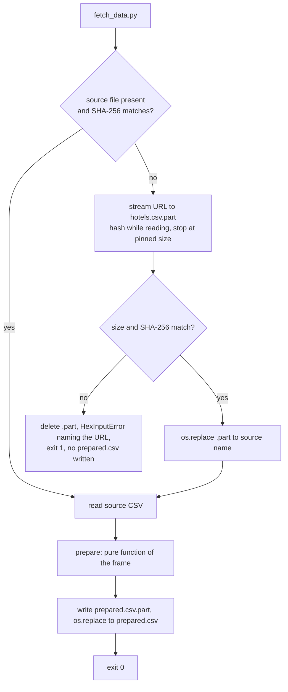

# Design Document: hexperiment-apps

## Overview

Two example apps, `hotel-cancellations` and `flight-delays`, run on the finished `hexperiment` core. Each app has a **haunted** training script (`haunted/train.py`) with two realistic leaks, and an **honest** training script (`train.py`) that fixes them. Each app also has `fetch_data.py`, `hex.toml`, a README, and shared offline tests in `apps/tests/`.

The apps use the core as it is: `hexperiment.load()`, `hexperiment.split(df)`, one final `hexperiment.audit(...)`, and the `hexperiment run <app_dir>` command. No file under `hexperiment/` changes.

This document does not cover the Kiro hook, the `exorcise` workflow, the ghost hunter agent or the MCP server (spec `hexperiment-kiro`), the gallery, or the leak benchmark.

### Status

Open questions remain (see the end, each with a recommended answer). Four decisions go beyond the literal requirement text:

1. **Duplicates are removed after the split, not before.** Removing duplicates before `hexperiment.split` changes which training rows exist when test rows are scrambled, so the canary would end `UNVERIFIED` (see "Why duplicates are removed after the split"). This conflicts with the wording of steering rule 2.
2. **Honest models are `HistGradientBoostingClassifier` pipelines**, not the logistic regression the owner measured, because the measured honest margins (0.891 against 0.85; 0.616 against 0.60) are thin and do not account for the duplicate removal. Logistic regression is the documented fallback.
3. **Verification runs in scratch copies** of each app (`apps/verify.py`), so this spec leaves no `runs/` folder behind. The committed history comes later from the `exorcise` workflow.
4. **The `hex.toml` files and scripts are designed from the dataset documentation and the owner's measurements.** The column names were not read from the CSV headers (the files are 16 and 32 MB and git-ignored). Task 1 prints the real headers, and the builder uses them if they differ.

### Design principles

1. **The apps know nothing about checks.** A script loads, splits, trains, predicts and audits. All leak detection stays in the core.
2. **A haunted script is the honest script plus marked leaks.** Both are written in the same shape, so the diff between them is the lesson. Each leak line carries a `# LEAK: ...` comment in the haunted script only.
3. **Preparation is a pure function of a DataFrame.** Download, checksum, file writing and the command line are separate edge functions that tests can replace.
4. **Tests are offline, fast and need no data.** They use small in-memory frames, fake download handles and temporary folders.
5. **Run history is evidence.** It comes from real runs and is never written, copied or edited by hand.
6. **Numbers in this document are targets to verify, not facts.** Only the owner's measurements (listed under "Measured facts") are facts.

### Key design decisions

| Decision | Choice | Reason |
|---|---|---|
| Prepared file name | `data/prepared.csv` in both apps | The source must keep its name (`hotels.csv`, `flights.csv`) so it is not downloaded again; the prepared file needs a different one. One name keeps `hex.toml` and the tests uniform. |
| Re-preparation | `fetch_data.py` always rewrites `prepared.csv` from the verified source | The output is a pure function of the source. No stale file after a change to `prepare`. It costs seconds, not a download. |
| Download safety | Stream to `<name>.part`, hash while reading, stop at the pinned size, `os.replace` only after size and SHA-256 match | A failed or hostile download can never leave a file that looks complete (Requirement 1.4). |
| Shared download code | Duplicated in the two `fetch_data.py` files with identical function names | `structure.md` makes each app self-contained. One parametrized test covers both copies. |
| Error type in `fetch_data.py` | `hexperiment.HexInputError(problem, fix)` | `tech.md`: invalid input raises it. `main` turns it into a message and exit code 1. |
| Honest model | `OrdinalEncoder` plus `HistGradientBoostingClassifier(early_stopping=False, random_state=0)` in a `Pipeline` | Fast on CPU, handles NaN and high-cardinality categoricals, no random validation split. Determinism is a gate (see "Risks"). |
| Overlap handling | `drop_seen_test_rows` after the split, keyed on `FEATURES + [TARGET]` | Matches the key of The Doppelganger. Changes no training row. |
| `timeout_seconds` | 120 in both apps | The core applies it to each execution. Expected execution time is 25 to 35 s; the honest full run (two executions) must also fit in 120 s. |
| History | Not produced by this spec | The `exorcise` workflow produces it later (see "Producing the run history"). |

## Architecture

### Layout

```
apps/
  verify.py                    dev tool: runs a script variant in a scratch copy of an app
  tests/
    conftest.py                loads fetch_data.py / verify.py by path, synthetic raw frames
    test_fetch_data.py         prepare, checksum, download, atomic write, main (both apps)
    test_hex_toml.py           each hex.toml loads with the core loader and has no weakened check
    test_prepared_with_core.py prepared synthetic data works with hexperiment.load / split
    test_scripts.py            static (ast) rules for every script, haunted pin, verify.py helper
    test_readme.py             required README content
    test_history.py            validates runs/ when it exists, skips otherwise
  hotel-cancellations/
    README.md  hex.toml  fetch_data.py
    train.py                   honest
    haunted/train.py           haunted starting point (copy over ../train.py to run)
    data/                      git-ignored: hotels.csv (source), prepared.csv
    runs/ verdict.json         created later by real runs; not created by this spec
    .hex/                      git-ignored
  flight-delays/
    (same files; source flights.csv)
```

`.gitignore` already contains `apps/*/data/` and `apps/*/.hex/`. No new dependency is needed (`urllib`, `hashlib`, `http.client`, `argparse` are standard library), so `docs/DECISIONS.md` is not touched.

### The demo arc (what each script state must produce)

| Step | Script state | Expected verdict | Ghosts and warnings |
|---|---|---|---|
| Hotels 1 | `haunted/train.py` as `train.py` | `REJECTED`, exit 1 | The Possession on `reservation_status`; The Peeking Spirit; warning "too good to be true"; `split_order` warning at the `transform` line |
| Hotels 2 | `reservation_status` removed only | `REJECTED` | The Peeking Spirit |
| Hotels 3 | `train.py` (honest) | `APPROVED`, exit 0 | none expected |
| Flights 1 | `haunted/train.py` as `train.py` | `REJECTED`, exit 1 | The Prophet; canary `not applied` warning (scrambled test rows are in the random training set); `split_order` warning at the `transform` line; "too good" warning if the AUC is above 0.75 |
| Flights 2 | split fixed with `hexperiment.split`, leak 2 kept | `REJECTED` | The Peeking Spirit |
| Flights 3 | `train.py` (honest) | `APPROVED`, exit 0 | none expected |

Steps 2 are what the `exorcise` workflow reaches when it fixes one finding at a time. For flights, `apps/verify.py` builds step 2 by a text substitution on the haunted script (see "`apps/verify.py`"). Hotels step 2 is not built by this spec.

### Fetch flow



## Components and Interfaces

`Path` is `pathlib.Path`, `Frame` is `pandas.DataFrame`. Public functions have type hints. Signatures are the contract; bodies are the builder's.

### `fetch_data.py` (one per app, same names)

```python
@dataclass(frozen=True, slots=True)
class Source:
    url: str; sha256: str; size: int; filename: str

SOURCE = Source(...)                 # pinned values from Requirement 1.2
PREPARED_NAME = "prepared.csv"
REQUIRED_COLUMNS: tuple[str, ...]    # source columns that prepare() and the scripts need
CHUNK_BYTES = 1 << 20
TIMEOUT_SECONDS = 60                 # per network read
Opener = Callable[..., AbstractContextManager[IO[bytes]]]   # urllib.request.urlopen-compatible

def prepare(source: Frame) -> Frame: ...                     # pure, no I/O
def check_digest(actual: str, expected: str, *, url: str) -> None: ...   # pure, raises HexInputError
def sha256_of(path: Path) -> str: ...                        # edge: chunked file read
def download(source: Source, dest: Path, *, opener: Opener = urlopen) -> None: ...   # edge
def write_atomic(frame: Frame, dest: Path) -> None: ...      # edge
def fetch(data_dir: Path, *, opener: Opener = urlopen) -> Path: ...   # returns the prepared path
def main(argv: Sequence[str] | None = None, *, data_dir: Path | None = None,
         opener: Opener = urlopen) -> int: ...
```

Run it as `.venv/Scripts/python apps/<app>/fetch_data.py`. `data_dir` defaults to `data/` next to the script.

**`fetch(data_dir, opener)`**

1. Create `data_dir` if needed. If `data_dir/<filename>` exists and `sha256_of` equals `SOURCE.sha256`, do not download (Requirement 1.3). A file that exists with another checksum is treated as missing and replaced by the download.
2. Otherwise `download(SOURCE, data_dir/<filename>, opener=opener)`.
3. `pd.read_csv` the source, `prepare` it, `write_atomic(frame, data_dir/PREPARED_NAME)`. The prepared file is rewritten on every call.
4. Return the prepared path.

**`download`** builds a `urllib.request.Request` with a `User-Agent` header and calls `opener(request, timeout=TIMEOUT_SECONDS)`. It reads `CHUNK_BYTES` at a time, writes to `<dest>.part`, updates a `hashlib.sha256` and a byte count, and stops with an error as soon as the count exceeds `SOURCE.size`. After the last chunk it checks the size, then `check_digest`, and only then calls `os.replace(part, dest)`. Any failure removes the `.part` file in a `finally` block unless the replace happened. `OSError` (which includes `URLError`, `HTTPError` and socket timeouts) and `http.client.HTTPException` become `HexInputError`. Every message names the URL, for example: `could not download <url> (<reason>).` with the fix `Check the network connection and run fetch_data.py again.`; or `the file downloaded from <url> has SHA-256 <actual>, expected <expected>.` with the fix `The source changed or the download was corrupted; do not use it. Run fetch_data.py again, and if it repeats, report the new checksum.` The size check message gives both sizes.

**`write_atomic`** writes `frame.to_csv(part, index=False, encoding="utf-8", lineterminator="\n")` to `<dest>.part`, then `os.replace`. On any exception it deletes the `.part` file and re-raises, so `prepared.csv` is either complete or absent (Requirement 1.4).

**`main`** prints `fetch_data: ...` progress lines (ASCII only) to stdout. A `HexInputError` prints `fetch_data: <problem> <fix>` to stderr and returns 1; success returns 0. An unreadable CSV or other `OSError` after the download is also reported on stderr with return 1. The script ends with `if __name__ == "__main__": sys.exit(main())`.

**`prepare` for hotel-cancellations** (Requirement 1.7): checks that every name in `REQUIRED_COLUMNS` is a column (a `HexInputError` lists the missing ones and says the source is not the pinned file), then returns `source.copy()`. Rows, row order and columns are unchanged. `reservation_status` and `reservation_status_date` stay, because the haunted script uses them.

`REQUIRED_COLUMNS` for hotels (from the dataset documentation; verify in task 1): `hotel, is_canceled, lead_time, arrival_date_year, arrival_date_month, arrival_date_week_number, arrival_date_day_of_month, stays_in_weekend_nights, stays_in_week_nights, adults, children, babies, meal, country, market_segment, distribution_channel, is_repeated_guest, previous_cancellations, previous_bookings_not_canceled, reserved_room_type, assigned_room_type, booking_changes, deposit_type, agent, company, days_in_waiting_list, customer_type, adr, required_car_parking_spaces, total_of_special_requests, reservation_status, reservation_status_date`.

**`prepare` for flight-delays** (Requirement 1.6):

1. Check `REQUIRED_COLUMNS`: `year, month, day, dep_time, sched_dep_time, dep_delay, arr_time, sched_arr_time, arr_delay, carrier, flight, tailnum, origin, dest, air_time, distance, hour, minute, time_hour`.
2. Drop the row-number column of the Rdatasets export (a column named `Unnamed: 0` or `rownames`), if present.
3. Keep rows where `arr_delay` is not missing (cancelled or diverted flights have none). Source row order is kept; the core sorts by time itself.
4. Add `late = (arr_delay > 15).astype("int64")`, so 15 minutes exactly is not late.
5. Rewrite `time_hour` as `%Y-%m-%dT%H:%M:%SZ` using `pd.to_datetime(..., utc=True)`. A value that does not parse raises `HexInputError` naming the column. Text without an offset is taken as UTC; the offset does not matter because the split only orders rows (see Open question 6).
6. Drop `dep_time, dep_delay, arr_time, arr_delay, air_time` (known only after departure). The result has the 15 remaining source columns minus the row number, plus `late` as the last column, and a fresh `RangeIndex`.

Expected on the real file: 327,346 rows, late rate 0.237 (owner's measurement).

### `hex.toml`

```toml
# apps/hotel-cancellations/hex.toml
[app]
name = "hotel-cancellations"
description = "Predict whether a hotel booking will be cancelled."

[data]
path = "data/prepared.csv"

[target]
column = "is_canceled"
positive = 1

[metric]
name = "roc_auc"
threshold = 0.85

[split]
test_fraction = 0.2
seed = 0

[run]
timeout_seconds = 120
```

```toml
# apps/flight-delays/hex.toml
[app]
name = "flight-delays"
description = "Predict whether a 2013 New York flight arrives more than 15 minutes late, from its schedule."

[data]
path = "data/prepared.csv"

[target]
column = "late"
positive = 1

[metric]
name = "roc_auc"
threshold = 0.60

[split]
test_fraction = 0.2
seed = 0
time_column = "time_hour"

[run]
timeout_seconds = 120
```

No `[checks]` table and no `[[waivers]]`: every check keeps its default, and a test asserts that (steering rules 6 and 7). Expected cost with the defaults: `max_test_uses = 5` allows the three or four runs of the demo arc without a `test_set_uses` warning.

### Shared script shape

Every script has the same structure, so the haunted/honest diff is small.

- Module constants `TARGET`, `CATEGORICAL`, `NUMERIC`, `FEATURES = CATEGORICAL + NUMERIC`.
- `drop_seen_test_rows(train, test, key)`, `build_model()`, `main()`, and `if __name__ == "__main__": main()`.
- `main()` loads with `hexperiment.load()` (no argument, so the folder of `train.py` is the app), splits, trains, predicts `y_score` on test and `y_score_train` on train, and ends with `hexperiment.audit(train=..., test=..., y_score=..., y_score_train=..., features=FEATURES, script=__file__)` as its last statement.
- Every random component has `random_state=0` (steering rule 0). Nothing calls `reset_index` or sets an index: the row id is the index label and the canary compares by it.
- Comments say why a column is left out (steering rule 3).

```python
def drop_seen_test_rows(train: pd.DataFrame, test: pd.DataFrame, key: list[str]) -> pd.DataFrame:
    """Return test without the rows whose key columns already occur in train (or earlier in test)."""
    seen = pd.concat([train[key], test[key]]).duplicated().to_numpy()
    return test.loc[~seen[len(train):]]
```

`duplicated()` marks later occurrences, and train comes first, so a test row is dropped exactly when an identical train row (or an earlier test row) exists. NaN equals NaN. The index labels are kept. The key is `FEATURES + [TARGET]`, the same columns The Doppelganger compares, so the check cannot find an overlap that this function left.

```python
def build_model() -> Pipeline:            # shared by honest and haunted
    encode = ColumnTransformer(
        [("cat", OrdinalEncoder(handle_unknown="use_encoded_value", unknown_value=np.nan,
                                encoded_missing_value=np.nan, min_frequency=50), CATEGORICAL)],
        remainder="passthrough")
    model = HistGradientBoostingClassifier(
        categorical_features=[True] * len(CATEGORICAL) + [False] * len(NUMERIC),
        max_iter=150, learning_rate=0.1, early_stopping=False, random_state=0)
    return Pipeline([("encode", encode), ("model", model)])
```

`train[FEATURES]` lists categoricals first, so the `ColumnTransformer` output order (encoded columns, then the passthrough numerics) matches the `categorical_features` mask. `min_frequency` groups rare categories (the `agent` column has hundreds of ids), which keeps every categorical below the 255-category limit of `HistGradientBoostingClassifier`. Everything learned is inside the `Pipeline`, fitted on `train` only (steering rule 1). The builder checks these scikit-learn arguments against the installed version while writing the scripts.

### hotel-cancellations scripts

**Honest `train.py`**

```python
TARGET = "is_canceled"
CATEGORICAL = ["hotel", "arrival_date_month", "meal", "country", "market_segment",
               "distribution_channel", "reserved_room_type", "deposit_type", "agent",
               "customer_type"]
NUMERIC = ["lead_time", "arrival_date_year", "arrival_date_week_number",
           "arrival_date_day_of_month", "stays_in_weekend_nights", "stays_in_week_nights",
           "adults", "children", "babies", "is_repeated_guest", "previous_cancellations",
           "previous_bookings_not_canceled", "booking_changes", "days_in_waiting_list", "adr",
           "required_car_parking_spaces", "total_of_special_requests"]
# Not used. reservation_status and reservation_status_date are filled in when the booking
# ends (cancelled, checked out, no-show), so they contain the answer. assigned_room_type is
# assigned at check-in or after a change, so it is not known when the cancellation happens.
# company is 94% missing.

def main() -> None:
    df = hexperiment.load()
    df["agent"] = df["agent"].fillna(-1).astype(int).astype(str)     # an id, not a quantity
    train, test = hexperiment.split(df)
    test = drop_seen_test_rows(train, test, FEATURES + [TARGET])
    model = build_model().fit(train[FEATURES], train[TARGET])
    hexperiment.audit(train=train, test=test,
                      y_score=model.predict_proba(test[FEATURES])[:, 1],
                      y_score_train=model.predict_proba(train[FEATURES])[:, 1],
                      features=FEATURES, script=__file__)
```

The forbidden names appear only in a comment, never as string constants, so the static test can scan the syntax tree for them. `df["agent"] = ...` is a row-wise change, so it cannot carry information between rows. `hexperiment.audit` is called with keywords as above (its parameters are `train, test, y_score, features, script, y_score_train`).

**Haunted `haunted/train.py`**: the honest script with these changes, each marked by a `# LEAK:` comment.

```python
df = hexperiment.load()
df["agent"] = ...                                                      # as in the honest script
# LEAK: The Peeking Spirit. The rate uses every row, so test labels reach training.
df["country_cancel_rate"] = df.groupby("country", dropna=False)[TARGET].transform("mean")
# LEAK: recorded after the outcome (post-outcome columns), but only reservation_status is a
# near-perfect proxy for the target; the other two score about 0.6 and no check can see them.
df["status_day"] = (pd.to_datetime(df["reservation_status_date"]) - pd.Timestamp("2015-01-01")).dt.days
CATEGORICAL += ["reservation_status", "assigned_room_type"]    # The Possession is reservation_status
NUMERIC += ["country_cancel_rate", "status_day"]
train, test = hexperiment.split(df)                                    # split is correct
test = drop_seen_test_rows(train, test, FEATURES + [TARGET])
```

`FEATURES` is built after these additions (the haunted script defines the lists, then extends them before the model is built; the builder keeps the code readable). The haunted script follows steering rules 0 to 2 and 4, as Requirement 2.2 asks: it loads with `load`, splits with `split`, fixes seeds, removes overlap and passes `y_score_train`.

Why each ghost fires:

- **The Possession.** `reservation_status` alone scores 1.000 (owner's measurement), above `proxy_auc_max = 0.95`. `reservation_status_date` (about 0.593) and `assigned_room_type` (about 0.599) stay below the threshold, so they are not reported. The honest script leaves all three out because they are recorded after the outcome (Requirement 2.4).
- **The Peeking Spirit.** In the canary execution the labels and countries of the test rows are replaced. The per-country rate of every country that has test rows changes, and so do the training feature values and predictions of most training rows. The control execution repeats the normal one exactly, so the finding is The Peeking Spirit, not The Shapeshifter. `split_order` also warns at the `transform` line, which appears in the finding's suspect lines.
- **Too good to be true.** AUC near 1.0 is above `min(0.85 + 0.15, 0.99) = 0.99`.

### flight-delays scripts

**Honest `train.py`**

```python
TARGET = "late"
CATEGORICAL = ["carrier", "origin", "dest"]
NUMERIC = ["month", "day", "sched_dep_time", "sched_arr_time", "distance"]
# Not used: flight and tailnum (identifiers), hour and minute (already inside sched_dep_time).
# fetch_data.py removed dep_time, dep_delay, arr_time and air_time: they exist only after departure.

def main() -> None:
    df = hexperiment.load()
    train, test = hexperiment.split(df)                  # latest 20% by time_hour is the test set
    test = drop_seen_test_rows(train, test, FEATURES + [TARGET])
    model = build_model().fit(train[FEATURES], train[TARGET])
    hexperiment.audit(...)                               # as in the hotel script
```

`month` and `day` stay in the features on purpose. The rows of one scheduled flight look the same every day, so without a date the same schedule would appear in both train and test with the same outcome, and The Doppelganger would reject the honest model. With the date, rows differ across days, and `drop_seen_test_rows` removes the few identical twins on the cutoff day.

**Haunted `haunted/train.py`**: the honest script with these changes.

```python
from sklearn.model_selection import train_test_split
df = hexperiment.load()
# LEAK: The Peeking Spirit. Same-day late rate of the carrier over all rows, test labels included.
day = df["time_hour"].str[:10]
df["carrier_day_late_rate"] = df.groupby(["carrier", day])[TARGET].transform("mean")
NUMERIC += ["carrier_day_late_rate"]
# LEAK: The Prophet. A random split on time-ordered data puts later flights in training.
train, test = train_test_split(df, test_size=0.2, random_state=0)   # LEAK: random split
test = drop_seen_test_rows(train, test, FEATURES + [TARGET])
```

The day key is a slice of `time_hour`, which the canary never scrambles, and the script does not combine `year`, `month` and `day` into a date (independent column scrambling can create dates that do not exist, and such a script would crash in the canary execution).

Why each ghost fires:

- **The Prophet.** The random split puts flights from after the earliest test flight into training. `check_temporal` reports the error with the number of test rows earlier than the latest training row.
- **Canary on the haunted script.** The scrambled rows are the latest 20% by time, and the random training set contains most of them, so `decide_canary` step 2 gives `not applied` with a warning. The verdict is `REJECTED` by The Prophet alone.
- **The Peeking Spirit (after the split is fixed).** With `hexperiment.split`, the rate of a (carrier, day) group that contains both training and test flights changes when the test labels and carriers are scrambled. That is every group of the cutoff day. It is a handful of groups out of the whole training set, but the canary treats any changed training row as a difference. The leak inflates the test AUC much more than it moves training. Its standalone score is 0.759, below 0.95, so The Possession cannot see it. If the cutoff falls exactly at a day boundary there is no straddling group and the leak would not be detected (see "Risks" and Open question 10).

### `apps/verify.py`

A dev tool, not part of the product. It runs a script variant of an app through `hexperiment run` in a scratch copy, so nothing is written to the app folder.

```
.venv/Scripts/python apps/verify.py <hotel-cancellations|flight-delays> [--variant NAME ...] [--fast]
```

Variants: `haunted`, `honest` for both apps, plus `split-fixed` for flight-delays. Default: all variants of the app.

For each variant it:

1. Copies the app folder to a `tempfile.TemporaryDirectory(ignore_cleanup_errors=True)`, ignoring `runs`, `.hex`, `verdict.json`, `haunted`, `__pycache__`, and the source files `hotels.csv` and `flights.csv` (only `data/prepared.csv` is copied).
2. Writes the variant source as `train.py`: the honest `train.py`, `haunted/train.py` unchanged, or `split_fixed_source(haunted_source)`.
3. Runs the console script (`shutil.which("hexperiment", path=<folder of sys.executable>)`) with `run <scratch app>` and measures the wall time with `time.perf_counter`.
4. Reads the scratch `verdict.json` and prints one table row: variant, exit code, status, mode, metric value, wall seconds, the ghosts and warning checks found, and the stdout summary of the run.

`split_fixed_source(source: str) -> str` is a pure function. It requires exactly one line ending in `# LEAK: random split` and replaces that line with `train, test = hexperiment.split(df)`; any other count raises `ValueError`. A test covers it, so a later edit of the haunted script cannot break the variant silently.

The builder copies the printed numbers into the READMEs. The temporary folders disappear, so no `runs/` evidence is created by verification.

### README outline (each app, `README.md`)

1. **Title and question** in one sentence.
2. **The data.** Source URL, size, licence and the required attribution (hotels: N. Antonio, A. de Almeida, L. Nunes, "Hotel booking demand datasets", Data in Brief 22 (2019), CC BY 4.0, redistributed through TidyTuesday; flights: nycflights13, CC0, original data from the US Bureau of Transportation Statistics, via Rdatasets). A line saying the data is downloaded, not committed.
3. **Run it.** `.venv/Scripts/python apps/<app>/fetch_data.py`, then `.venv/Scripts/hexperiment run apps/<app>`, the expected verdict, and the measured full-run time with the machine and date.
4. **The haunted script.** A table: leak, line marker, ghost, how it is caught, evidence from a real run.
5. **The honest script.** What changed, in a short list, and why each omitted column is omitted.
6. **Results.** A table with the haunted AUC, the honest AUC, the threshold and the verdict of each step (numbers from task 6, never estimates).
7. **Replay the demo.** Copy `haunted/train.py` over `train.py` (Git Bash `cp`, PowerShell `Copy-Item`), then run the `exorcise` workflow or fix it by hand and run `hexperiment run` again. A note that replaying adds runs to `runs/` and that `git restore apps/<app>/train.py` returns the honest script.
8. **Limits.** Hotels: two Portuguese hotels, 2015 to 2017, a random split, columns such as `booking_changes` and `adr` can change after booking. Flights: one year, three airports, a schedule-only model, so the AUC is modest.
9. **Files** table.

No placeholder text may remain in a finished README (a test checks this).

### Tests (`apps/tests/`)

Run with `.venv/Scripts/python -m pytest apps/tests -q`. No test uses the network or needs `data/`. Target: under 20 s in total. There is no `pytest.ini` under `apps/`, so Hypothesis tests set `@settings(max_examples=50, deadline=None)` themselves.

**`conftest.py`**: `load_module(path, name)` (importlib, registers in `sys.modules`; needed because folder names contain hyphens), session fixtures for the two `fetch_data` modules and `verify.py`, a parametrized `app` fixture (name, folder, fetch module), and factories `raw_hotels(n)` and `raw_flights(arr_delays, ...)` that build a frame with every `REQUIRED_COLUMNS` column.

**`test_fetch_data.py`** (parametrized over both apps unless noted):

- Pinned constants equal the values in Requirement 1.2 (URL, SHA-256, size).
- `check_digest`: equal passes; different raises `HexInputError` whose message contains the URL.
- `download` with a fake opener (a function returning `io.BytesIO`): good data is written and no `.part` remains; wrong checksum, wrong size, a download larger than the pinned size, an opener that raises `URLError`, and a handle whose `read` raises `OSError` after the first chunk each raise `HexInputError` naming the URL and leave neither the destination nor a `.part` file. A pre-existing destination with other content is not changed by a failed download.
- `fetch`: existing source with the right checksum means the fake opener is never called and `prepared.csv` is written; existing source with a wrong checksum is replaced; missing source is downloaded. To keep pinned values out of the fake, the tests monkeypatch `SOURCE` with the digest and size of a tiny synthetic CSV.
- `write_atomic` with `to_csv` monkeypatched to raise: no `prepared.csv`, no `.part`.
- `main`: failing opener returns 1, stderr contains the URL, no `prepared.csv`; success returns 0.
- `prepare` hotels: all columns and rows unchanged, `reservation_status` and `reservation_status_date` kept; a missing required column raises `HexInputError` naming it.
- `prepare` flights: cancelled rows dropped; `late` is 0 at `arr_delay` 15 and 1 at 16; negative delays give 0; the five columns and the row-number column are gone; `time_hour` is ISO UTC for naive and offset inputs; row order kept; an unparseable `time_hour` raises `HexInputError`.
- Hypothesis (flights `prepare`): for any list of delays with NaN, the kept rows are exactly the non-NaN ones, in order, `late == (arr_delay > 15)`, and no dropped column survives.

**`test_hex_toml.py`**: each `hex.toml` loads with `hexperiment.config.load_config`; target column and positive, metric `roc_auc` and thresholds 0.85 and 0.60, `test_fraction` 0.2, a set `seed`, `time_column` `"time_hour"` for flights and `None` for hotels, `timeout_seconds` between 60 and 300, `data.path == "data/" + fetch.PREPARED_NAME`, `config.checks == ChecksConfig()` and `config.waivers == ()`.

**`test_prepared_with_core.py`**: prepare a synthetic raw frame, write it as `data/prepared.csv` in a temporary app folder next to the real `hex.toml`, call `hexperiment.load(folder)` and `hexperiment.split(df)`. Flights: both sides non-empty, every training `time_hour` at or before every test `time_hour`, no post-departure column. Hotels: both sides non-empty, the test share within 0.1 of 0.2 on 300 rows, `reservation_status` present. This proves that the prepared files fit the core without real data.

**`test_scripts.py`** (static, `ast` only, nothing is executed):

- Each of the four scripts parses; calls `hexperiment.load`; its last statement in `main` is a call to `hexperiment.audit` that passes `script=__file__` and `y_score_train`; every call to `HistGradientBoostingClassifier` and `train_test_split` has `random_state`; nothing calls `reset_index`.
- Honest scripts call `hexperiment.split` and never `train_test_split`. Honest hotels has none of `reservation_status`, `reservation_status_date`, `assigned_room_type` among its string constants.
- Haunted hotels uses `reservation_status` and `country_cancel_rate`. Haunted flights uses `train_test_split` and not `hexperiment.split`, and has exactly one line ending in `# LEAK: random split`. Each haunted script has at least two `# LEAK:` comments.
- `split_fixed_source` on the haunted flights source contains `hexperiment.split(` and no call to `train_test_split`; other line counts raise.
- Haunted pin: the SHA-256 of each haunted script (line endings normalised to `\n`) equals a constant in the test, so the starting point cannot change unnoticed. Task 6 sets the constants once the scripts are final.

**`test_readme.py`**: each README contains its attribution text from Requirement 4.1, the `fetch_data.py` and `hexperiment run` commands, `haunted/train.py`, the names of its ghosts, and a stated run time; it contains none of `TODO`, `TBD`, `XXX`, `<measured`.

**`test_history.py`**: skips with a reason when `runs/` does not exist. Otherwise, with `hexperiment.load_history(app_dir)`: at least two runs; the first is `REJECTED` and its findings contain the ghosts of the haunted script (hotels: The Possession and The Peeking Spirit; flights: The Prophet); the last is `APPROVED`; flights also has a run with The Peeking Spirit; no `APPROVED` run comes before a `REJECTED` run; every run folder has `model_card.md`; `<app>/verdict.json` equals the last run's `verdict.json`. This is the check for Requirement 5.3 once the history exists.

### Rules from the steering that the scripts follow

| Rule | Where |
|---|---|
| 0 Let the kit own the data, fix seeds | `hexperiment.load()`, `split`; `random_state=0` everywhere |
| 1 Split first, fit on training rows only | `Pipeline` fitted after the split (honest); the haunted statistics are the planted leaks |
| 2 No row in both worlds | `drop_seen_test_rows` (after the split, see below) |
| 3 No features from the future | honest feature lists and the comment above them |
| 4 Respect time | `time_column = "time_hour"` and `hexperiment.split` (honest flights) |
| 5 Suspicion is a signal | the haunted AUCs trigger the "too good" warning |
| 6, 7 Audit last; fix the cause | the last statement of `main`; the apps never lower a threshold or add a waiver |

### Why duplicates are removed after the split

The hotels file has many exact duplicate rows (about a quarter, per the dataset's known structure; task 1 measures it). `drop_duplicates()` before `hexperiment.split` keeps the first of each group of duplicates. In the canary execution the test rows have other values, so a test row that was the first of a duplicate group no longer matches its training twin, and the training twin survives. The set of training row ids then differs between the normal and the canary execution, and `decide_canary` step 3 stops with "the split depends on data values" and an `UNVERIFIED` verdict. Removing overlap after the split changes only test rows: training rows are never dropped because of a test row. Steering rule 2 says "before splitting"; see Open question 1.

## Expected numbers

### Measured facts (owner, real data, core proxy scorer, logistic regression)

- Hotels: 119,390 rows, cancel rate 0.37. Standalone scores: `reservation_status` 1.000, `country` 0.708, `lead_time` 0.690, `deposit_type` 0.661, `assigned_room_type` 0.599, `reservation_status_date` 0.593. Honest AUC 0.891 on a 20% random split (before overlap removal); 1.0 with `reservation_status`.
- Flights: 327,346 rows, late rate 0.237. Time split (latest 20%): honest AUC 0.616; random split 0.656; with the per-carrier per-day rate over all rows 0.767 (standalone score 0.759); `dep_delay` standalone 0.878.

### Targets to verify (nothing here is measured)

| Run | Metric target | Acceptance gate for the builder |
|---|---|---|
| Hotels haunted | 0.99 or more | status `REJECTED`; The Possession on `reservation_status`; The Peeking Spirit; "too good" warning |
| Hotels honest | 0.90 to 0.93 | `APPROVED`; AUC at least 0.87 (threshold plus 0.02) |
| Flights haunted | 0.72 to 0.80 | `REJECTED`; The Prophet |
| Flights split-fixed | 0.72 to 0.80 | `REJECTED`; The Peeking Spirit; no The Prophet |
| Flights honest | 0.64 to 0.68 | `APPROVED`; AUC at least 0.62 |

Time per execution: interpreter and scikit-learn start-up 8 to 9 s, `load` 1 to 3 s, fit and predict about 5 to 15 s. Target: 25 to 35 s per execution; honest full run (two executions) about 60 s and at most 120 s; a three-execution run at most 120 s as well, which is checked but only the honest bound is required.

### If a gate fails (fallbacks, in order)

1. Hotels honest below 0.87, or flights honest below 0.62: raise `max_iter` to 300 (check the time), then try `learning_rate=0.05` with `max_iter=300`. Do this once per app; repeated trial against the test AUC would tune on the test set.
2. A Shapeshifter finding or `UNVERIFIED` on an honest script because the HGB scores differ between identical executions: replace the model by a logistic regression pipeline and record the change in the README. Hotels: `ColumnTransformer` of median `SimpleImputer` plus `StandardScaler` for numerics and `OneHotEncoder(handle_unknown="ignore", min_frequency=50)` for categoricals, then `LogisticRegression(max_iter=1000, random_state=0)`. Flights: the same with `month`, `day` and the hour from `sched_dep_time` as one-hot features; expect an AUC near 0.62 to 0.64.
3. Anything else: stop and report. Never lower `threshold`, add a waiver, or change a `[checks]` value to get a pass (steering rules 6 and 7).

## Producing the run history

This spec does not create `runs/`, `verdict.json` or `model_card.md` in the app folders. Every `hexperiment run` writes them, so verification uses `apps/verify.py` in scratch copies, and the committed history stays empty until the real arc is recorded.

The recording happens after spec `hexperiment-kiro` provides the `exorcise` workflow, for each app, from a clean `runs/`:

1. Copy `haunted/train.py` over `train.py`.
2. Run the `exorcise` workflow. It runs `hexperiment run`, fixes one finding at a time and re-runs until `APPROVED`. Expected history: hotels 3 or 4 runs, flights 3 runs (see "The demo arc"), all within `max_test_uses = 5`.
3. Commit `runs/`, `verdict.json` and the final `train.py` unchanged.
4. If the arc is not clean, delete the whole `runs/` folder and the app `verdict.json` and record again. Never edit a file inside `runs/`.

`apps/tests/test_history.py` then checks the arc. The final `train.py` is the agent's result, so `test_scripts.py` also validates it (forbidden columns, audit last, seeds). The authored honest script stays in git history and in this spec's verification record.

## Error Handling

- `fetch_data.py`: every failure is a `HexInputError` printed as `fetch_data: <problem> <fix>` with exit code 1; the message names the URL for download problems. No partial file survives (`.part` files are removed in `finally`). A wrong-checksum source is never used.
- Training scripts: no error handling of their own. `hexperiment.load` reports a missing `data/prepared.csv` with the resolved path and the fix "Run fetch_data.py" (core behaviour).
- `apps/verify.py`: a non-zero exit code of `hexperiment run` is printed, not hidden; exit code 2 prints the stderr tail and the tool exits non-zero.
- Unreadable prepared data or a missing column in a script fails the training execution, so `hexperiment run` exits 2 with the stderr tail. That is the intended signal for a broken app.

## Risks (the builder must check these)

| Risk | Why it matters | Check |
|---|---|---|
| HGB is not bit-identical between runs | The canary compares training scores at `1e-9`. A difference gives The Shapeshifter and `UNVERIFIED`. | Task 3 and 4: run the honest script; no `determinism` finding. Otherwise fallback 2. |
| The canary scramble breaks cross-column consistency | A script that parses a combination of columns (a date from `year`, `month`, `day`) can crash in the canary execution. | The scripts avoid it. Any exit code 2 in a full run is investigated first for this. |
| The Doppelganger key is `FEATURES + [TARGET]` | A feature set without a date makes repeated schedules overlap. | Honest flights keeps `month`, `day`; `drop_seen_test_rows` uses the same key. |
| The cutoff day has no straddling (carrier, day) group | The Peeking Spirit would not be detected in the flights step 2. | Task 4 runs the `split-fixed` variant; see Open question 10. |
| Honest hotels AUC after overlap removal | The owner's 0.891 was measured before it. | Gate in "Expected numbers". |
| Column names and `time_hour` format differ from the documentation | The scripts and `prepare` would fail on the real file. | Task 1 prints the real header and dtypes. |
| Running a script in place | `python apps/<app>/train.py` or `hexperiment run apps/<app>` writes `runs/` and `verdict.json` into the app. | Use `apps/verify.py`. |

## Requirements traceability

| Requirement | Where |
|---|---|
| 1.1, 1.2, 1.3 | `fetch_data.py`: `SOURCE`, `fetch` step 1 |
| 1.4 | `download`, `write_atomic`, `main`; tests in `test_fetch_data.py` |
| 1.5 | `prepare` (pure) and its tests |
| 1.6 | `prepare` for flights |
| 1.7 | `prepare` for hotels |
| 1.8 | existing `.gitignore` entry `apps/*/data/` |
| 2.1 | hotels `hex.toml`; `test_hex_toml.py` |
| 2.2, 2.3 | hotels haunted script; demo arc; `verify.py` run |
| 2.4 | hotels honest script; `test_scripts.py`; `verify.py` run |
| 3.1 | flights `hex.toml` |
| 3.2, 3.3 | flights haunted script; `split-fixed` variant |
| 3.4 | flights honest script |
| 4.1, 4.2 | README outline; `test_readme.py` |
| 5.1 | `apps/tests/` as listed |
| 5.2 | timeouts; task 6 measurement; README run time |
| 5.3 | "Producing the run history"; `test_history.py` |
| 5.4 | task 6 (`ruff check apps`) |

## Open questions

**Resolved by the project owner on 2026-11-11.** Every recommendation below is accepted, with these notes:

- **1 and 7:** the steering now agrees with this design. Rule 2 says to remove the overlap after the split (every test row that also appears in the training rows; duplicates within the training rows may stay), and rule 4 says to build date features from the one time column, never by combining year, month and day columns.
- **2:** the run history is produced after this spec and `hexperiment-kiro` are both built. For each app the owner runs the haunted script, the `exorcise` workflow and the final script with `hexperiment run`, then commits `runs/`, `verdict.json` and `model_card.md`.
- **6:** closed. The pinned file writes `time_hour` with a `Z` offset (`2013-01-01T10:00:00Z`), so it is already UTC; `prepare` keeps the same format.
- **Headers:** the real headers match `REQUIRED_COLUMNS` for both files. The flights row-number column is `rownames`. Task 1 still prints them as a check.

1. **Steering rule 2 says "drop exact duplicate rows before splitting".** With the core canary, that order makes the training row set depend on test values whenever duplicates cross the split, which ends in `UNVERIFIED` (see "Why duplicates are removed after the split"). The apps remove overlap after the split. An agent that follows rule 2 literally in `exorcise` would hit this on hotels. *Recommended:* keep the apps as designed, and ask the owner of `.kiro/steering/` to reword rule 2 to "make sure no row appears in both train and test; do it after `hexperiment.split`". This spec does not edit steering. Alternatively the core could compare training rows by content instead of by id, which is a core change.
2. **Requirement 5.3 cannot be met by this spec alone.** The history must come from the `exorcise` workflow, which another spec builds. *Recommended:* accept the split: this spec ships apps without `runs/` and with `test_history.py` ready; a recording step in `hexperiment-kiro` (or a follow-up task) produces and commits the history.
3. **"A full run fits in `timeout_seconds`" (Requirement 2.1, 5.2) is ambiguous.** The core applies the timeout to each execution; the requirement could mean the whole run. *Recommended:* set 120 s and require the honest full run (two executions) to finish within 120 s as well, which satisfies both readings.
4. **Model choice.** HGB is not the measured model. *Recommended:* use HGB with the determinism gate, because logistic regression leaves the flights honest AUC at about 0.62 against 0.60 and the hotels margin is untested after overlap removal. Fallback 2 returns to logistic regression if HGB is not reproducible.
5. **`booking_changes`, `adr`, `required_car_parking_spaces` and `total_of_special_requests` may be updated after booking.** The requirements exclude only three columns. *Recommended:* keep them in the honest script and say so under "Limits" in the README; excluding more columns would lower the honest AUC without a requirement to do so.
6. **The `time_hour` text in the Rdatasets file may carry no offset.** If so, it is local New York time and `prepare` labels it UTC. *Recommended:* accept; only the order of rows matters for the split. Task 1 records the real format and the README says "scheduled hour".
7. **The canary scramble replaces columns independently**, so a script that combines columns can fail in canary mode. This is a core property. *Recommended:* keep the apps free of such code and ask the owner of the Kiro steering to mention it in the ML-integrity rules for `apps/**/*.py`.
8. **Duplicated download code.** The two `fetch_data.py` files repeat about 80 lines. *Recommended:* keep the duplication, because `structure.md` makes each app self-contained and one parametrized test covers both.
9. **`apps/verify.py` is not in `structure.md`.** *Recommended:* keep it; it is the only way to verify the apps without writing evidence into `runs/`. Delete it later if the gallery spec provides a replacement.
10. **Detection of the flights step 2 depends on the cutoff day.** If the verification shows no The Peeking Spirit, the grouping by carrier and day is too narrow for a time split. *Recommended:* stop and ask before changing it; the likely fix is a coarser group (carrier and ISO week), which departs from the "same-day" wording of Requirement 3.2 and the README.
11. **After the recording, `train.py` is the agent's script, and `test_scripts.py` scans it for the forbidden hotel columns as string constants.** An agent that uses a drop list would fail that test. *Recommended:* keep the test; if it fails, ask the agent to use an explicit feature list as steering rule 3 suggests, instead of weakening the test.
