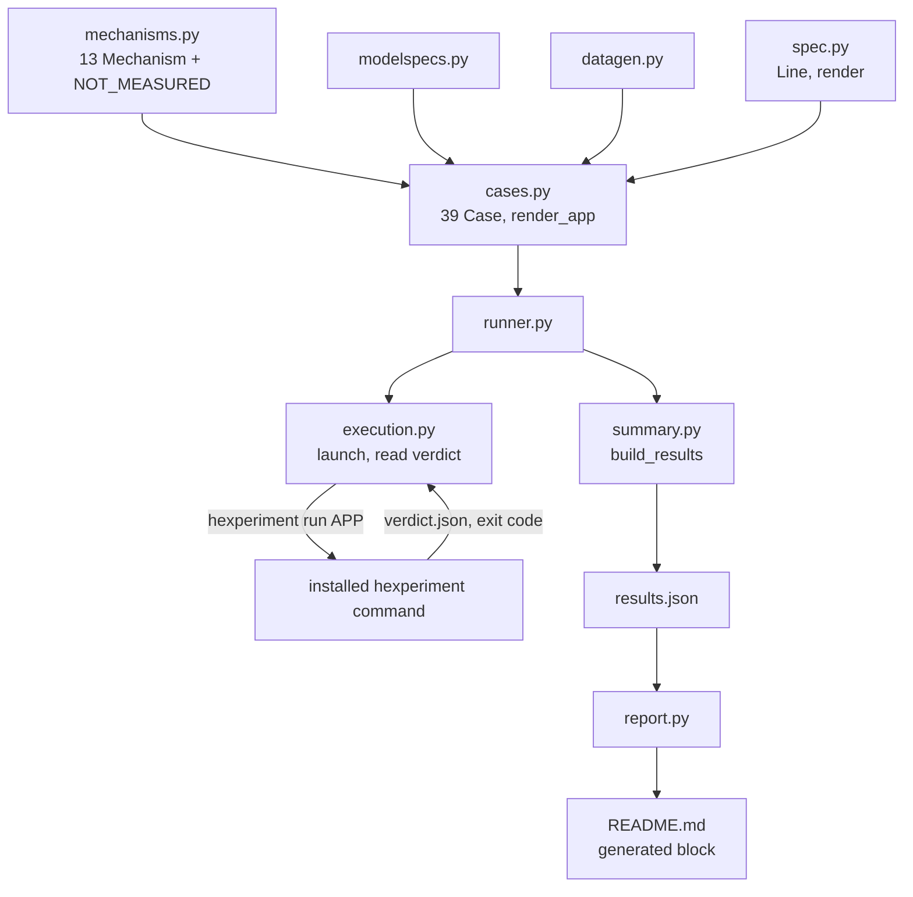

# Design Document: hexperiment-benchmark

## Overview

The benchmark runs 39 cases (13 leak mechanisms, 3 models each) through the real `hexperiment run` command. Every case is a pair of small apps, a leaky one and its clean twin, so 78 full runs. The result is one JSON file and one README table: how many leaky apps were rejected, by which ghost, and how many clean apps were rejected by mistake.

Three ideas carry the design:

- **One description per case.** A case is data, not two hand-written scripts. A script is a list of lines, each marked `both`, `leaky` or `clean`. The leaky app and the clean twin are two renderings of the same list, so their line diff is exactly the `# LEAK:` lines and their replacements (Requirement 1.4). A test proves it for all 39 cases.
- **The kit is a black box.** The runner starts the installed `hexperiment` command, reads `verdict.json` and the exit code, and nothing else. It imports none of the kit's checks and passes no option that changes one (Requirement 5.1).
- **Predictions are written down before the first run.** This document states what each case should do and why. The first complete run decides who was right. Misses are reported, not fixed (Requirement 5.2).

The design changes nothing in `src/hexperiment/`. It adds the folder `hexperiment/benchmark/`, new tests in `hexperiment/tests/`, one line in `tests/conftest.py` and one in `pyproject.toml` (see "Layout").

### Status

Fifteen questions are open (see "Open questions"), each with a recommended answer that this design already follows. Nothing in this document was measured. The predicted outcomes and the expected size of each leak's effect on the score come from reasoning about the data and the checks; the first run in "Build order" is the first measurement.

### Design principles

1. **Description first.** Everything a reader may want to know about a case (leak type, mechanism, model, seeds, data, lines) is a field of one frozen dataclass. Scripts, `hex.toml` files, datasets, the README table and the results file are all derived from it.
2. **Pure core, thin edges.** Rendering, data generation, summaries and the table are pure functions. File and process work is in two modules (`execution.py`, `runner.py`). The tests reach the edges through injected functions, so no test starts a case.
3. **No tuning toward a check.** The data parameters below were chosen from the definition of each mechanism and from two needs only: the leak must move the score (Requirement 1.4) and the clean twin must pass the metric gate. No parameter was chosen because a ghost fires or does not fire.
4. **Report what happened.** `ERROR`, `UNVERIFIED` and "rejected by the `input` check" are separate outcomes in the file and are never folded into "caught".
5. **Run on an everyday machine.** One run at a time, a per-execution timeout in `hex.toml`, and a whole benchmark of about 15 to 25 minutes.

### Key design decisions

| Decision | Choice | Reason |
|---|---|---|
| Where the code lives | `hexperiment/benchmark/hexbench/` (a package) plus two scripts next to it | Requirement 6.2: not under `src/`, so not installed and not importable as `hexperiment.*`. |
| How the tests import it | `tests/conftest.py` puts `hexperiment/benchmark` on `sys.path`; the tests write `from hexbench import ...` | `pytest` runs from the repository root with `rootdir` `hexperiment/`; no install step and no `__init__.py` in `tests/`. |
| Case description | Lines with a side (`both`, `leaky`, `clean`) in named slots of one script skeleton | Requirement 1.4 by construction. |
| Data | Own generator on `numpy.random.Generator`, values rounded to 4 decimals | Requirement 2.1. `sklearn.datasets.make_classification` uses BLAS and changes between releases; rounding hides the last-bit differences between CPUs. |
| Models | `LogisticRegression(C=10.0, max_iter=2000, random_state=0)`, `RandomForestClassifier(n_estimators=100, n_jobs=1, random_state=0)`, `HistGradientBoostingClassifier(max_iter=100, early_stopping=False, random_state=0)` | Requirement 1.3. Fixed seeds keep the canary deterministic. `C=10.0` lets the linear model overfit, so a leak can move its score. `n_jobs=1` avoids worker processes. |
| Metric threshold | In `hex.toml`, per mechanism: `0.60`, except `0.52` (L1.3) and `0.55` (L3.1) | The metric gate is not what is measured. Each value sits 0.05 or more below the clean twin's expected score, so the gate does not reject a clean twin. Thresholds are not checks (Requirement 1.5 forbids `[checks]` and waivers). |
| Process model | One `hexperiment run` at a time | OpenMP in `HistGradientBoostingClassifier` already uses every core. Parallel runs would oversubscribe the CPU, stretch the 30-second budget of Requirement 2.2 and risk timeouts that look like misses. |
| Timeouts | `[run] timeout_seconds = 60` per execution; 240 s for the whole `hexperiment run` process | A full run is at most three executions (normal, canary, control) plus start-up. |
| Reading a result | `verdict.json` and the exit code (0, 1, 3 are verdicts; anything else is `ERROR`) | Requirement 3.4. |
| README table | Generated by `update_readme.py` between two marker comments; a test compares it with `results.json` | Requirement 5.3. The numbers cannot drift from the file. |

## Architecture

### Layout

```text
hexperiment/
  pyproject.toml                 changed: [tool.ruff] src += "benchmark"
  src/hexperiment/               unchanged
  benchmark/                     not installed, not a package of hexperiment (6.2)
    README.md                    hand-written text plus the generated block
    results.json                 committed output of one complete run (4.4)
    run_benchmark.py             `python hexperiment/benchmark/run_benchmark.py --out FILE [--only KEY]`
    update_readme.py             `python hexperiment/benchmark/update_readme.py [results.json]`
    hexbench/
      __init__.py
      spec.py                    Line, Mechanism, ModelSpec, DataSpec, Case, AppFiles, render
      modelspecs.py              the three models
      datagen.py                 pure data generators
      mechanisms.py              MECHANISMS (13) and NOT_MEASURED (1)
      cases.py                   all_cases(), render_app(), write_case()
      execution.py               find_command(), run_app(), read_outcome()   (edge)
      summary.py                 RunRecord, CaseRecord, build_results()       (pure)
      report.py                  render_block(), splice_block()               (pure)
      runner.py                  main(): the orchestration                    (edge)
  tests/
    conftest.py                  changed: one line adds benchmark/ to sys.path
    test_benchmark_spec.py  test_benchmark_cases.py  test_benchmark_data.py
    test_benchmark_summary.py  test_benchmark_runner.py  test_benchmark_results.py
```

`tests/conftest.py` gets `sys.path.insert(0, str(Path(__file__).parents[1] / "benchmark"))`, written once at import. `[tool.ruff] src = ["src", "tests", "benchmark"]` makes `ruff` treat `hexbench` as first-party, so `ruff check hexperiment` (which covers `benchmark/`) sorts its imports the same way for the scripts and the tests. The scripts in `benchmark/` run with their own folder first on `sys.path`, so `import hexbench` needs nothing else. Setuptools looks for packages under `src/` only, so `hexbench` is never packaged (Requirement 6.2).

### Components



Dependency rules, checked by `test_benchmark_results.py` (an AST scan, no import of the modules):

- `spec`, `datagen`, `summary`, `report`, `mechanisms`, `modelspecs` and `cases` do no file or process work, except `cases.write_case`, which is the one file-writing function of `cases.py`.
- `subprocess` is imported only by `execution.py`.
- The benchmark imports, besides the standard library and `hexbench`, only `numpy` and `pandas`, and only `datagen` and `cases` do. `sklearn` appears in `hexbench` only as text inside the scripts it writes. The versions of numpy, pandas and scikit-learn are read with `importlib.metadata.version`, which imports nothing.
- No module under `src/hexperiment/` mentions `hexbench`.

## Components and Interfaces

Signatures are the contract; bodies are not specified. Public functions have type hints and results are frozen dataclasses.

### `spec.py`: one description, two renderings (Requirements 1.3, 1.4, 1.5)

```python
type Side = Literal["both", "leaky", "clean"]
MARK = "# LEAK: "

@dataclass(frozen=True, slots=True)
class Line:
    text: str          # one physical line with its indentation; no newline
    side: Side = "both"
    note: str = ""     # leaky lines only: what is wrong, the text after MARK

def both(text: str) -> Line: ...
def leak(text: str, note: str) -> Line: ...    # text may be only spaces: a comment line
def clean(text: str) -> Line: ...

def render(lines: Sequence[Line], variant: Literal["leaky", "clean"]) -> str: ...

@dataclass(frozen=True, slots=True)
class ModelSpec:
    key: str                   # "lr", "rf", "hgb"
    import_line: str
    expression: str            # the constructor call, with random_state=0

@dataclass(frozen=True, slots=True)
class DataSpec:
    generator: str             # name of a function in datagen
    params: Mapping[str, float | int | str | bool]
    feature_expr: str          # Python expression for BASE_FEATURES in the script
    entity_column: str | None = None   # L3.2 only; never part of the features
    time_column: str | None = None     # L3.1 only

@dataclass(frozen=True, slots=True)
class Mechanism:
    key: str                   # "scaler-all-rows", used by --only and in file names
    leak_type: str             # "L1.2"
    mechanism: str             # one sentence, copied to results.json
    designed_to_catch: tuple[str, ...]   # ghost names; () when no check is designed for it
    data: DataSpec
    threshold: float
    slots: Mapping[str, tuple[Line, ...]]       # train.py slots (below)
    toml_slots: Mapping[str, tuple[Line, ...]] = {}   # hex.toml slot "split_extra"

@dataclass(frozen=True, slots=True)
class Case:
    case_id: str               # f"{mechanism.key}-{model.key}"
    mechanism: Mechanism
    model: ModelSpec
    data_seed: int             # 1000 + 10 * mechanism number + model number (0, 1, 2)
```

`Line` validates itself: `text` and `note` contain no line break; a `leaky` line has a non-empty `note`; `both` and `clean` lines contain no `# LEAK:`. `render(..., "leaky")` keeps `both` and `leaky` lines and appends `"  # LEAK: " + note` to each `leaky` line (a line of spaces only becomes the comment `# LEAK: note` at that indentation). `render(..., "clean")` keeps `both` and `clean` lines. Because both renderings walk the same list, a line diff of the two files can only contain the `leaky` lines (all marked) and the `clean` lines (the replacements). A leak that spans several statements is several `leaky` lines, each one physical line.

**The script skeleton** is the only template. A slot is a tuple of lines; a mechanism fills the slots it needs and the rest keep their defaults.

```python
from __future__ import annotations

{imports}                       # slot: default none
{model.import_line}
import hexperiment

TARGET = "y"
BASE_FEATURES = {data.feature_expr}
{features}                      # slot: default  FEATURES = list(BASE_FEATURES)
{helpers}                       # slot: default none


def main() -> None:
    df = hexperiment.load()
    {after_load}                # slot: default none
    {split}                     # slot: default  train, test = hexperiment.split(df)
    features = list(FEATURES)
    {after_split}               # slot: default none
    model = {model.expression}
    model.fit(train[features], train[TARGET])
    hexperiment.audit(
        train=train,
        {audit_test}            # slot: default  test=test,
        {audit_score}           # slot: default  y_score=model.predict_proba(test[features])[:, 1],
        y_score_train=model.predict_proba(train[features])[:, 1],
        features=features,
        script=__file__,
    )


if __name__ == "__main__":
    main()
```

This skeleton follows `ml-integrity.md` for every clean twin: it loads and splits with the kit, fixes every seed, ends with one `audit` call and passes `y_score_train` (without it the canary cannot clear a run, which would make every clean twin `UNVERIFIED`). `BASE_FEATURES` is a generated expression such as `[f"f{i:02d}" for i in range(60)]`, so the scripts stay short.

**`hex.toml`** is rendered the same way from a fixed text plus the slot `split_extra`:

```toml
[app]
name = "scaler-all-rows-hgb"        # the case id; the same in both apps
description = "Benchmark case. Generated; do not edit."
[data]
path = "data/dataset.csv"
[target]
column = "y"
positive = 1
[metric]
name = "roc_auc"
threshold = 0.6                     # per mechanism
[split]
test_fraction = 0.2
seed = 0
# split_extra slot: time_column, or a LEAK comment
[run]
timeout_seconds = 60
```

There is no `[checks]` table and no `[[waivers]]` in any app (Requirement 1.5). `app.name` is the case id in both apps so that the two `hex.toml` files differ only in the `split_extra` lines.

### `cases.py`

```python
@dataclass(frozen=True, slots=True)
class AppFiles:
    train_py: str
    hex_toml: str

def all_cases() -> tuple[Case, ...]: ...                 # 13 mechanisms x 3 models, in file order
def render_app(case: Case, variant: Literal["leaky", "clean"]) -> AppFiles: ...
def write_case(case: Case, root: Path) -> tuple[Path, Path]: ...
```

`write_case` generates the dataset once with `datagen`, then writes `root/<case_id>/leaky/` and `root/<case_id>/clean/`, each with `train.py`, `hex.toml` and its own copy of `data/dataset.csv` (written by `DataFrame.to_csv(index=False)`). It returns the two app folders. Mechanism numbers are the order in "The 13 mechanisms" below; model numbers are `lr` 0, `rf` 1, `hgb` 2. The data seed also seeds the generator only. Models, the split and every other seed are fixed (`random_state=0`, `split.seed = 0`), so the same row ids are test rows in every case of one size.

Satisfies: 1.3, 1.4, 1.5, 2.3.

### `datagen.py`: the data (Requirements 2.1 to 2.3)

Every generator is a pure function `(seed, **params) -> pd.DataFrame`. It draws from one `np.random.default_rng(seed)` in a fixed order, builds the columns with element-wise numpy operations and reductions over short axes (no matrix product, so no BLAS), and rounds every float column to 4 decimals. The target column is `y` (0 or 1, positive class 1). Feature columns are `f00`, `f01`, ... Which columns carry signal is chosen by `rng.permutation`, so a column name says nothing. The file is written with `to_csv(index=False)`; the same seed gives the same file on every machine.

| Generator | Construction |
|---|---|
| `tabular` | `y ~ Bernoulli(prevalence)`. Informative columns: `x = (2y - 1) * shift + N(0, 1)`. Noise columns: `N(0, 1)`. Options: `heavy_tail` (every column `x -> sinh(1.5 x)`, which is monotone, keeps the signal and gives long tails), `missing` (each cell set to NaN with that probability, after `heavy_tail`), `label_flip` (each label flipped with that probability, before anything else is derived), `extra` (one more column, see below). |
| `tabular` extra | One more column named by the parameter `extra_name`. `extra_kind = "proxy"`: `(2y - 1) + N(0, extra_sigma)`. `extra_kind = "copy"`: `y` itself. Used by mechanisms 8, 9 and 10. |
| `high_cardinality` | 3,000 rows. `cat` is one of 600 levels (`c000` to `c599`) drawn uniformly. Each level has an effect `u ~ N(0, 1)`. Twelve numeric columns `N(0, 1)`. `y ~ Bernoulli(sigmoid(u[cat] + 0.4 (f00 + f01 + f02)))`. |
| `drifting` | `n` rows, one per hour from 2021-01-01 00:00:00 (`event_time`, text `YYYY-MM-DD HH:MM:SS`, rows in time order), `t_index = i / n`, sixteen columns `N(0, 1)`. `y ~ Bernoulli(sigmoid(1.5 f00 + b f01))` with `b = +1.0` for the first 75% of rows and `b = -1.0` after. |
| `entities` | 2,000 entities with one row and 300 entities with four rows (3,200 rows). Each entity has a vector `z ~ N(0, 1)` over 100 columns and a label `y ~ Bernoulli(sigmoid(1.5 z[0]))` shared by all its rows. A row is `z + N(0, 0.3)`. `entity_id` is a text column (`e0001`, ...). Rows are shuffled with `rng.permutation`. |
| `duplicated` | A `tabular` frame of 2,500 rows, then 1,000 of its rows chosen at random are appended a second time, and all 3,500 rows are shuffled. |

Each mechanism states its own parameters below. The defaults for `tabular` are `prevalence = 0.5`, `shift = 0.20`, six informative columns, `label_flip = 0`, 3,000 rows and 60 columns.

**What `shift` means.** For a column with `shift = s` the stand-alone ROC AUC is about `Phi(s * sqrt(2))`. Six columns at `s = 0.20` give a combined AUC of about 0.75 for an ideal linear model, and the clean twins of the `tabular` cases are expected to score about 0.70 to 0.76. That is above every threshold by 0.10 or more and below the `too_good_margin` limit (threshold 0.60 + 0.15 = 0.75) for most of them. A `too good` warning would not change a status, so this is a convenience, not a requirement.

**Size and time.** Every dataset has at least 2,500 rows (Requirement 2.2). The largest, `univariate-selection-all-rows`, is 2,400 x 501 values (about 8 MB as text). A full run of one app is three executions at roughly 3 to 6 seconds each on a laptop CPU (interpreter and imports are about half of it), so one app is expected to take 10 to 20 seconds, inside the 30 seconds of Requirement 2.2. This is an estimate; the first run measures it, and the runner prints the time of every run.

**Entity and time columns.** `entities` has the column `entity_id`, which is never in `BASE_FEATURES` (Requirement 2.3). `drifting` has `event_time`, declared as `time_column` in every `hex.toml` of the mechanism `random-split-in-script` and in the clean twin of `time-column-undeclared`; only the leaky app of `time-column-undeclared` leaves it out. `t_index` is an ordinary feature (a numeric period counter); its stand-alone AUC is about 0.5 because the label rate does not drift.

Satisfies: 2.1 to 2.3.

### `modelspecs.py`

| Key | Import | Expression |
|---|---|---|
| `lr` | `from sklearn.linear_model import LogisticRegression` | `LogisticRegression(C=10.0, max_iter=2000, random_state=0)` |
| `rf` | `from sklearn.ensemble import RandomForestClassifier` | `RandomForestClassifier(n_estimators=100, n_jobs=1, random_state=0)` |
| `hgb` | `from sklearn.ensemble import HistGradientBoostingClassifier` | `HistGradientBoostingClassifier(max_iter=100, early_stopping=False, random_state=0)` |

Every model of every mechanism has `random_state=0`, a test asserts that (Requirement 1.3). The three models are not tuned. A model that cannot take missing values is never given any: the mechanism `imputer-all-rows` imputes in both twins.

## The 13 mechanisms

Each subsection gives what Requirements 1.1, 1.4 and 4.2 need: the sentence written to the results file, the data, the leaky lines and the clean lines (slot contents; the skeleton supplies everything else), the check designed to catch it, the predicted outcome with its reason, and why the leak moves the score. Case ids are `<key>-lr`, `<key>-rf` and `<key>-hgb`; the data seed of the case with mechanism number `m` and model number `k` is `1000 + 10 m + k`. Predictions apply to all three models of a mechanism unless a line says otherwise.

How to read "designed to catch": it names the ghost whose definition in `product.md` covers the leak. A check that fires on a leak it was not written for is a finding of the benchmark, not a design target, and the list stays empty (mechanisms 10 and 13). The README states this rule.

### 1. `no-test-set` (L1.1 No test set)

Sentence: "The model is scored on the rows it was trained on." Data: `tabular` with the defaults (3,000 x 60). Threshold 0.60.

```python
# slot audit_test            leaky:  test=train,   # LEAK: the model is scored on its own training rows
#                            clean:  test=test,
# slot audit_score           leaky:  y_score=model.predict_proba(train[features])[:, 1],   # LEAK: same rows
#                            clean:  y_score=model.predict_proba(test[features])[:, 1],
```

Designed to catch: The Doppelganger (every test row is also a training row). Prediction: rejected, 3 of 3, by The Doppelganger alone: the canary does not see a difference (training does not use the scrambled test rows) and no single column predicts the label. Random forest and gradient boosting will also draw a `too good` warning. Score: a random forest scores about 1.0 on its training rows against about 0.72 on test rows; the linear model overfits 60 columns with C = 10, so its training score is higher than its test score by a few points. The difference is certain, its size for the linear model is modest.

### 2. `scaler-all-rows` (L1.2 Pre-processing on training and test set)

Sentence: "A standard scaler is fitted on all rows before the split." Data: `tabular` with `heavy_tail`, 3,000 x 20 (6 informative). Threshold 0.60.

```python
# slot imports   both:   from sklearn.preprocessing import StandardScaler
# slot helpers   both:   def winsorise(frame, scaler):  copy of frame whose FEATURES are
#                        scaler.transform(frame[FEATURES]).clip(-2.0, 2.0)
# slot after_load  leaky:  scaler = StandardScaler().fit(df[FEATURES])   # LEAK: fitted on every row, test rows included
# slot after_split clean:  scaler = StandardScaler().fit(train[FEATURES])
#                  both:   train, test = winsorise(train, scaler), winsorise(test, scaler)
```

Designed to catch: The Peeking Spirit. Prediction: rejected, 3 of 3, by The Peeking Spirit, with a `split_order` warning on the `fit` line. Reason: the transformed training rows depend on the mean and standard deviation of all rows; in the canary run the test rows are scrambled, those statistics move, every training value that is not clipped changes, and the control run reproduces the normal run, so the difference comes from the test rows. The canary decides from the training rows alone, so it does not depend on the size of the score effect.

Why the score moves: a standard scaler alone is a monotone map per column, and trees give the same predictions for any monotone map. The common line `.clip(-2.0, 2.0)` (winsorise at two standard deviations, a common step) makes the mean and standard deviation matter: which values reach the cap depends on the statistics. The long tails of `heavy_tail` make the standard deviation sensitive to the extreme rows, which fall in the test rows or not, so the statistics of all rows and of the training rows differ by several percent. The expected effect is small, in the third decimal of the AUC. If a case shows an identical score, the runner flags it (see "Effect check") and Open question 3 applies.

### 3. `imputer-all-rows` (L1.2)

Sentence: "A mean imputer is fitted on all rows before the split." Data: `tabular` with `heavy_tail`, `missing = 0.25`, 3,000 x 20. Threshold 0.60.

```python
# slot imports   both:   from sklearn.impute import SimpleImputer
# slot after_load  leaky:  df[FEATURES] = SimpleImputer(strategy="mean").fit_transform(df[FEATURES])   # LEAK: mean over every row
# slot after_split clean:  imputer = SimpleImputer(strategy="mean").fit(train[FEATURES])
#                          train[FEATURES] = imputer.transform(train[FEATURES])
#                          test[FEATURES] = imputer.transform(test[FEATURES])
```

Designed to catch: The Peeking Spirit. Prediction: rejected, 3 of 3. Reason: the canary keeps missing cells missing and redraws the other test values from the upper half of their column, so the mean over all rows moves, and every imputed cell in the training rows changes. Why the score moves: the imputed constant is the all-row mean instead of the training mean, so it sits at a slightly different place among the real values, and rankings that depend on it change. With heavy tails the two means differ by a few hundredths of a standard deviation. The AUC is a rank statistic over about 90,000 test pairs, so any reordering shows in the fourth or fifth decimal; the expected effect is small and is checked by the effect check.

### 4. `oversample-before-split` (L1.2)

Sentence: "The rare class is randomly over-sampled before the split." Data: `tabular` with `prevalence = 0.10`, `shift = 0.25`, 4,000 x 30. Threshold 0.60.

```python
# slot imports   both:   import pandas as pd
# slot after_load  leaky:  minority = df[df[TARGET] == 1]   # LEAK: the rare class is copied before the split
#                          extra = minority.sample(n=len(df) - 2 * len(minority), replace=True, random_state=0)   # LEAK: ...
#                          df = pd.concat([df, extra], ignore_index=True)   # LEAK: copies get new row ids, so they split independently
#                  clean:  (nothing; the clean twin does not over-sample)
```

Designed to catch: The Doppelganger (the copies are identical rows). Prediction: rejected, 3 of 3. Reason: 400 rare rows become about 3,600, each about nine times, and with new row ids each copy goes to train or test on its own, so most test positives have an identical row in the training rows. `ignore_index=True` is deliberate: `pd.concat` without it leaves duplicate row ids, which `audit` refuses (`_require_unique_ids`); the run would end as an input error without a score and Requirement 1.4 could not be met. The canary also warns that scrambled row ids appear in train (the new ids reuse old numbers); that warning does not change the rejection. Why the score moves: forest and boosting memorise the copies; the linear model fits copies of the same rows twice as well on test as on unseen rows, a smaller effect.

### 5. `target-encoding-all-rows` (L1.2)

Sentence: "A category's mean label is computed from all rows and used as a feature." Data: `high_cardinality` (3,000 rows, 600 levels, 12 numeric columns); `BASE_FEATURES` are the 12 numeric columns. Threshold 0.60.

```python
# slot features    both:   FEATURES = [*BASE_FEATURES, "cat_te"]
# slot after_load  leaky:  df["cat_te"] = df.groupby("cat")[TARGET].transform("mean")   # LEAK: level mean of every row's label, test labels included
# slot after_split clean:  sums = train.groupby("cat")[TARGET].agg(["sum", "count"])
#                          prior = train[TARGET].mean()
#                          own = (train["cat"].map(sums["sum"]) - train[TARGET]) / (train["cat"].map(sums["count"]) - 1)
#                          train["cat_te"] = own.fillna(prior)      # leave-one-out on training rows
#                          test["cat_te"] = test["cat"].map(sums["sum"] / sums["count"]).fillna(prior)
```

Designed to catch: The Peeking Spirit. Prediction: rejected, 3 of 3, by The Peeking Spirit, with a `split_order` hint at the `transform` line (the canary fixture `target_encoding_global` has the same pattern). The Possession is not predicted: with five rows per level the test row's own label is a fifth of its encoding, which should give a stand-alone AUC well below 0.95; if it fires it is reported. Why the score moves: the leak puts the row's own label into its feature, a large effect (tens of points) for all three models. The clean twin uses a leave-one-out encoding for training rows so that its own training features do not carry their own labels; a plain training-set mean would make the clean twin overtrust the encoding and lower its honest score.

### 6. `univariate-selection-all-rows` (L1.3 Feature selection on training and test set)

Sentence: "The 15 best columns are chosen with the labels of all rows before the split." Data: `tabular`, 2,400 rows, 500 columns, 5 informative at `shift = 0.08`. Threshold 0.52.

```python
# slot imports   both:   import numpy as np
#                both:   from sklearn.feature_selection import SelectKBest, f_classif
# slot after_load  leaky:  selector = SelectKBest(f_classif, k=15).fit(df[FEATURES], df[TARGET])   # LEAK: scores every column with every row's label
# slot after_split clean:  selector = SelectKBest(f_classif, k=15).fit(train[FEATURES], train[TARGET])
#                  both:   features = list(np.array(FEATURES)[selector.get_support()])
```

Designed to catch: The Peeking Spirit. Prediction: rejected, 3 of 3, by The Peeking Spirit with the message "features selected changed when only test rows were altered". Reason: the canary compares the list of feature names that the script passes to `audit`; a different list is a difference like any other. Whether the list changes depends on the data, and this is the case where it might not: if the signal were strong, the same columns would be chosen with or without the test rows, nothing in training would move, the score would not move either, and the run would be approved. The data is therefore weak on purpose: five informative columns with a correlation of about 0.08 to the label, among 495 noise columns whose best correlation with a label is about 0.06 in 2,400 rows. The informative columns are chosen, but 10 of the 15 picks are noise columns that happen to correlate with the labels of the rows the selector saw. Flipping the labels of the test rows (what the canary does to a two-valued column) reorders those noise picks, so the list is expected to change. If it did not, the case would be a miss and would be reported as such.

Why the score moves: the 10 noise picks correlate with the labels of the test rows too, because the selector saw them. Ten columns at a correlation of about 0.05 are worth about 0.03 AUC, and the clean twin gets nothing from them. The clean twin's expected score is about 0.58 (threshold 0.52, test set of 480 rows, standard error about 0.025).

### 7. `duplicated-rows` (L1.4 Duplicates in datasets)

Sentence: "Part of the rows appear twice in the source file, and the split is random." Data: `duplicated` (2,500 base rows, 40 columns, `label_flip = 0.10`, 1,000 rows appended a second time, 3,500 rows). Threshold 0.60.

```python
# slot imports   both:   import pandas as pd
# slot after_split leaky:  # LEAK: copies of one row are in train and in test; nothing removes them   (a comment line)
#                  clean:  key = [*features, TARGET]
#                          seen = set(pd.util.hash_pandas_object(train[key], index=False))
#                          seen_in_test = pd.util.hash_pandas_object(test[key], index=False).isin(seen)
#                          test = test.loc[~seen_in_test.to_numpy()]
```

Designed to catch: The Doppelganger. Prediction: rejected, 3 of 3. Reason: 1,000 of 3,500 rows have a twin; a test row has its twin in the training rows with probability about 0.8, so roughly 280 of 700 test rows overlap, and the default tolerance is 0. The clean twin removes those rows after the split, which `ml-integrity.md` rule 2 prescribes, so it keeps about 420 test rows (standard error of the AUC about 0.025). Why the score moves: 10% of the labels are flipped before the copies are made, so a model that memorises a row is right about the (noisy) label of its twin: the forest and boosting gain a lot, the linear model a little. Without the label noise the copies would add nothing the model could not learn from the other row.

### 8. `post-outcome-copy` (L2 Model uses features that are not legitimate)

Sentence: "A column recorded after the outcome copies the label." Data: `tabular` defaults with 30 columns plus the column `refund_flag`, equal to `y`. `BASE_FEATURES` has the 30 columns. Threshold 0.60.

```python
# slot features  leaky:  FEATURES = [*BASE_FEATURES, "refund_flag"]   # LEAK: recorded after the outcome, equal to it
#                clean:  FEATURES = list(BASE_FEATURES)
```

Designed to catch: The Possession. Prediction: rejected, 3 of 3. Reason: the stand-alone AUC of `refund_flag` is 1.0, above the 0.95 default; the metric also draws a `too good` warning. Why the score moves: the leaky AUC is 1.0000 for every model, the clean one about 0.72.

### 9. `noisy-proxy` (L2)

Sentence: "A noisy measurement of the label is used as a feature." Data: `tabular` defaults with 30 columns plus `risk_score = (2y - 1) + N(0, 0.65)`. The noise level of 0.65 gives a stand-alone AUC of about 0.985 (`Phi(2 / (0.65 sqrt(2)))`), the level at which a reader would still call the column "almost the label". Threshold 0.60.

```python
# slot features  leaky:  FEATURES = [*BASE_FEATURES, "risk_score"]   # LEAK: a noisy copy of the label
#                clean:  FEATURES = list(BASE_FEATURES)
```

Designed to catch: The Possession. Prediction: rejected, 3 of 3. Reason: a stand-alone AUC of 0.985 with a standard error of about 0.006 on 600 test rows is more than five standard errors above 0.95. Whether a noisy proxy is caught depends on its noise, and this one is at the "almost perfect" end by construction; mechanism 10 is the other end (Open question 8).

### 10. `weak-proxy` (L2)

Sentence: "A weaker proxy of the label (stand-alone AUC about 0.89) is used as a feature." Data: as mechanism 9 with `risk_score = (2y - 1) + N(0, 1.15)`, stand-alone AUC about 0.89 (`Phi(2 / (1.15 sqrt(2)))`), inside the range 0.85 to 0.92 of Requirement 1.1 with room on both sides (the standard error is about 0.006 on all 3,000 rows). Threshold 0.60.

Leaky and clean lines: as mechanism 9, with the same `# LEAK:` text.

Designed to catch: none (the column is below `checks.proxy_auc_max`, 0.95, by design of the check). Prediction: approved, 3 of 3, which would be three misses: the column exists in the file, so the canary sees nothing; it is not a copy, so no row overlaps; the combined score of about 0.9 draws a `too good` warning (0.75 and above) but warnings do not reject. Why the score moves: the leaky model adds a column worth an AUC of 0.89 to columns worth 0.72, a gain of about 0.15 or more.

### 11. `random-split-in-script` (L3.1 Temporal leakage)

Sentence: "Time-ordered data is split at random by the script instead of with `hexperiment.split`." Data: `drifting`, 3,000 rows, `BASE_FEATURES` = the sixteen columns and `t_index`. `hex.toml` declares `time_column = "event_time"` in both apps (a `both` line in `split_extra`). Threshold 0.55.

```python
# slot imports   leaky:  from sklearn.model_selection import train_test_split   # LEAK: a random split of time-ordered data
# slot split     leaky:  train, test = train_test_split(df, test_size=0.2, random_state=0)   # LEAK: later rows train the model, earlier rows test it
#                clean:  train, test = hexperiment.split(df)
```

Designed to catch: The Prophet. Prediction: rejected, 3 of 3, by The Prophet (a random 20% of 3,000 rows leaves training rows later than the earliest test row with a probability that is 1 for practical purposes). The canary does not apply: it warns that scrambled test rows are in the training set. Why the score moves: the relation between `f01` and the label changes sign after 75% of the rows. A time split trains on the old regime and tests on the new one; a random split trains on both, so a model with `t_index` (forest, boosting) can interpolate and the linear model sees a mixture. Expected AUC, rough: leaky about 0.75 to 0.85, clean about 0.60 to 0.65; the clean twin must stay above 0.55 (test set of 600 rows, standard error about 0.02), which the shared `f00` effect, `1.5 f00`, secures.

### 12. `time-column-undeclared` (L3.1)

Sentence: "The time column is not declared in `hex.toml`, so `hexperiment.split` splits at random." Data: `drifting` as in mechanism 11. `train.py` is identical in both apps (the skeleton defaults, no leaky lines); the leak is in `hex.toml`. Threshold 0.55.

```toml
# split_extra slot   leaky:  # LEAK: time_column is not declared, so hexperiment.split splits at random
#                    clean:  time_column = "event_time"
```

Designed to catch: The Prophet, which is written for exactly this leak but is `not applicable` without `split.time_column` (`check_temporal` returns before reading any time). Prediction: approved, 3 of 3, which would be three misses: nothing else looks at time, the canary passes (the script splits with the kit and trains on training rows only), and there is no overlap. A `too good` warning is likely. This is the "partly caught" shape: the kit catches the leak only when the data scientist has declared the time column, and this case is the one where they have not. Why the score moves: the same drift as in mechanism 11, with a random split instead of a time split.

### 13. `entity-leak` (L3.2 Nonindependence between training and test samples)

Sentence: "Several rows of one entity, each differing by small noise, are split at random." Data: `entities` (3,200 rows, 100 columns, `entity_id` outside the features). Threshold 0.60.

```python
# slot after_split leaky:  # LEAK: rows of one entity are split at random, so entities are in train and in test   (a comment line)
#                  clean:  train_entities = set(train["entity_id"])
#                          test = test.loc[~test["entity_id"].isin(train_entities)]
```

Designed to catch: none. Prediction: approved, 3 of 3, which would be three misses: the rows are not identical (the noise is the point), no column predicts the label, and the canary passes. A `too good` warning is likely. Why the score moves: 300 entities have four rows each, with a label that is only partly predictable from the entity's vector (`1.5 z[0]`), so most of what a model can learn about their labels is the identity of the entity, spread over 100 columns, which even a linear model can partly fit. A test row of such an entity is predicted from its siblings in training. Caveat, by Requirement 1.4: the clean twin drops every test row whose entity is in training, which removes nearly all repeated entities (0.2^4 of them survive), so the clean test set is the 400 or so rows of single-row entities and is not the same set of rows as the leaky test set. The score difference mixes the leak and that change of test set. The README says so.

### Predicted totals

| Mechanisms | Predicted rejected | By |
|---|---|---|
| 1, 4, 7 | 9 of 9 | The Doppelganger |
| 2, 3, 5, 6 | 12 of 12 | The Peeking Spirit (6 is the least certain) |
| 8, 9 | 6 of 6 | The Possession |
| 11 | 3 of 3 | The Prophet |
| 10, 12, 13 | 0 of 9 | none: misses by design or by construction |

Predicted 30 of 39 leaky apps rejected, 0 of 39 clean twins rejected. These are predictions, not targets: nothing in the cases is adjusted toward them (Requirement 5).

## The runner (Requirement 3)

### `execution.py` (edge)

```python
@dataclass(frozen=True, slots=True)
class Launched:
    exit_code: int | None      # None: stopped by the runner after the time limit
    stderr: str                # last 4,000 characters
    seconds: float

type Launch = Callable[[Sequence[str], Path, float], Launched]   # argv, cwd, time limit

@dataclass(frozen=True, slots=True)
class RunRecord:               # one run of one app (also used by summary.py)
    status: str                # "APPROVED" | "REJECTED" | "UNVERIFIED" | "ERROR"
    score: float | None
    ghosts: tuple[str, ...]    # ghost name, else check name, of each error finding; distinct, sorted
    warnings: tuple[str, ...]  # check names of warning findings; distinct, sorted
    seconds: float
    message: str | None        # the reason, for ERROR only

def find_command(which: Callable[..., str | None] = shutil.which) -> str | None: ...
def launch(argv: Sequence[str], cwd: Path, limit: float) -> Launched: ...
def run_app(command: str, app_dir: Path, *, launcher: Launch = launch) -> RunRecord: ...
def read_outcome(app_dir: Path, launched: Launched) -> RunRecord: ...
```

- `find_command` looks for `hexperiment` first next to `sys.executable` (the `Scripts` folder of the virtual environment on Windows, `bin` elsewhere) and then on `PATH`. The first place is the interpreter that runs the benchmark, so the command and the benchmark share an environment. `None` makes the runner stop with exit code 2 and the message "the `hexperiment` command was not found; install it with `.venv/Scripts/python -m pip install -e "hexperiment[dev]"` and run the benchmark with that environment's Python" (Requirement 3.3).
- `launch` starts `[command, "run", <app_dir>]` with no shell, `cwd` the temporary root and stdin closed. Standard output and error go to temporary files (not pipes), as `canary.run_train_script` does, so a grandchild that outlives the script cannot block the read. On Windows the process starts in a new process group; at the time limit the whole tree is killed (`taskkill /T /F /PID`, otherwise `process.kill()`; elsewhere `start_new_session` and `os.killpg`). The same kill runs in a `finally`, so a `KeyboardInterrupt` in the runner leaves no training process behind. The kit's own `_kill_process_tree` is private, so `execution.py` carries a small copy; the two do the same thing and a change in one is not a change in the benchmark's meaning.
- `run_app` passes the limit `HARD_LIMIT_SECONDS = 240`, which is three executions at the 60 seconds of `[run] timeout_seconds` plus a minute for start-up and writing the run folder. The command line is exactly `hexperiment run <app>`: no `--fast`, no `--full` (full is the default) and no option that changes a check (Requirement 5.1; there is none to pass).
- `read_outcome` maps the result to a `RunRecord`:

| Exit code | Meaning | Record |
|---|---|---|
| 0, 1, 3 | A verdict was written | Read `<app>/verdict.json` as JSON. Expected status for the code: 0 `APPROVED`, 1 `REJECTED`, 3 `UNVERIFIED`. Take `status`, `metric.value` as `score`, `ghosts` from the findings with `severity == "error"` (`ghost`, or `check` when the ghost is null) and `warnings` from the findings with `severity == "warning"`. |
| 0, 1, 3 and the file is missing, is not JSON, lacks a field, or its `status` is not the one for the code | The kit and the file disagree | `ERROR` with the reason (for example "exit code 1 but verdict.json says APPROVED"). |
| 2 | Input error, a failed script or a timeout inside the kit (Requirement 3.4) | `ERROR`, `message` = the first non-empty lines of standard error (at most 600 characters). It is not counted as caught. |
| `None` | The runner's own time limit | `ERROR`, "no result after 240 seconds; the run was stopped". |
| Any other code | Unknown | `ERROR`, "unexpected exit code N". |

The record also carries the wall time of the run. A verdict whose `metric.value` is null (the kit's input-error verdict) gives `score = None`; its status is still `REJECTED` and its error finding has `check == "input"`, so it is counted as rejected, under the key `input` in `by_ghost`. That is not a leak detection and the README says so (Open question 6).

### `summary.py` (pure)

```python
@dataclass(frozen=True, slots=True)
class CaseRecord:
    case_id: str
    mechanism: str             # mechanism key
    model: str
    data_seed: int
    leaky: RunRecord
    clean: RunRecord

def build_results(records: Sequence[CaseRecord], *, mechanisms: Sequence[Mechanism],
                  not_measured: Sequence[NotMeasured], environment: Mapping[str, object],
                  created_at: str, only: str | None) -> dict[str, object]: ...
```

For each mechanism in file order (also the ones without records when `only` is set: they are left out, so a `--only` file has one item):

- `scripts` = number of its records; `statuses` = counts of `leaky.status` with all four keys (`APPROVED`, `REJECTED`, `UNVERIFIED`, `ERROR`) present, zero included; `rejected` = `statuses["REJECTED"]`.
- `by_ghost` = for each key (ghost name, else check name) the number of leaky scripts that have an error finding from it; a script that has two error findings from the same key counts once, and one with two different keys counts under both.
- `mean_score_leaky` and `mean_score_clean` = the mean over the runs that have a score, rounded to 4 decimals, `null` when none have one. A leaky script and its twin are averaged independently, so the two means can cover different numbers of runs.
- `clean`: `scripts`, `false_alarms` = clean runs with status `REJECTED`, `by_ghost` and `statuses` in the same way.
- `complete` = `only is None`.

Everything is a function of its arguments; the clock and the environment are passed in.

### `runner.py` (edge)

```python
def main(argv: Sequence[str] | None = None, *, launcher: Launch = launch,
         find: Callable[[], str | None] = find_command,
         clock: Callable[[], float] = time.perf_counter) -> int: ...
```

`run_benchmark.py` is five lines: it puts nothing on `sys.path` (its own folder is already there), imports `hexbench.runner` and calls `sys.exit(main())`. The sequence:

1. **Parse** `--out FILE` (required) and `--only KEY`. An unknown key, a missing `--out`, or an `--out` whose folder does not exist exits with code 2 before anything runs, and the message lists the valid keys or names the folder. `--out` is checked by creating and deleting a probe file next to it, so that a 15-minute run does not end at an unwritable path.
2. **Find the command.** `find()` returns `None` -> exit code 2 with the message above.
3. **Select cases:** `all_cases()`, or the three cases of one mechanism with `--only`.
4. **Create the temporary folder** with `tempfile.TemporaryDirectory(prefix="hexbench-", ignore_cleanup_errors=True)`.
5. **For each case, in file order:** `write_case` into the temporary folder; `run_app` on the leaky app, then on its clean twin; print one line (below); delete that case's folder (the datasets are up to 8 MB each, 78 copies would be 300 MB). Sequential, for the reason in "Key design decisions". The total is about 78 x 15 s, roughly 20 minutes, hence the predicted 15 to 25 minutes.
6. **Summarise:** `build_results`, print the summary table, then write `FILE` atomically (a temporary file in the same folder, then `os.replace`). Exit `0`, whether or not leaks were caught (Requirement 3.3).

**The per-case line**, written through one function `emit` that calls `sys.stdout.write` (the benchmark is outside the package, and `print` is not called anywhere; Open question 12):

```text
[ 7/39] scaler-all-rows-hgb      leaky REJECTED 0.7612 The Peeking Spirit   clean APPROVED 0.7605   34.1 s
```

**Summary table** at the end: one line per mechanism (`key`, leak type, `rejected N of M`, ghosts and counts), the clean line (`false alarms N in M`), the list of `ERROR` runs with their messages, and the effect check (below).

**Effect check.** A leak must change the score (Requirement 1.4). After a case, if both scores exist and `abs(leaky - clean) < 1e-4`, the line gets the suffix `NO EFFECT`, and the summary lists those cases. It is a report, not a failure: the runner still exits 0 and records everything. It also tells the maintainer which case to repair before the complete run (see "Build order"). A case whose leaky or clean run has no score cannot be checked, and the summary says "effect not checked" for it.

**Time check.** Requirement 2.2 allows 30 seconds for one full run. Every run longer than 30 s is listed in the summary with its time. It is a report only; the times are also in `cases[*].seconds`.

**Environment record** (Requirement 3.5), written by `runner.py` and passed to `build_results`:

```json
{"hexperiment": "0.1.0", "python": "3.13.1", "numpy": "2.2.1", "pandas": "2.2.3",
 "scikit-learn": "1.6.0", "os": "Windows-11-10.0.26100-SP0", "cpu_count": 8, "run_seconds": 1180.4}
```

The versions come from `importlib.metadata.version`, the system from `platform.platform()`, `python` from `platform.python_version()`, and `run_seconds` from the clock around steps 3 to 6, rounded to 0.1 s. `cpu_count` is an addition that helps to read the run time.

**Cleanup.**

| Ending | Temporary folder | Results file | Exit code |
|---|---|---|---|
| Complete | Deleted when the `with` block ends. | Written. | 0 |
| A run fails (any status, including `ERROR`) | Not a failure of the benchmark: the run is recorded and the loop goes on. | Written. | 0 |
| An unexpected exception in the runner | Deleted (`finally`); the traceback is printed. | Not written. | 2 |
| Ctrl+C | The running `hexperiment` process tree is killed by `launch`'s `finally`, the folder is deleted, "interrupted; no results written" is printed. | Not written; an existing file keeps its content. | 130 |

If the folder cannot be deleted (a Windows lock on a killed process's file), `ignore_cleanup_errors=True` keeps the benchmark from failing and the runner prints the leftover path.

Satisfies: 3.1 to 3.5, 5.1.

## The results file (Requirement 4)

`hexperiment/benchmark/results.json` is written with `json.dumps(indent=2, ensure_ascii=False)` in this key order, one trailing newline. The example below shows the shape. **Its numbers are placeholders chosen to show the format; they are not measurements and not predictions.** The committed file holds the numbers of one complete run.

```json
{
  "format": "hexperiment-benchmark/1",
  "created_at": "2026-01-15T10:42:07Z",
  "complete": true,
  "only": null,
  "environment": {
    "hexperiment": "0.1.0", "python": "3.13.1", "numpy": "2.2.1", "pandas": "2.2.3",
    "scikit-learn": "1.6.0", "os": "Windows-11-10.0.26100-SP0", "cpu_count": 8,
    "run_seconds": 1180.4
  },
  "source": "Kapoor and Narayanan, Leakage and the reproducibility crisis in machine-learning-based science, Patterns 4(9), 100804, 2023, doi:10.1016/j.patter.2023.100804",
  "mechanisms": [
    {
      "key": "scaler-all-rows",
      "leak_type": "L1.2",
      "leak_type_name": "Pre-processing on training and test set",
      "mechanism": "A standard scaler is fitted on all rows before the split.",
      "designed_to_catch": ["The Peeking Spirit"],
      "scripts": 3,
      "rejected": 3,
      "by_ghost": {"The Peeking Spirit": 3},
      "statuses": {"APPROVED": 0, "REJECTED": 3, "UNVERIFIED": 0, "ERROR": 0},
      "mean_score_leaky": 0.7412,
      "mean_score_clean": 0.7398
    }
  ],
  "clean": {
    "scripts": 39,
    "false_alarms": 0,
    "by_ghost": {},
    "statuses": {"APPROVED": 39, "REJECTED": 0, "UNVERIFIED": 0, "ERROR": 0}
  },
  "not_measured": [
    {
      "leak_type": "L3.3",
      "leak_type_name": "Sampling bias in test distribution",
      "reason": "It depends on the population a claim is about, which neither the code nor the data shows."
    }
  ],
  "cases": [
    {
      "id": "scaler-all-rows-lr", "mechanism": "scaler-all-rows", "model": "lr", "data_seed": 1020,
      "leaky": {"status": "REJECTED", "score": 0.7431, "ghosts": ["The Peeking Spirit"],
                "warnings": ["split_order"], "seconds": 14.2, "message": null},
      "clean": {"status": "APPROVED", "score": 0.7419, "ghosts": [], "warnings": [],
                "seconds": 9.8, "message": null}
    }
  ]
}
```

Requirement 4.1 to 4.3 map as follows. `format`, `created_at` (UTC, `%Y-%m-%dT%H:%M:%SZ`), `complete`, `environment`, `source`, `mechanisms`, `clean` and `not_measured` are the keys it lists, with the item keys of 4.2 and 4.3. Three keys are additions, which the gallery ignores (`hexperiment-gallery`, Requirement 6.1: "ignore keys it does not show"):

- `only`: `null`, or the key given to `--only`. Requirement 3.2 says a file written with `--only` "says so"; `complete: false` says it, and `only` names which mechanism it holds.
- `key` in each mechanism item: the join between the file, the cases, the README and `--only`.
- `cases`: one item per case with both runs. It is the evidence behind the counts: the score pair that shows the leak moved the result (Requirement 1.4, "Requirement 4.2 records both"), the ghost names, the warnings and the time. The `statuses` of a mechanism are the counts of `cases[*].leaky.status` and a test checks that.

`not_measured` has one entry (L3.3, with the reason of Requirement 1.2), written from the constant `NOT_MEASURED` in `mechanisms.py`. Item order in `mechanisms` is the order of "The 13 mechanisms", which is also the order of `MECHANISMS`.

### `report.py` and the README table (Requirement 5.3)

```python
BEGIN = "<!-- BEGIN BENCHMARK TABLE (generated by update_readme.py; do not edit) -->"
END = "<!-- END BENCHMARK TABLE -->"

def render_block(results: Mapping[str, object]) -> str: ...      # pure, deterministic
def splice_block(readme: str, block: str) -> str: ...            # pure; raises ValueError if a marker is missing or repeated
```

`render_block` returns the text between and including the two markers: one Markdown table with a row per mechanism (leak type and the paper's name, mechanism, designed to catch or "No check is designed for it", `rejected N of M` with the percentage, the ghosts or checks with their counts, mean score leaky and clean), a last row `clean twins: N false alarms in M scripts`, then the not-measured list with reasons, the citation, and one line with the `hexperiment`, Python and scikit-learn versions, the date and the number of runs (`2 x scripts`). Mechanisms with `UNVERIFIED` or `ERROR` runs get a suffix in the "rejected" cell (`, 1 unverified`) so that those are not read as caught. `update_readme.py [results.json]` reads the file, calls `splice_block` on `README.md` and writes it back. It prints nothing but the path it wrote and is run by hand after a complete run. It refuses a file with `complete: false`.

`README.md` has these parts, in this order: what the benchmark is and is not (synthetic data; cases written by the authors of the checks; the five checks and what each can see); the taxonomy and citation; "What we expected before the first run" (the table "Predicted totals" of this design, Open question 14); the 13 mechanisms and the model for each case; how to run it (`.venv/Scripts/python hexperiment/benchmark/run_benchmark.py --out hexperiment/benchmark/results.json`, 15 to 25 minutes) and how to run one mechanism (`--only`); the generated block; "Missed or partly caught" (hand-written after the complete run: every mechanism with `rejected < scripts`, each by its key, with the reason as far as it is known, and the L3.2 test-set caveat); and "Changes after the first complete run" (empty at first, then one entry per change with its reason, Requirement 5.2). The text above the generated block is written before the first run, so it contains no number from it.

Satisfies: 4.1 to 4.4, 5.2, 5.3.

## Error Handling

| Situation | Where | Result |
|---|---|---|
| `hexperiment` command not found | `runner.main` | Message with the install command, exit `2`, nothing written. |
| Unknown `--only` key, missing `--out`, `--out` in a missing folder or an unwritable folder | `runner.main`, before any run | Message that names the problem (and lists the valid keys), exit `2`. |
| Case generation fails (an exception in `datagen` or `write_case`) | `runner.main` | Unexpected exception: traceback, temporary folder deleted, exit `2`, no results file. A generator bug is a bug of the benchmark, not a result. |
| `hexperiment run` exits `2` (input error, script crash, timeout inside the kit) | `execution.read_outcome` | `ERROR` with the first lines of the message; not counted as caught; the benchmark goes on. |
| `hexperiment run` exceeds 240 s | `execution.launch` | The process tree is killed; `ERROR`, "no result after 240 seconds". |
| Exit code and `verdict.json` disagree, or the file is unreadable | `execution.read_outcome` | `ERROR` with the reason. |
| Leaky and clean scores are equal to 4 decimals | `runner.main` | `NO EFFECT` on the case line and in the summary; recorded as it is. |
| Ctrl+C | `execution.launch`, `runner.main` | Process tree killed, folder deleted, no file written, exit `130`. |
| `update_readme.py` with `complete: false`, a missing marker or a repeated marker | `update_readme.py` | Message and exit `2`; `README.md` unchanged. |

## Testing Strategy

Commands as in `tech.md`. The tests mirror the modules, never run a case, and never start `hexperiment run` (Requirement 6.1). The edges are tested through the injected `launcher`, `find` and `writer` arguments of `runner.main`, with fakes that write `verdict.json` files. Nothing in the suite starts a training script.

| File | Covers | Test functions |
|---|---|---|
| `test_benchmark_spec.py` | `Line` validation (leaky needs a note, no line breaks, no marker on `both` or `clean`); a comment-only leaky line; `render` for both variants. Hypothesis: for any list of lines, every `leaky` line of the leaky rendering carries `# LEAK:`, the clean rendering has none, and a `difflib` of the two renderings contains exactly the `leaky` lines on one side and the `clean` lines on the other. | 5 + 2 property |
| `test_benchmark_cases.py` | 13 mechanisms and 39 cases; unique ids and data seeds that follow the formula; the leakage types of Requirement 1.1 (`L1.1`, four of `L1.2`, `L1.3`, `L1.4`, three of `L2`, two of `L3.1`, `L3.2`) and `L3.3` in `NOT_MEASURED` with a reason; three models per mechanism, each with `random_state=0`; `designed_to_catch` names are ghosts of `hexperiment.ghosts.CATALOG`. For each of the 39 cases and both variants: both `train.py` compile, both `hex.toml` pass `tomllib` and `config.parse_config` with no `[checks]` and no waivers (1.5); the diff of the two apps is exactly the `# LEAK:` lines and their replacements (1.4); no `# LEAK:` in a clean file; each leaky app has at least one `# LEAK:` line; each script calls `hexperiment.load()` and `hexperiment.audit(...)` as the last statement of `main`, every clean twin calls `hexperiment.split(` and has no `fit`, `fit_transform` or `fit_resample` before it; `time_column` is declared in every `L3.1` app except the leaky app of `time-column-undeclared`; the entity column of `L3.2` is not in `BASE_FEATURES`. | 8 + 7 parametrised over 39 |
| `test_benchmark_data.py` | Every dataset is generated once per module (about 3 to 4 s): deterministic (twice equal), at least 2,000 rows, binary `y` with both classes, 4-decimal values, columns cover `BASE_FEATURES` (the generated expression is evaluated with `eval` in an empty namespace; it only builds a list). Mechanism facts: the stand-alone AUC of `risk_score` is at least 0.97 in mechanism 9 and between 0.86 and 0.92 in mechanism 10 (Requirement 1.1; `roc_auc_score` on a column, no model); `refund_flag` equals `y`; `entities` has 2,000 singleton entities and 300 entities of four rows, and `entity_id` is not a feature; `duplicated` has exactly 1,000 repeated rows; `drifting` has increasing, parseable `event_time`; `missing` is within 0.02 of 0.25; no NaN outside mechanism 3. Hypothesis: any seed gives the same frame twice. | 12 + 1 property |
| `test_benchmark_summary.py` | `build_results` on records made in the test: counts, `by_ghost` (one count per script, two keys for two ghosts), zero-filled `statuses` that include `ERROR`, means with and without scores (including `null`), false alarms, `--only` gives `complete: false` and one mechanism, an `ERROR` run is not in `rejected`, `cases` agree with the counts, the result is JSON-serialisable. `report.render_block` (a row per mechanism, the clean row, the not-measured list, the unverified suffix, the citation and versions line) and `splice_block` (replaces, is idempotent, rejects a missing or repeated marker). Hypothesis: for any records, `sum(statuses) == scripts`, `rejected == statuses["REJECTED"]`, every `by_ghost` count is at most `rejected`. | 15 + 1 property |
| `test_benchmark_runner.py` | `read_outcome` for exits 0, 1 and 3 with real-shaped `verdict.json` files (built from `hexperiment.models.Verdict.to_dict`), and the `ERROR` cases: exit 2 with its message, a timeout (`exit_code None`), an unexpected code, a missing or invalid file, a status that disagrees with the code, and an input-error verdict (`REJECTED`, no score, key `input`). `find_command` with a fake `which`. `run_app` builds exactly `[command, "run", <app>]` and the 240-second limit (Requirement 5.1: no other argument). `runner.main` with fakes: a full pass of 39 cases is 78 launches in order, the folder is deleted, the file is written, exit 0 although leaks are missed; `--only` runs 6 apps and writes `complete: false`; `NO EFFECT` is printed for equal scores; one line per case and a summary on standard output; an existing `--out` file keeps its content on Ctrl+C and on an unexpected exception (and the folder is deleted in both); exit 2 for an unknown key, a missing command and a bad `--out` before any launch. One real process: `python hexperiment/benchmark/run_benchmark.py --only no-such-key --out <tmp>/r.json` exits 2 and lists the keys, which proves the entry point imports. | 20, 1 starts a process |
| `test_benchmark_results.py` | The committed `results.json`: `format`, ISO `created_at`, `complete` true, `only` null, the environment keys, the citation, one item per mechanism in the order and with the keys, sentences, leakage types and `designed_to_catch` of `MECHANISMS`, `scripts == 3`, `statuses` summing to `scripts`, `rejected` equal to the `REJECTED` count, `by_ghost` within `rejected`, `clean.scripts == 39`, `not_measured` equal to `NOT_MEASURED`, and `build_results` applied to its own `cases` reproduces the `mechanisms` and `clean` sections. `README.md`: the generated block equals `render_block(results)`; the file cites the paper, states that the data is synthetic and the cases are written by the authors of the checks, names `L3.3`, and names every mechanism with `rejected < scripts` in "Missed or partly caught". Isolation (Requirement 6.2): nothing named `benchmark` or `hexbench` under `src/`, `pyproject.toml` still lists exactly `pandas`, `numpy`, `scikit-learn` as runtime dependencies and no benchmark path in `package-data`, an AST scan of the benchmark's imports (standard library, `hexbench`, `numpy`, `pandas` only; `subprocess` only in `execution.py`). These tests fail, not skip, when `results.json` is absent. | 14 |

Total: about 83 test functions, about 330 collected items with the parametrisation. Python processes started by the suite for the benchmark: one, a few hundred milliseconds. Training runs: none. Estimated added time: 3 to 4 s of data generation, 2 s of compiling and parsing 78 scripts, 1 to 2 s for the fake runs, a few seconds of Hypothesis (the profile in `conftest.py` is 60 examples, no deadline): at most 15 s of CPU spread over the xdist workers, so the suite stays inside the 3 minutes of Requirement 6.3. `ruff check hexperiment` covers `benchmark/` and the new tests; the generated scripts are strings and are not linted.

The `results.json` tests land in the same step as the committed file (see "Build order"), because they cannot pass before it exists and must not be skipped.

## Build order and the first run

1. `spec.py`, `modelspecs.py`, `mechanisms.py`, `cases.py` and their tests (spec and cases). No data yet.
2. `datagen.py` and the data tests.
3. `execution.py`, `summary.py`, `report.py`, `runner.py`, `run_benchmark.py`, `update_readme.py` and their tests.
4. **Smoke runs, one mechanism at a time** with `--only`. Their purpose is to find scripts that crash or do not do what their mechanism says, and cases with `NO EFFECT`. Allowed fixes: a crash, a script that does not implement its mechanism, a leak that does not move the score (change the data parameter or the leak, with the reason noted in the commit message). Not allowed: any change made because a ghost fired or did not fire, a threshold chosen from a verdict, a case dropped. This is the discipline of Requirement 5.2, applied before the freeze.
5. One complete run: `run_benchmark.py --out hexperiment/benchmark/results.json`. Commit the file, run `update_readme.py`, write "Missed or partly caught", add the results tests.
6. From then on, a case changes only to fix a script that does not do what its mechanism says; the change is listed in the README with its reason and step 5 is repeated (Requirement 5.2).

## Open questions

Each question has a recommended answer. The design follows the recommendation.

**Owner's answers (2026-11-12).** Every recommendation below is accepted, with two specifics:

- Question 11: the names were checked on the paper's PubMed Central page (PMC10499856) on 2026-11-12. They are, word for word: `L1.1` No test set; `L1.2` Pre-processing on training and test set; `L1.3` Feature selection on training and test set; `L1.4` Duplicates in datasets; `L2` Model uses features that are not legitimate; `L3.1` Temporal leakage; `L3.2` Nonindependence between training and test samples; `L3.3` Sampling bias in test distribution. `mechanisms.py` uses exactly these, and a test compares them with this list.
- Question 15: use `pythonpath = ["benchmark"]` in `[tool.pytest.ini_options]` of `hexperiment/pyproject.toml` (the section already exists), not a `sys.path` line in `conftest.py`.
- The complete run of Build order step 5 is done by the owner, in everyday use, so that the recorded environment and run time are real. The smoke runs of step 4 are done by the builder, one mechanism at a time with `--only`.

1. **Keys that Requirement 4 does not list.** The results file here has `only`, `key` (per mechanism) and `cases`. Requirement 4.1 says the file is an object "with" the listed keys, and `hexperiment-gallery`, Requirement 6.1, says the gallery ignores keys it does not show. *Recommended:* keep them. `cases` is the evidence for Requirement 1.4 (both scores of every case), and `only` names the mechanism of a partial file. If the owner wants the file to hold exactly the listed keys, `cases` and `only` can move to a second file, and the effect check and the results test lose their data.
2. **What "designed to catch" means.** Requirement 4.2 does not say whose judgement it is. *Recommended:* the ghost whose definition in `product.md` covers the leak, decided before the first run and written in `mechanisms.py`. Mechanism 1 lists The Doppelganger (a test set equal to the training set is the extreme case of "identical rows in both"); mechanism 12 lists The Prophet, which is written for that leak but cannot apply without `time_column`; mechanisms 10 and 13 list nothing. A check that fires on a leak it is not listed for is reported as such.
3. **Requirement 1.4 and the scaler and imputer.** Scaling is a monotone map per column and does not change what a tree model predicts, and a mean imputer moves a constant by a few hundredths of a standard deviation, so for random forest and boosting these two leaks may leave the score unchanged to four decimals. The design adds a clip at two standard deviations (mechanism 2) and long-tailed data (mechanisms 2 and 3) to make the statistics matter, and an effect check that reports `NO EFFECT`. The size of the effect is a prediction (third decimal), not a fact. *Recommended:* accept, and treat a `NO EFFECT` case as a defect of the case to repair in the smoke runs (Build order, step 4). If a repair would need an artificial step, drop the mechanism's tree-model cases to "effect not checked" in the README rather than distort the script; Requirement 1.3 asks for three models, so that would need the owner's decision.
4. **Requirement 1.4 and the changed test set.** The clean twins of `L1.1`, `L1.4` and `L3.2` change what the test set contains (the test rows, the test rows without duplicates, the test rows without known entities), so the score difference mixes the leak with that change. For `L3.2` the effect is the largest: literally, "drops from the test rows every entity that also occurs in the training rows" leaves almost no test rows when every entity has several rows, so the data has 2,000 single-row entities and 300 entities of four rows. *Recommended:* accept, state it in the README, and read the score pair as "the score the script reports", which is what Requirement 4.2 asks to record.
5. **Over-sampling and duplicate row ids.** `pd.concat` without `ignore_index=True` gives duplicate row ids; `audit` refuses them as an input error, the run has no score, and Requirement 1.4 cannot be met. The case uses `ignore_index=True`. *Recommended:* keep. The refusal is itself a (different) kit behaviour; the README mentions it.
6. **Rejected by the `input` check.** Requirement 3.4 records an input error (exit code 2) as `ERROR`, but an input error that `audit` records ends as exit code 1 with a `REJECTED` verdict and an error finding of the check `input`. Under the glossary ("Rejected: the run's status is `REJECTED`") such a run is rejected. *Recommended:* count it as rejected, show `input` as its key in `by_ghost`, and say in the README that this is a refusal of bad input, not a leak finding. No case is predicted to end this way.
7. **Thresholds differ between mechanisms.** `hex.toml` sets 0.60, except 0.52 (mechanism 6, weak signal by design) and 0.55 (mechanisms 11 and 12, drift lowers the honest score). Requirement 1.5 forbids `[checks]` and waivers, not a metric threshold, and each threshold is the same in both twins. *Recommended:* accept, because a single value would either reject the honest twin of mechanism 6 or be so low that it means nothing for the others. The threshold is not tuned from verdicts (Build order, step 4).
8. **The noise level of the "noisy proxy".** Requirement 1.1 fixes the range of the weaker proxy (0.85 to 0.92) but not the noisy one. The design uses a stand-alone AUC of about 0.985, well above the 0.95 default, so mechanism 9 is a near-certain catch and mechanism 10 a near-certain miss. A proxy at 0.93 to 0.95 would test the edge of the check. *Recommended:* keep the two cases the requirement names. Say in the README that the pair brackets the `checks.proxy_auc_max` default, and that no case lies between 0.92 and 0.95.
9. **Sequential runs and run time.** One case at a time, about 15 to 25 minutes in total (an estimate from 78 runs of 10 to 20 seconds; the first run measures it). No `--jobs` option. *Recommended:* keep; if a faster run is wanted later, parallelism needs a separate decision because it changes the timing the kit is run under.
10. **Exit code after Ctrl+C.** Requirement 3.3 gives `0` and `2` only. *Recommended:* `130`, the usual code after an interrupt, and no results file, because a partial file would look like a result.
11. **Spelling of the leakage type names.** Requirement 1.1 writes "Nonindependence between training and test samples"; the paper's table (as far as this design can tell without opening it) writes "Non-independence". Requirement 4.2 asks for "the paper's name". *Recommended:* copy the eight names from the paper when `mechanisms.py` is written, and let a test compare them with the constant only for presence, not for spelling.
12. **`print` in the benchmark.** `structure.md` says `console.print_text()` is the only caller of `print`. The benchmark is not part of the package. *Recommended:* the runner writes through one function `emit` that calls `sys.stdout.write`, so that `print` is not called anywhere and the rule is kept in letter without importing the kit's console.
13. **Identical datasets on every machine.** Requirement 2.1 says the same seed gives the same file everywhere. The generator avoids BLAS and rounds to 4 decimals, which removes last-bit differences except for a value that sits exactly on a rounding boundary. *Recommended:* test determinism within a process, and commit no digest of the generated files, because a failure on another CPU would say little about the benchmark. The environment record in the results file shows which machine produced the committed numbers.
14. **Where the predictions are published.** The "Predicted totals" table of this document is the record made before the first run. *Recommended:* copy it into the README, above the generated block, under "What we expected before the first run", so that a reader can compare it with the result. It is not stored in the code and no test compares the result with it.
15. **Files outside `benchmark/`.** The design changes `tests/conftest.py` (one `sys.path` line) and `pyproject.toml` (`src` of `[tool.ruff]`). Neither is an installed file. *Recommended:* accept. The alternative, a `pythonpath = ["benchmark"]` entry in `[tool.pytest.ini_options]`, needs only `pyproject.toml` and removes the `conftest.py` change; either works with `.venv/Scripts/python -m pytest hexperiment/tests -q` from the repository root, and `pythonpath` is the cleaner choice if the owner accepts a pytest option.
