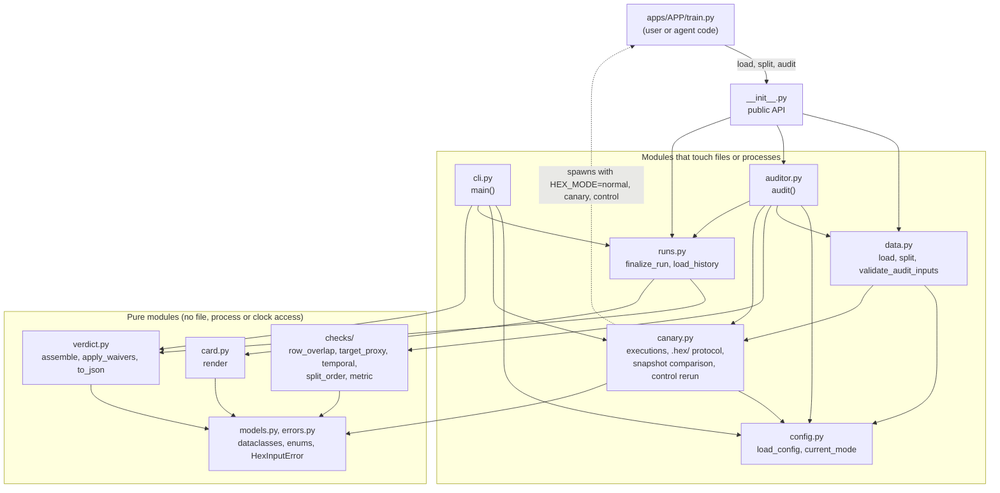
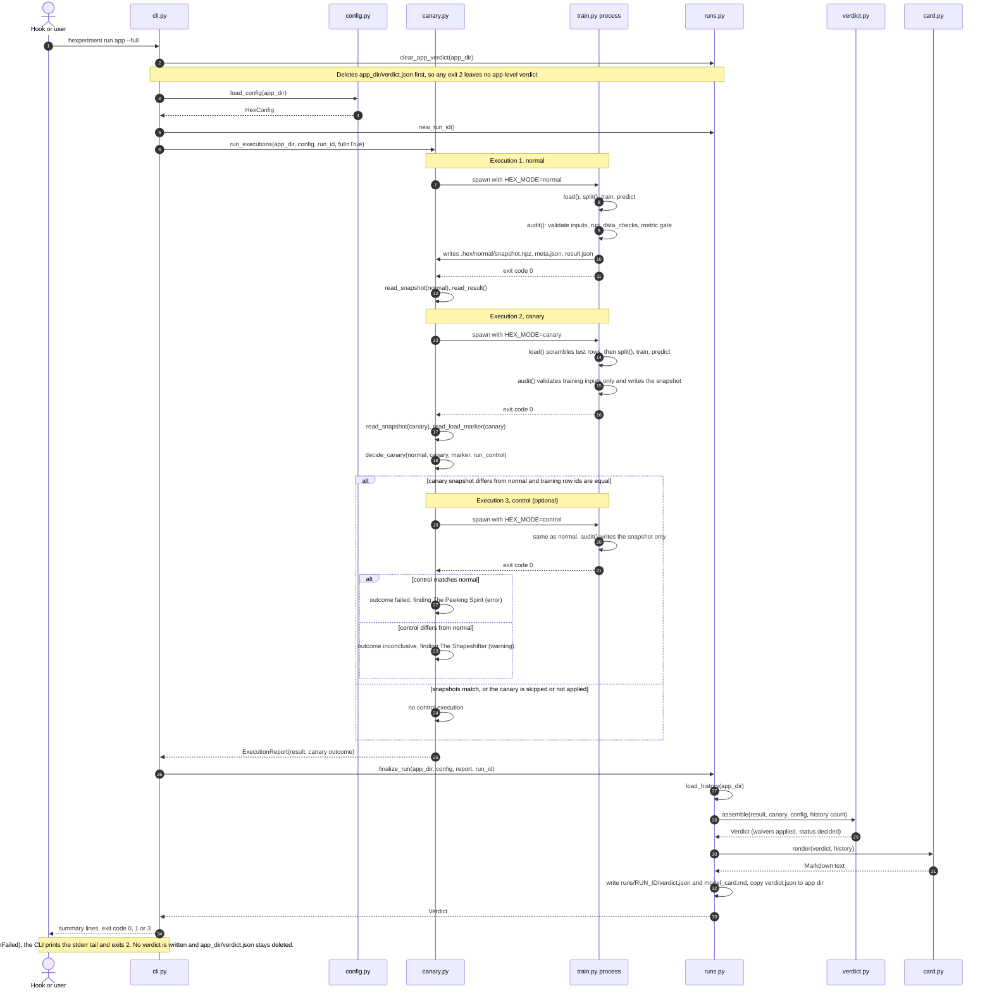

# Design Document: hexperiment-core

## Overview

`hexperiment` is a Python package that audits one training run of a binary classifier. A training script loads data with `load()`, splits it with `split()`, trains, and ends with one call to `audit(...)`. The audit validates its inputs, runs the data checks, applies the metric gate, and records a snapshot of what training saw. The `hexperiment run <app_dir>` command executes the script one to three times (normal, canary, and a control only when needed), compares the snapshots, applies waivers, and writes `verdict.json` and `model_card.md`.

This document covers the modules named in `structure.md`. Four of them (`errors.py`, `models.py`, `auditor.py`, `runs.py`) are described under "Supporting modules". It does not cover Kiro hooks, the workflow loop, the power, the example apps or the benchmark.

### Status

No question is open. The project owner chose Option C for Requirement 1.5 (Resolved question 1): the canary replaces the values in the test rows by a tilted resample, so leaks through column-level statistics (mean imputation, a scaler fitted on all rows, a target encoding computed over all rows) change training and are detected. The behaviour is confined to `data.scramble_test_rows` and its helper `data.tilt_column`. The signature of `scramble_test_rows` is unchanged, because the two-valued swap rule handles a binary target like any other column, so the function needs neither the target column nor its positive value.

All review questions are resolved (see "Resolved questions"). Three resolutions go beyond the literal requirement text and are built into this design: the time split is cutoff-based (Resolved question 5), `hexperiment run` deletes the app-level `verdict.json` before it starts (Resolved question 3), and `audit` skips scoring-only validation in canary and control mode (Resolved question 14).

### Design principles

1. **Small public API.** The package exposes `load`, `split`, `audit`, `load_history`, `HexInputError`, the types `Verdict` and `Finding` that `load_history` returns, and the `hexperiment` command. Everything else is internal.
2. **Checks are pure functions.** A check takes DataFrames and plain parameters and returns a `CheckResult`. It reads no files, no environment and no clock, and it does not modify its arguments.
3. **All canary orchestration lives in `canary.py`.** Spawning the executions, reading and comparing snapshots, deciding whether a control rerun is needed, and mapping the outcome to findings are all in that one module. `cli.py` makes one call into it.
4. **File I/O only at the edges.** Reading `hex.toml` and the CSV, writing the `.hex/` exchange files, writing run folders, and the CLI are the only places that touch the file system or processes. `verdict.py`, `card.py`, `models.py` and `checks/` are free of I/O. A structural test enforces this (see Testing Strategy).
5. **Fail loudly.** Invalid input raises `HexInputError` with what is wrong and how to fix it. No fallback hides a problem.
6. **No new dependencies.** Runtime use is limited to `pandas`, `numpy`, `scikit-learn` and the standard library (`tomllib`, `argparse`, `subprocess`, `ast`, `json`, `hashlib`). No entry in `docs/DECISIONS.md` is needed.

### Key design decisions

| Decision | Choice | Reason |
|---|---|---|
| Who writes the verdict | The parent process (`hexperiment run`), after all executions | Only the parent sees the normal, canary and control snapshots together. |
| How the parent gets the data-check results | The normal execution writes `.hex/normal/result.json` next to its snapshot | The checks run where the data frames live (inside `audit`). Re-running them in the parent would need the frames again. |
| Standalone `python train.py` | `audit` finalizes a `fast` run itself when `HEX_RUN_ID` is not set | A direct run still leaves evidence (Resolved question 2). |
| Canary scramble | Tilted resample: two-valued columns are swapped; columns with three or more distinct test values draw from the upper half of their test values | Moves column-level statistics systematically and never introduces a value the column did not have in its test rows (Requirement 1.5, Resolved question 1). |
| Time-split boundary | `load` computes a `(time, row_id)` cutoff from the full loaded frame and stores it in `df.attrs["hexperiment"]`; `split` and the canary mask both use it | Rows dropped or filtered before `split` cannot move the boundary (Resolved question 5). |
| Stale app-level verdict | The parent deletes `<app_dir>/verdict.json` before the first execution of every run | A run that ends with exit code 2 leaves no verdict, so hooks and loops see "not approved" (Resolved question 3). |
| Test-row hash split | SplitMix64 finalizer over `row_id` and `seed`, vectorized in numpy | Independent of row values, of Python's string hash randomization and of the row order. |
| Snapshot encoding | `meta.json` plus `snapshot.npz` loaded with `allow_pickle=False` | Exact float64 round trip, compact for large frames, no pickle. |
| Row hash for the canary | `pandas.util.hash_pandas_object(..., index=False)` per training row | Stable across processes, handles mixed dtypes. |
| Canary tolerance | Absolute `1e-9` on `y_score_train`, exact equality on row hashes | As required by Requirement 10.3. |
| Exceptions for non-input failures | Private `ExecutionFailed` in `canary.py`, mapped to exit code 2 by the CLI | `HexInputError` stays reserved for invalid input. |


## Architecture

### Component diagram



Dependency rules, enforced by `tests/test_architecture.py`:

- Arrows point from caller to callee. There are no cycles.
- Only `canary.py` imports `subprocess`.
- Modules in the "pure" group, and every module under `checks/`, import none of `os`, `pathlib`, `shutil`, `subprocess`, `tomllib`, `datetime` and do not call `open`. (`json` is allowed because it only serializes strings.)
- `train.py` imports only names listed in `hexperiment.__all__`.

### Process model and the `.hex/` exchange protocol

A run involves two kinds of process.

- **Parent**: `hexperiment run`. It owns the `run_id`, spawns executions, reads their files, and writes the verdict.
- **Child**: `python train.py`, started with `cwd=<app_dir>`, `sys.executable`, no shell, and two environment variables.

| Variable | Set by | Meaning |
|---|---|---|
| `HEX_MODE` | parent per execution | `normal` (default when unset), `canary` or `control`. Any other value raises `HexInputError` in the child. |
| `HEX_RUN_ID` | parent | The run's id. When unset, the child is a standalone run. |

The child and parent exchange data only through `<app_dir>/.hex/<mode>/`. The parent deletes that mode folder before each execution so that a stale file can never be read.

| File | Written by | Mode | Content |
|---|---|---|---|
| `loaded.json` | `data.load` | all, only when `HEX_RUN_ID` is set | Proof that the script loaded data through `hexperiment.load`. |
| `scrambled_ids.npy` | `data.load` | canary | Row ids whose values were scrambled. |
| `meta.json`, `snapshot.npz` | `auditor.audit` | all | The snapshot (format below). |
| `result.json` | `auditor.audit` | normal | The `DataAuditResult` (data checks, metric, data summary, or an input error). |

Every file carries `run_id`. The parent rejects a file whose `run_id` differs from its own. This is the only protection against two runs of the same app overlapping; concurrent runs of one app are not supported.

The parent also owns `<app_dir>/verdict.json`. It deletes that file (`runs.clear_app_verdict`) before the first execution of every run, and `finalize_run` writes it again only when a verdict exists. A run that ends with exit code 2 therefore leaves no app-level verdict, and a hook or loop that finds the file missing treats the run as not approved.

### Sequence of a full run



Other paths through the same machinery:

- **Fast run** (`--fast`): only execution 1. `decide_canary` is not called. The canary outcome is `skipped`, the status is `REJECTED` or `UNVERIFIED`, and `mode` is `fast`.
- **Input error in execution 1**: `audit` writes `result.json` with an input error, then re-raises. The child exits non-zero. `run_executions` accepts that one case (normal mode, `result.json` present with a matching `run_id` and an input error), skips executions 2 and 3, and the verdict is `REJECTED` (Requirement 4.7).
- **Any other failure** (non-zero exit, timeout, missing snapshot, `run_id` mismatch): `run_executions` raises the private `ExecutionFailed`. The CLI prints the tail of the child's stderr and exits with code 2. No verdict is written, and `<app_dir>/verdict.json` is already gone because `clear_app_verdict` ran first (Resolved question 3). Earlier `runs/<run_id>/` folders are untouched.
- **Standalone run** (`python train.py`, no `HEX_RUN_ID`): `audit` itself calls `runs.finalize_run(..., mode=fast)` after writing its snapshot, and returns the `Verdict`. In canary and control mode it only writes the snapshot. A standalone run does not call `clear_app_verdict`; it overwrites `<app_dir>/verdict.json` when it finishes.

## Components and Interfaces

Signatures are the contract. Bodies are not specified here. `Path` is `pathlib.Path`, `NDArray` is `numpy.typing.NDArray`, `Frame` is `pandas.DataFrame`. Every public function has type hints (tech.md). Result types are frozen dataclasses defined in `models.py` unless stated.

### `__init__.py` (public API)

```python
from hexperiment.errors import HexInputError
from hexperiment.models import Finding, Verdict
from hexperiment.data import load, split
from hexperiment.auditor import audit
from hexperiment.runs import load_history

__all__ = ["audit", "load", "split", "load_history",
           "HexInputError", "Verdict", "Finding"]
```

The CLI is the sixth public surface; it is installed as the console script `hexperiment = "hexperiment.cli:main"`. Nothing else is exported, and the list matches `structure.md`. `tests/test_architecture.py` asserts `__all__`.

Satisfies: 1.1, 1.2, 2.1, 15.2, 16.1 (entry point).

### `config.py`

Loads and validates `hex.toml`, and reads the execution mode from the environment.

```python
CONFIG_FILENAME = "hex.toml"
ENV_MODE = "HEX_MODE"
ENV_RUN_ID = "HEX_RUN_ID"

class ExecMode(StrEnum):
    NORMAL = "normal"; CANARY = "canary"; CONTROL = "control"

@dataclass(frozen=True, slots=True)
class AppConfig:     name: str; description: str          # name defaults to the app folder name
@dataclass(frozen=True, slots=True)
class DataConfig:    path: str
@dataclass(frozen=True, slots=True)
class TargetConfig:  column: str; positive: int | str | bool = 1
@dataclass(frozen=True, slots=True)
class MetricConfig:  name: str; threshold: float          # name is "roc_auc"
@dataclass(frozen=True, slots=True)
class SplitConfig:   test_fraction: float = 0.2; seed: int = 0; time_column: str | None = None
@dataclass(frozen=True, slots=True)
class ChecksConfig:
    proxy_auc_max: float = 0.95; overlap_max_fraction: float = 0.0
    too_good_margin: float = 0.15; max_test_uses: int = 5
@dataclass(frozen=True, slots=True)
class RunConfig:     timeout_seconds: float = 120
@dataclass(frozen=True, slots=True)
class Waiver:        check: str; reason: str; column: str | None = None
@dataclass(frozen=True, slots=True)
class HexConfig:
    app: AppConfig; data: DataConfig; target: TargetConfig; metric: MetricConfig
    split: SplitConfig; checks: ChecksConfig; run: RunConfig
    waivers: tuple[Waiver, ...]; app_dir: Path

def load_config(app_dir: Path) -> HexConfig: ...                      # I/O: reads app_dir/hex.toml
def parse_config(raw: Mapping[str, Any], *, source: Path, app_dir: Path) -> HexConfig: ...   # pure
def current_mode(environ: Mapping[str, str] | None = None) -> ExecMode: ...
def run_id_from_env(environ: Mapping[str, str] | None = None) -> str | None: ...
```

Validation in `parse_config` (all raise `HexInputError` that names the key and the file):

- Required keys: `data.path`, `target.column`, `metric.name`, `metric.threshold`. Everything else has the defaults in Data Models.
- `metric.name` must be `"roc_auc"`.
- `metric.threshold` and `split.test_fraction` must be numbers (not booleans) with `0 < x < 1`.
- Other numeric keys are range-checked: `proxy_auc_max` in `(0, 1]`, `overlap_max_fraction` in `[0, 1]`, `too_good_margin >= 0`, `max_test_uses >= 1`, `timeout_seconds > 0`, `seed >= 0`.
- Unknown tables or keys are rejected, so a typo such as `proxy_auc_mx` cannot silently leave a default in place (Resolved question 11).
- Waivers: `check` must be one of `row_overlap`, `target_proxy`, `temporal`; `reason` must be a string of at least 10 characters after stripping; `column` is required with `target_proxy` and rejected with the other checks, so a waiver can never cover a leaking column that appears later (11.1, 11.3).

Satisfies: 3.1, 3.2, 3.3, 3.4, 10.7 (non-waivable checks are rejected), 11.1, 11.3.

### `data.py`

Loads, splits and scrambles data, and validates the inputs of `audit`.

```python
# Public (re-exported by __init__)
def load(app_dir: str | os.PathLike[str] | None = None) -> Frame: ...
def split(df: Frame) -> tuple[Frame, Frame]: ...

# Pure helpers (internal, unit-tested directly)
def hash_fraction(row_ids: NDArray[np.int64], seed: int) -> NDArray[np.float64]: ...
def compute_cutoff(df: Frame, split: SplitConfig) -> TimeCutoff | None: ...   # None without time_column
def test_mask(df: Frame, split: SplitConfig,
              cutoff: TimeCutoff | None = None) -> NDArray[np.bool_]: ...
def split_frame(df: Frame, split: SplitConfig,
                cutoff: TimeCutoff | None = None) -> tuple[Frame, Frame]: ...
def scramble_test_rows(df: Frame, mask: NDArray[np.bool_] | pd.Series,
                       time_column: str | None, seed: int) -> Frame: ...
def tilt_column(values: pd.Series, rng: np.random.Generator) -> pd.Series: ...   # one column's test values
def parse_times(series: pd.Series, column: str, frame_name: str) -> pd.Series: ...

@dataclass(frozen=True, slots=True)
class TimeCutoff:
    time: pd.Timestamp        # UTC
    row_id: int               # first test row in (time, row id) order

@dataclass(frozen=True, slots=True)
class ValidatedInputs:
    features: tuple[str, ...]
    y_true_train: NDArray[np.bool_]
    y_true_test: NDArray[np.bool_]
    y_score: NDArray[np.float64]
    y_score_train: NDArray[np.float64] | None

@dataclass(frozen=True, slots=True)
class SnapshotInputs:         # all that canary and control mode need
    features: tuple[str, ...]
    y_score_train: NDArray[np.float64] | None

def validate_audit_inputs(train: Frame, test: Frame, y_score: ArrayLike1D,
                          y_score_train: ArrayLike1D | None,
                          features: Sequence[str], config: HexConfig) -> ValidatedInputs: ...
def validate_snapshot_inputs(train: Frame, y_score_train: ArrayLike1D | None,
                             features: Sequence[str]) -> SnapshotInputs: ...
```

`ArrayLike1D` is `Sequence[float] | NDArray[np.floating] | pd.Series`. Scores are matched to rows by position, in the order of the frame passed to `audit`.

**`load(app_dir)`**

1. Resolve `app_dir`. If `None`, use the directory of the calling script (`sys._getframe(1).f_globals["__file__"]`). If the caller has no `__file__` (a REPL), raise `HexInputError` asking for `app_dir`.
2. `config.load_config`, then read the CSV at `data.path` (relative to `app_dir`). A missing file, an unreadable file or zero data rows raises `HexInputError` naming the resolved path (Requirement 1.6).
3. Set the index to `RangeIndex(0, n)` in file order, so the row id is the position in the file.
4. With a `time_column`, compute `cutoff = compute_cutoff(df, split)` from the full loaded frame, before anything else touches it. This is the only place the cutoff is derived from the whole file.
5. In canary mode only: compute the test mask with `test_mask(df, split, cutoff)` and replace the frame with `scramble_test_rows(...)`. In normal and control mode the frame is returned as read. The time column is never scrambled, so the cutoff is the same in all three modes.
6. When `HEX_RUN_ID` is set, write `loaded.json` (and `scrambled_ids.npy` in canary mode) through `canary.write_load_marker`.
7. Store `{"app_dir": "<absolute path>", "cutoff": <TimeCutoff or None>}` in `df.attrs["hexperiment"]` and return.

**`split(df)`** finds its config from `df.attrs["hexperiment"]["app_dir"]` and its time cutoff from `df.attrs["hexperiment"]["cutoff"]`. It passes both to `split_frame`, so rows dropped or filtered between `load` and `split` (`dropna()`, `drop_duplicates()`, a query) cannot move the time boundary: a remaining row is a test row exactly when its `(time, row id)` is at or after the stored cutoff. If the attribute was lost (some pandas operations drop `attrs`), `split` falls back to the calling script's directory, as `load` does, and recomputes the cutoff from the frame it receives. In that case the boundary can move when rows were removed, and `decide_canary` step 2 still guards the canary. `split` returns copies, and raises `HexInputError` if either side is empty (so the mistake is reported at the split, not later in `audit`). Filtering that removes every test row is reported there.

**`hash_fraction`**: for each row id `i`, take `x = (i + (seed + 1) * 0x9E3779B97F4A7C15) mod 2**64`, apply the SplitMix64 finalizer, and return `(x >> 11) / 2**53`, a value in `[0, 1)`. It uses `uint64` array arithmetic under `np.errstate(over="ignore")`. It never calls Python's `hash`, so it is the same in every process.

**`compute_cutoff`**: parse the time column with `parse_times`, order rows by `(time, row id)` using `np.lexsort`, set `n_test = min(n - 1, max(1, floor(n * test_fraction + 0.5)))` where `n` is the number of rows in the frame it receives, and return the `(time, row id)` of the first of the last `n_test` rows. Rows with equal timestamps are ordered by row id, so the result is deterministic (Requirement 1.3). A frame with fewer than 2 rows raises `HexInputError`.

**`test_mask`**

- No `time_column`: `hash_fraction(df.index) < test_fraction`. Membership depends only on the row id and the seed (Requirement 1.4), so filtering cannot change it.
- With `time_column`: parse with `parse_times`; if `cutoff` is `None`, call `compute_cutoff(df, split)`. A row is a test row when `time > cutoff.time`, or `time == cutoff.time` and `row id >= cutoff.row_id`.

**`scramble_test_rows`** (Requirement 1.5, Resolved question 1). It returns a copy and changes only the cells of test rows (`mask` true) in every column except `time_column`. Row ids, the row count, non-test rows and the time column are untouched. Each column is handled independently, in column order, by `tilt_column`. One generator, `np.random.default_rng([seed, CANARY_SALT])` with a fixed integer `CANARY_SALT`, is shared by all columns, so the result is a pure function of the frame, the mask and the seed.

The function does not receive the target column or the positive value, and the signature does not change. The two-valued rule swaps a binary target like any other two-valued column, which exchanges the two class counts and keeps both classes. A target with three or more distinct test values (multi-class labels compared with `target.positive`) is tilted like any other column and can end up with one class; that is harmless in canary mode (Resolved question 14).

**`tilt_column(values, rng)`** receives the test values of one column and returns replacements of the same length and dtype. Let *k* be the number of distinct non-missing values and *m* the number of non-missing values.

1. Missing values (`NaN`, `None`, `NA`, `NaT`) keep their positions, are not counted in *k* or *m*, and are never drawn.
2. *k* ≤ 1: the column is returned unchanged.
3. *k* = 2: the two values are swapped. Every occurrence of one value becomes the other.
4. *k* ≥ 3: build a pool, draw once per non-missing position (with replacement, uniformly from the pool, positions in row-id order), then repair.
   - **Numeric dtype** (`pandas.api.types.is_numeric_dtype`): sort the non-missing values ascending as a list with repeats. The upper half is `sorted[floor(m/2):]`. Widen it downward: the pool starts at `min(floor(m/2), index of the first copy of the second-largest distinct value)`, so it holds at least two distinct values. The pool keeps repeats, so common values are drawn more often. Equal values are interchangeable, so a tie at the halfway point needs no rule.
   - **Other dtypes** (object, string, category, datetime): count each distinct value, rank by count descending with ties broken by ascending `str(value)`, and keep the top `ceil(k/2)` categories. Because *k* ≥ 3, at least two categories are kept, so no widening is needed. The pool is the non-missing test values that belong to a kept category, with repeats.
   - **Repair:** if every draw is the same value, replace the draw at the first non-missing position by the highest-ranked pool value that differs (the largest value for numeric dtypes, the most frequent category otherwise). Plain draws from a two-valued pool can all coincide when *m* is small. The repair is the only step that is not a random draw, and it guarantees that a column with two or more distinct test values never becomes constant (Requirement 17.2).
5. Written values are always values the column already had in its test rows, so no unseen value, category or dtype change can appear. Row combinations across columns are new, because each column is replaced independently.

Effect: the test rows of a numeric column move toward the old upper half, so its mean, median and quantiles move upward by a systematic amount; category frequencies shift toward the frequent categories; a two-valued column and a binary target flip. Any statistic computed over all rows (a global mean, a scaler, a target encoding) therefore differs between the normal and the canary execution. `scramble_test_rows` is the only function that implements Requirement 1.5.

**`parse_times`** converts with `pd.to_datetime(series, utc=True)`. A value that cannot be parsed, or a missing value, raises `HexInputError` naming the column and frame. Using `utc=True` makes timezone-naive and aware inputs comparable.

**`validate_audit_inputs`** (normal mode) raises `HexInputError` in this order, each message saying what is wrong and how to fix it:

1. `train` or `test` is empty, naming which (4.1).
2. The target column is missing from either frame, naming column and frame (4.2), or holds a missing value in either frame.
3. `y_score` length differs from `len(test)`, or `y_score_train` length differs from `len(train)`; any score is NaN or outside `[0, 1]` (4.4).
4. `features` is empty, or a name in `features` is not a column of both frames (4.5).
5. `time_column` is configured but missing from a frame or not parseable (4.6).
6. The test target has one class, after comparing `test[target] == target.positive` (4.3). The message names the positive value and the test target's distinct values, because a wrong `positive` is the usual cause.

`build_snapshot` also raises `HexInputError` when a frame's index is not integer or the training index has duplicates. In normal mode `audit` records these like the rules above (4.7). In canary and control mode the test frame still needs an integer index; the scramble never changes the index, and normal mode has already rejected a bad one.

**`validate_snapshot_inputs`** (canary and control mode) checks only what the snapshot needs, with the same messages as the matching rules above: `train` is not empty (rule 1, train only), `features` is not empty and every name in it is a column of `train` (rule 4, train only), and `y_score_train`, when given, has `len(train)` entries that are all in `[0, 1]` (rule 3, training part only). It does not look at the test target, at `y_score`, at the time column or at the test frame's columns. A scrambled test set (a test target with three or more distinct values can end up with one class after the tilt, and test scores can be unrelated to the scrambled values) therefore cannot crash the canary or control execution. An error in the checked part still raises `HexInputError`, and the parent reports exit 2.

Satisfies: 1.1 to 1.6, 4.1 to 4.6, 7.1 (time parsing), 10.6 (marker). In canary and control mode, Requirements 4.1 to 4.6 apply only to the snapshot inputs above; this is Resolved question 14.

### `checks/`

One module per check. Each check is a pure function that returns a `CheckResult` (name, ghost, outcome, findings). It never mutates its arguments and never reads files, environment or clock. Outcomes and finding locations are fixed by the vocabulary table in Data Models.

```python
# checks/__init__.py
def run_data_checks(train: Frame, test: Frame, v: ValidatedInputs, *,
                    config: HexConfig, script_source: str | None,
                    script_name: str) -> DataAuditResult: ...

# checks/row_overlap.py
def check_row_overlap(train: Frame, test: Frame, features: Sequence[str],
                      target: str, max_fraction: float) -> CheckResult: ...

# checks/target_proxy.py
def standalone_score(train: Frame, test: Frame, feature: str, target: str,
                     y_true_train: NDArray[np.bool_],
                     y_true_test: NDArray[np.bool_]) -> float | None: ...
def check_target_proxy(train: Frame, test: Frame, features: Sequence[str], target: str,
                       y_true_train: NDArray[np.bool_], y_true_test: NDArray[np.bool_],
                       auc_max: float) -> CheckResult: ...

# checks/temporal.py
def check_temporal(train: Frame, test: Frame, time_column: str | None) -> CheckResult: ...

# checks/split_order.py
def check_split_order(source: str | None, script_name: str) -> CheckResult: ...

# checks/metric.py
def compute_metric(y_true: NDArray[np.bool_], y_score: NDArray[np.float64]) -> float: ...
def check_metric(value: float, name: str, threshold: float,
                 too_good_margin: float) -> tuple[MetricResult, tuple[Finding, ...]]: ...
```

`run_data_checks` calls the five modules in a fixed order (`row_overlap`, `target_proxy`, `temporal`, `split_order`, then the metric) and collects the results into one `DataAuditResult`. It is the only function in the package that knows the list of checks. The script's source text is read by `auditor.audit` (an edge) and passed in; `None` means the file could not be read.

**`check_row_overlap`** (The Doppelganger)

- Build the key frame `features + [target]` for both sides. Deduplicate train, then left-merge test onto it with an indicator column. A test row counts as overlapping when the indicator is `both`. pandas treats NaN as equal to NaN in merge keys, so two rows with the same missing values are identical. The merge is exact, so there are no hash collisions.
- Evidence: `{"rows": count, "test_rows": n, "fraction": count / n}`. Error when `fraction > max_fraction`. Fix: "drop exact duplicates before splitting".
- The count is a function of the two row sets, so reordering either frame cannot change it (Requirement 5.3).

**`check_target_proxy`** (The Possession)

- For each feature, `standalone_score` returns `None` only when the feature has one unique value in the test rows, counting a missing value as a value (`nunique(dropna=False) == 1`, 6.3). Otherwise it returns a score in `[0.5, 1]`; no other feature is skipped.
- **Value score** (numeric, boolean, datetime and timedelta dtypes). Datetimes are converted to UTC and then, like timedeltas, to their `int64` nanosecond value; booleans to `0/1`. `load` reads CSV without parsing dates, so a text (object or string) feature whose non-missing values in train and test all parse with `pd.to_datetime(values, utc=True, format="ISO8601")` is treated as a datetime feature; one value that does not parse keeps it a text feature (category score only). Other date formats such as `03/01/2024` are not recognised. The values are ranked with missing values placed lowest, and `max(AUC, 1 - AUC)` is taken against `y_true_test` with `sklearn.metrics.roc_auc_score`. The same is repeated with missing values ranked highest, and the higher score is kept. A column that is filled in only for one class therefore scores `1.0`. When the column has no missing value, both rankings are the same.
- **Category score** (all other dtypes, and also numeric features with at most 50 distinct non-missing test values). For each training value, `positives / count` is computed as an integer ratio and mapped onto the test rows. Unseen values and missing values get the overall training positive rate. The score is the AUC of that mapping. For a numeric feature that gets both scores, the higher one is kept, so integer codes whose meaning is not ordered (codes 1 and 3 positive, 2 and 4 negative) are caught. Computing means from integer counts keeps the values exact, so a reorder cannot flip a tie (Requirement 6.4).
- Evidence: `{"score": s, "threshold": auc_max}`. Location is the column. Error when `score >= auc_max`. Fix: "check whether this column is recorded after the outcome; if so, drop it".

**`check_temporal`** (The Prophet)

- No `time_column`: outcome `not applicable`, no findings (7.3).
- Otherwise parse both columns with `data.parse_times`, then compare `train_max` with `test_min`. A tie is not a leak. If `train_max > test_min`, report an error with evidence `{"test_rows_earlier": count(test_time < train_max), "latest_train": ..., "earliest_test": ...}`. Fix: "split by time with hexperiment.split".

**`check_split_order`** (no ghost, warnings only)

- `source is None` or `ast.parse` fails: one `warning` "the hint could not be applied" and outcome `inconclusive` (8.3). The script is parsed, never executed or imported.
- Find the first call whose callee name is `split`, `hexperiment.split` or `train_test_split` (by smallest line number), including import aliases (`import hexperiment as hx` then `hx.split`; `from hexperiment import split as hsplit`; `from sklearn.model_selection import train_test_split as tts`). If none: the same warning (8.3).
- Calls nested in the arguments of the split call, such as `split(df.fillna(df.mean()))`, run before the split and are reported like earlier calls.
- Any call, anywhere in the script, whose callee name is one of `read_csv`, `read_parquet`, `read_excel`, `read_json`, `read_feather`, `read_table`, `read_fwf`, `read_pickle`, `read_sql`, `read_orc`, `loadtxt` or `genfromtxt` gives a `warning` at `train.py:<line>` with the message "this reads data without hexperiment.load(); the canary test cannot scramble this copy" and the fix "load the data with hexperiment.load() and derive everything from that frame" (8.4). These warnings do not depend on the split call and are reported even when no split call is found.
- Collect earlier calls: `fit`, `fit_transform`, `fit_resample` on any receiver; and `mean`, `median`, `std`, `quantile`, `min`, `max`, `transform` as methods whose receiver is a name, subscript, call or attribute chain not rooted at an imported module alias. A bare builtin `min(...)` or `max(...)` is not a method call and is ignored. Each is a `warning` at `train.py:<line>` with the hint "this runs before the split; make sure it does not use test rows" (8.2).
- The comparison is by line number, not data flow. A helper function defined above the split but called below it is reported. This is acceptable for a hint; the canary test is the authority.

**`check_metric`** (not a ghost)

- `compute_metric` returns the ROC AUC. `check_metric` returns `MetricResult(name, value, threshold, passed=value >= threshold)`. If `value > min(threshold + too_good_margin, 0.99)` it also returns a `warning` with check `metric`, message "too good to be true", evidence `{"value": v, "threshold": t}`, and fix "treat this as a leak until proven otherwise: look for a column that encodes the target".

Satisfies: 2.3 (data checks), 2.5, 5.1 to 5.3, 6.1 to 6.4, 7.1 to 7.3, 8.1 to 8.3, 9.1 to 9.3.

### `canary.py`

The single home of canary orchestration: spawning executions, the `.hex/` file protocol, snapshot comparison, the control rerun decision, and the mapping to findings. It has three layers, in this order inside the file.

```python
SCORE_TOLERANCE = 1e-9

class ExecutionFailed(RuntimeError): ...     # private: not exported, not a HexInputError

@dataclass(frozen=True, slots=True)
class Snapshot:
    mode: ExecMode; run_id: str | None; features: tuple[str, ...]
    train_ids: NDArray[np.int64]            # sorted ascending
    test_ids: NDArray[np.int64]             # sorted ascending
    train_row_hash: NDArray[np.uint64]      # aligned with train_ids
    y_score_train: NDArray[np.float64] | None   # aligned with train_ids

@dataclass(frozen=True, slots=True)
class LoadMarker:
    mode: ExecMode; run_id: str; scrambled_ids: NDArray[np.int64] | None   # ids only in canary mode

@dataclass(frozen=True, slots=True)
class SnapshotDiff:
    ids_equal: bool
    rows_changed: int                # hash differs OR score differs by more than the tolerance
    feature_rows_changed: int
    score_rows_changed: int
    max_abs_change: float | None     # None when either snapshot has no y_score_train
    @property
    def differs(self) -> bool: ...

@dataclass(frozen=True, slots=True)
class CanaryOutcome:
    outcome: Outcome                 # canary check outcome
    determinism: Outcome             # determinism check outcome
    findings: tuple[Finding, ...]

@dataclass(frozen=True, slots=True)
class ExecutionReport:
    result: DataAuditResult
    canary: CanaryOutcome
    mode: RunMode

# Layer 1: pure
def build_snapshot(mode: ExecMode, run_id: str | None, train: Frame, test: Frame,
                   features: Sequence[str],
                   y_score_train: NDArray[np.float64] | None) -> Snapshot: ...
def compare_snapshots(a: Snapshot, b: Snapshot,
                      tolerance: float = SCORE_TOLERANCE) -> SnapshotDiff: ...
def decide_canary(normal: Snapshot, canary: Snapshot, marker: LoadMarker | None,
                  run_control: Callable[[], Snapshot],
                  hint_locations: Sequence[str]) -> CanaryOutcome: ...
def hint_locations(result: DataAuditResult) -> tuple[str, ...]: ...
def skipped_outcome() -> CanaryOutcome: ...          # used by fast runs

# Layer 2: .hex/ protocol (file I/O)
def hex_dir(app_dir: Path, mode: ExecMode) -> Path: ...
def clear_mode_dir(app_dir: Path, mode: ExecMode) -> None: ...
def write_snapshot(app_dir: Path, snapshot: Snapshot) -> None: ...
def read_snapshot(app_dir: Path, mode: ExecMode, run_id: str) -> Snapshot: ...
def write_load_marker(app_dir: Path, marker: LoadMarker) -> None: ...
def read_load_marker(app_dir: Path, mode: ExecMode, run_id: str) -> LoadMarker | None: ...
def write_result(app_dir: Path, result: DataAuditResult, run_id: str | None) -> None: ...
def read_result(app_dir: Path, run_id: str) -> DataAuditResult: ...

# Layer 3: process orchestration
Runner = Callable[[Path, ExecMode, str, float], None]
def run_train_script(app_dir: Path, mode: ExecMode, run_id: str, timeout_seconds: float) -> None: ...
def run_executions(app_dir: Path, config: HexConfig, run_id: str, *, full: bool,
                   runner: Runner = run_train_script) -> ExecutionReport: ...
```

**`build_snapshot`** sorts rows by id, then computes `pandas.util.hash_pandas_object(train[features], index=False)` per row, so the hash depends on values only. It also stores the sorted test ids.

**`compare_snapshots`** compares row ids first. When the id sets are equal it counts rows whose hash differs, rows whose score differs by more than the tolerance, and the largest absolute score change. Scores are compared only when both snapshots have them.

**`decide_canary`** evaluates these steps in order and stops at the first that applies. `run_control` is called at most once, and only at step 5.

| Step | Condition | Canary | Determinism | Findings |
|---|---|---|---|---|
| 1 | `marker is None` (the canary execution never called `load`) | not applied | skipped | warning: the script did not load its data with `hexperiment.load` (10.6) |
| 2 | `marker.scrambled_ids` intersects `canary.train_ids` | not applied | skipped | warning: scrambled rows ended up in train, split with `hexperiment.split` (Resolved question 5) |
| 3 | `normal.train_ids != canary.train_ids` | skipped | skipped | warning: inconclusive, the split depends on data values (10.2) |
| 4 | `compare(normal, canary)` shows no difference | passed, or inconclusive when `normal.y_score_train is None` | passed | none, or the warning below when `normal.y_score_train is None` |
| 5 | difference, and `compare(normal, control)` shows none | failed | passed | error The Peeking Spirit (10.5) |
| 6 | difference, and control also differs from normal | inconclusive | failed | warning The Shapeshifter (10.4) |

In steps 4 to 6, if `normal.y_score_train is None`, add a warning (check `canary`, no ghost). In step 4 it says the canary compared only the training features and could not rule out a model fitted on test rows, so the result is inconclusive; in steps 5 and 6 it says the canary test is weaker without training predictions. In both cases the fix is "pass y_score_train=model.predict_proba(train[features])[:, 1] to hexperiment.audit" (Requirement 2.6). Without training predictions a run can therefore be at best `UNVERIFIED`. In step 5 the evidence is `{"train_rows", "rows_changed", "feature_rows_changed", "largest_change"}` from `compare(normal, canary)`, and the fix text is "test rows influenced training; fit preprocessing on training rows only, after the split." followed by "Suspect lines: <hint locations joined by comma>." when `hint_locations` is non-empty. Canary findings are created with the severity they will keep: they have no waivable check name, so `verdict.apply_waivers` cannot touch them (10.7).

**`run_train_script`** runs `subprocess.run([sys.executable, "train.py"], cwd=app_dir, env=os.environ | {HEX_MODE, HEX_RUN_ID}, capture_output=True, text=True, timeout=timeout_seconds)` with no shell. It does not set `PYTHONHASHSEED`: hash-order dependence in a user script is real non-determinism and should surface as The Shapeshifter. A timeout or a non-zero exit raises `ExecutionFailed` carrying the stderr tail (last 40 lines).

**`run_executions`**

1. `full=False`: run `normal`, read its `result.json`, return `ExecutionReport(mode=FAST, canary=skipped_outcome())`.
2. `full=True`: run `normal`. If it left an input error in `result.json`, return a full report with `skipped_outcome()` and stop. Otherwise run `canary`, read both snapshots and the canary's load marker, and call `decide_canary` with `run_control` bound to run-and-read `control`.
3. Before each execution call `clear_mode_dir`. After it, verify that the snapshot exists and carries this `run_id`; otherwise raise `ExecutionFailed` ("train.py did not call hexperiment.audit" or "another run is using this app").
4. A non-zero exit of the normal execution is tolerated only in the input-error case above.
5. `run_executions` never reads or writes `<app_dir>/verdict.json`. The CLI has already deleted it (`runs.clear_app_verdict`), so when `ExecutionFailed` propagates, no app-level verdict exists.

The `runner` parameter lets tests replace the subprocess with a function that writes prepared snapshots, so orchestration is tested without spawning Python.

Satisfies: 2.3, 2.4, 2.6, 10.1 to 10.7, 16.2, 16.3, 16.5 (exit 2 conditions).

### `verdict.py`

Combines the data-check result, the canary outcome, the waivers and the history count into a `Verdict`. All functions are pure. The clock, the random token and the file system belong to `runs.py` and the CLI.

```python
FINDING_ORDER: tuple[str, ...]   # input, row_overlap, target_proxy, temporal, split_order,
                                 # canary, determinism, metric, test_set_uses, waiver

def assemble(result: DataAuditResult, canary: CanaryOutcome, config: HexConfig, *,
             mode: RunMode, run_id: str, created_at: str, version: str,
             test_set_uses: int) -> Verdict: ...
def apply_waivers(findings: Sequence[Finding], waivers: Sequence[Waiver]
                  ) -> tuple[tuple[Finding, ...], tuple[WaiverRecord, ...]]: ...
def decide_status(metric_passed: bool, findings: Sequence[Finding],
                  canary: Outcome, mode: RunMode) -> Status: ...
def to_json(verdict: Verdict) -> str: ...
def from_dict(raw: Mapping[str, Any]) -> Verdict: ...
def format_summary(verdict: Verdict) -> str: ...
```

**`assemble`** performs these steps:

1. If `result.input_error` is set: metric `value=None, passed=False`; the only finding is the input error; the other checks are omitted; the status is `REJECTED` (4.7).
2. Otherwise gather the data-check findings, the metric finding (too good), and `canary.findings`.
3. If `test_set_uses > config.checks.max_test_uses`, add a `warning` (check `test_set_uses`) "the metric may be optimistic because the test set has been evaluated N times" (12.2).
4. `apply_waivers` on the data-check findings only. Its stale-waiver warnings join the finding list.
5. Build the six `CheckSummary` entries (outcomes from the vocabulary table; canary and determinism outcomes come from `canary`).
6. Sort findings by `(FINDING_ORDER index, location, message)` so equal inputs give equal findings (13.5).
7. `decide_status`.

**`apply_waivers`** matches a finding when `finding.check == waiver.check`, and, if `waiver.column` is set, `finding.location == waiver.column`. A matching finding becomes `severity=WAIVED` with `waiver_reason` set. Only findings of `row_overlap`, `target_proxy` and `temporal` are candidates. Each applied waiver yields a `WaiverRecord(check, column, reason, findings_waived)`. A waiver that matches no finding is not recorded in `waivers`; instead it yields a `warning` finding with check `waiver`, no ghost, and location `<check>` or `<check>:<column>` (the waiver's own check and column). The message says the waiver matched no finding and the fix says to remove it from `hex.toml` if the finding no longer occurs. The evidence is `{"check", "column"}`. A stale waiver therefore stays visible in the verdict and the model card, and, being a warning, never changes the status. Stale-waiver warnings are not produced when the verdict is an input error, because the checks did not run (Resolved question 7).

**`decide_status`** (13.1):

```text
REJECTED   if not metric_passed or any finding has severity ERROR (waived findings do not count)
APPROVED   elif mode is FULL and canary == PASSED
UNVERIFIED otherwise
```

**`to_json`** returns `json.dumps(as_dict, indent=2, sort_keys=True, ensure_ascii=False, allow_nan=False) + "\n"`. Non-finite floats are converted to `null` before dumping. Floats in evidence are rounded to 6 decimals when the finding is created.

**`format_summary`** returns the text printed by the CLI (16.4):

```text
REJECTED (full)  roc_auc 0.8734 >= 0.8000  run 20251101-093012-a1b2c3
  waived   The Possession      tenure_months  check whether this column is recorded after the outcome; if so, drop it
  warning  split_order         train.py:14    this runs before the split; make sure it does not use test rows
  error    The Peeking Spirit  train.py       test rows influenced training; fit preprocessing on training rows only, after the split. Suspect lines: train.py:14.
```

The ghost column shows the check name when a finding has no ghost. The metric line uses `<` instead of `>=` when the metric fails.

Satisfies: 4.7, 10.7, 11.2, 11.4, 12.1 (together with `runs.py`), 12.2, 13.1, 13.2, 13.4, 13.5, 16.4.

### `card.py`

```python
def render(verdict: Verdict, history: Sequence[Verdict]) -> str: ...
```

Pure function that returns GitHub-flavoured Markdown. `history` holds the earlier verdicts of the app, oldest first, and excludes the verdict being rendered. Sections, in order:

1. Title with the app name, then the description.
2. A status block: verdict status, mode, run id, date, `hexperiment` version.
3. A generated-file notice: "Generated by hexperiment. Do not edit by hand." (14.2)
4. Data: train and test row counts and positive rates; the time range of each split when a time column is configured.
5. Metric against its threshold.
6. Checks table: check, ghost, outcome.
7. Findings: severity, ghost (or check), location, message, evidence, fix hint. For waived findings, the waiver reason.
8. Waivers: check, column, reason.
9. Test-set uses.
10. Run history table: run id, status, metric value. Shows "none" when empty.

Every table cell passes through one `_cell(text)` helper that escapes `|`, replaces newlines with a space and trims, so column names, descriptions and evidence containing Markdown characters cannot break a table (14.3). Satisfies 14.1 to 14.3, 11.4.

### `cli.py`

```python
EXIT_APPROVED = 0; EXIT_REJECTED = 1; EXIT_RUN_FAILED = 2; EXIT_UNVERIFIED = 3

def build_parser() -> argparse.ArgumentParser: ...      # run <app_dir> [--fast | --full]
def exit_code_for(status: Status) -> int: ...
def main(argv: Sequence[str] | None = None) -> int: ...
```

`main` and a standalone `audit` (which prints `format_summary` after finalizing a `fast` run) are the only functions in the package that print. Its flow, in order:

1. Parse arguments. `--fast` and `--full` are a mutually exclusive group; the default is full (16.1).
2. Check that `app_dir` is an existing directory, then call `runs.clear_app_verdict(app_dir)`, which deletes `<app_dir>/verdict.json` if it exists. This happens before anything else can fail, so every path that ends with exit code 2 leaves no app-level verdict (Resolved question 3). If `app_dir` is not a directory, print the error to stderr and return 2.
3. `config.load_config(app_dir)`. A `HexInputError` is printed to stderr as `hexperiment: <problem> <fix>` and returns 2. A missing `train.py` is reported the same way.
4. `runs.new_run_id()`, then `canary.run_executions(app_dir, config, run_id, full=...)`.
5. `runs.finalize_run(...)`, then print `verdict.format_summary`.
6. Return `exit_code_for(verdict.status)`.
7. `ExecutionFailed`, `OSError` and any `HexInputError` raised after step 3 (for example a malformed file found by `load_history`) are printed (with the stderr tail for `ExecutionFailed`) and return 2 (16.3, 16.5). No verdict is written, and none is left from an earlier run.

Satisfies 16.1 to 16.5.

### `pyproject.toml`

- `requires-python = ">=3.13"`; dependencies `pandas`, `numpy`, `scikit-learn`; the `dev` extra has `pytest`, `hypothesis`, `ruff`.
- `[project.scripts] hexperiment = "hexperiment.cli:main"` (16.1).
- `[tool.ruff]` selects `E`, `F`, `I`, `UP`, `B`. `[tool.pytest.ini_options]` sets `testpaths = ["tests"]`. Satisfies 17.5 and 17.6.

### `tests/`

Described under Testing Strategy. Files mirror the package: `tests/test_<module>.py`.

### Supporting modules

`structure.md` lists these four modules. They are internal, except that `HexInputError`, `Finding` and `Verdict` are re-exported (Resolved question 8).

#### `errors.py`

```python
class HexInputError(ValueError):
    problem: str
    fix: str
    def __init__(self, problem: str, fix: str) -> None: ...   # str(self) == f"{problem} {fix}"
```

Requiring both arguments makes every raise site state what is wrong and how to fix it (tech.md).

#### `models.py`

Enums and frozen dataclasses shared by all modules. No logic beyond `to_dict` and `from_dict` helpers.

```python
class Status(StrEnum):   APPROVED = "APPROVED"; REJECTED = "REJECTED"; UNVERIFIED = "UNVERIFIED"
class Severity(StrEnum): ERROR = "error"; WARNING = "warning"; WAIVED = "waived"
class RunMode(StrEnum):  FAST = "fast"; FULL = "full"
class Outcome(StrEnum):
    PASSED = "passed"; FAILED = "failed"; SKIPPED = "skipped"; INCONCLUSIVE = "inconclusive"
    NOT_APPLIED = "not applied"; NOT_APPLICABLE = "not applicable"

JsonValue = str | int | float | bool | None | list["JsonValue"] | dict[str, "JsonValue"]

@dataclass(frozen=True, slots=True)
class Finding:
    check: str; ghost: str | None; severity: Severity
    location: str; message: str; evidence: dict[str, JsonValue]; fix: str
    waiver_reason: str | None = None

@dataclass(frozen=True, slots=True)
class CheckResult:    name: str; ghost: str | None; outcome: Outcome; findings: tuple[Finding, ...] = ()
@dataclass(frozen=True, slots=True)
class CheckSummary:   name: str; ghost: str | None; outcome: Outcome
@dataclass(frozen=True, slots=True)
class MetricResult:   name: str; value: float | None; threshold: float; passed: bool
@dataclass(frozen=True, slots=True)
class WaiverRecord:   check: str; column: str | None; reason: str; findings_waived: int
@dataclass(frozen=True, slots=True)
class SplitSignature: data_path: str; test_fraction: float; seed: int; time_column: str | None
@dataclass(frozen=True, slots=True)
class DataSummary:
    n_train: int; n_test: int; positive_rate_train: float; positive_rate_test: float
    train_time_range: tuple[str, str] | None; test_time_range: tuple[str, str] | None

@dataclass(frozen=True, slots=True)
class DataAuditResult:           # what the normal execution writes to result.json
    run_id: str | None
    metric: MetricResult | None  # None only when input_error is set
    checks: tuple[CheckResult, ...]
    extra_findings: tuple[Finding, ...]   # metric warning
    data: DataSummary | None
    input_error: Finding | None

@dataclass(frozen=True, slots=True)
class Verdict:
    status: Status; mode: RunMode; app: str; run_id: str; created_at: str
    hexperiment_version: str; metric: MetricResult
    checks: tuple[CheckSummary, ...]; findings: tuple[Finding, ...]
    waivers: tuple[WaiverRecord, ...]; test_set_uses: int
    split: SplitSignature; data: DataSummary | None
```

#### `auditor.py`

Holds `audit`, the in-script half of a run. It is the only module in the child process that writes the snapshot and `result.json`.

```python
def audit(train: Frame, test: Frame, y_score: ArrayLike1D, features: Sequence[str],
          script: str | os.PathLike[str],
          y_score_train: ArrayLike1D | None = None) -> Verdict | None: ...
```

Behaviour (the return value is a `Verdict` only for a standalone normal run, otherwise `None`):

1. `app_dir = Path(script).resolve().parent`; `config = load_config(app_dir)`; `mode = current_mode()`; `run_id = run_id_from_env()` (2.2).
2. Validate. In normal mode call `validate_audit_inputs`. On `HexInputError`, write `result.json` with the input error through `canary.write_result`; if standalone, also call `runs.finalize_run` with a fast report that carries the input error so a `REJECTED` verdict exists (4.7); then re-raise. In canary and control mode call only `validate_snapshot_inputs`: conditions that matter only for scoring (a single-class test target, the values and length of `y_score`, the time column, the test frame's columns) are not checked and cannot raise, so a scrambled test set cannot crash these executions. The snapshot is written whenever the training frame, the features and `y_score_train` are valid (Resolved question 14).
3. `canary.write_snapshot(app_dir, build_snapshot(...))` in every mode (2.3, 2.4).
4. In `canary` or `control` mode, return `None`. No checks, no verdict, no model card (2.4).
5. In normal mode, read the script text (an edge read; a failure becomes `None` for `check_split_order`), call `run_data_checks`, and write `result.json`.
6. If `run_id` is set, return `None`; the parent finalizes. Otherwise wrap the result as `ExecutionReport(result, skipped_outcome(), RunMode.FAST)`, call `runs.finalize_run`, print `format_summary`, and return the `Verdict`.

`audit` never modifies `train`, `test`, `y_score` or `y_score_train`: it converts scores with `np.asarray(..., dtype=float)` (a copy when needed) and reads the frames through `.loc` and `[]` only (2.5).

#### `runs.py`

The run store: everything that creates or reads `runs/`.

```python
def format_run_id(now: datetime, token: str) -> str: ...                # "YYYYMMDD-HHMMSS-" + 6 hex chars
def new_run_id(now: datetime | None = None, token: str | None = None) -> str: ...   # clock and secrets.token_hex(3)
def count_test_set_uses(history: Sequence[Verdict], signature: SplitSignature) -> int: ...  # pure
def load_history(app_dir: str | os.PathLike[str]) -> list[Verdict]: ...
def clear_app_verdict(app_dir: Path) -> None: ...                       # deletes app_dir/verdict.json if present
def finalize_run(app_dir: Path, config: HexConfig, report: ExecutionReport,
                 *, run_id: str) -> Verdict: ...
```

`clear_app_verdict` calls `Path.unlink(missing_ok=True)` on `<app_dir>/verdict.json`. It never touches `runs/`.

`finalize_run` is the one function that writes outputs:

1. `history = load_history(app_dir)`. `test_set_uses = count_test_set_uses(history, signature)`, plus 1 unless `report.result.input_error` is set (an input error means this run never scored the test set).
2. `verdict = verdict.assemble(...)` with `created_at` from the clock (`YYYY-MM-DDTHH:MM:SSZ`, UTC) and `version` from `importlib.metadata.version("hexperiment")` (not from the package `__init__`, which imports this module).
3. `text = card.render(verdict, history)`.
4. `runs/<run_id>/` is created with `mkdir(parents=True, exist_ok=False)`. If it exists, `finalize_run` raises instead of overwriting (15.1). Then write `verdict.json` and `model_card.md` as UTF-8.
5. Copy `verdict.json` to `<app_dir>/verdict.json` through a temporary file and `os.replace`, so a hook that reads it never sees a partial file.

`load_history` reads `runs/*/verdict.json`, parses each with `verdict.from_dict`, and sorts by `(created_at, run_id)`. A missing `runs/` folder returns `[]`. An unreadable or malformed file raises `HexInputError` naming the file. `count_test_set_uses` counts verdicts whose `split` equals `signature`, except verdicts whose result is an input error (a finding with check `input`), because the test set was never scored in those runs. Every other fast or full run with the same split block counts, including `UNVERIFIED` and `REJECTED` ones (Resolved question 9).

## Data Models

### `hex.toml` schema

| Table | Key | Type | Default | Constraint |
|---|---|---|---|---|
| `[app]` | `name` | string | app folder name | |
| `[app]` | `description` | string | `""` | |
| `[data]` | `path` | string | required | relative to the app folder |
| `[target]` | `column` | string | required | |
| `[target]` | `positive` | int, string or bool | `1` | value of the positive class |
| `[metric]` | `name` | string | required | `"roc_auc"` |
| `[metric]` | `threshold` | float | required | `0 < x < 1` |
| `[split]` | `test_fraction` | float | `0.2` | `0 < x < 1` |
| `[split]` | `seed` | int | `0` | `>= 0` |
| `[split]` | `time_column` | string | absent | column parseable as datetimes |
| `[checks]` | `proxy_auc_max` | float | `0.95` | `0 < x <= 1` |
| `[checks]` | `overlap_max_fraction` | float | `0.0` | `0 <= x <= 1` |
| `[checks]` | `too_good_margin` | float | `0.15` | `>= 0` |
| `[checks]` | `max_test_uses` | int | `5` | `>= 1` |
| `[run]` | `timeout_seconds` | number | `120` | `> 0` |
| `[[waivers]]` | `check` | string | required | `row_overlap`, `target_proxy` or `temporal` |
| `[[waivers]]` | `column` | string | absent | required with `target_proxy`, rejected otherwise |
| `[[waivers]]` | `reason` | string | required | at least 10 characters |

```toml
[app]
name = "churn"
description = "Predict which subscribers cancel within 30 days."

[data]
path = "data/churn.csv"

[target]
column = "churned"
positive = 1

[metric]
name = "roc_auc"
threshold = 0.80

[split]
test_fraction = 0.2
seed = 0
# time_column = "signup_date"

[checks]
proxy_auc_max = 0.95

[[waivers]]
check = "target_proxy"
column = "tenure_months"
reason = "Tenure is known at prediction time and is legitimately strong."
```

### Check vocabulary

This table fixes the `check` names, ghosts, finding locations and outcome rules used by `checks/`, `canary.py` and `verdict.py`.

| `check` | Ghost | Finding `location` | Outcome rule | Waivable |
|---|---|---|---|---|
| `input` | none | `hex.toml` or `audit()` | not listed in `checks`; the finding is the only content of a rejected verdict | no |
| `row_overlap` | The Doppelganger | `train vs test` | `failed` if a non-waived error exists, else `passed` | yes |
| `target_proxy` | The Possession | the column name | same | yes |
| `temporal` | The Prophet | the time column | same, or `not applicable` without `time_column` | yes |
| `split_order` | none | `<script>:<line>` | `passed` when a split call was found (warnings do not change it), `inconclusive` when the hint could not be applied | no |
| `canary` | The Peeking Spirit (error finding only) | the script name | `skipped`, `passed`, `failed`, `inconclusive` or `not applied` per the `decide_canary` table | no |
| `determinism` | The Shapeshifter | the script name | `passed`, `failed` (control differed), or `skipped` | no |
| `metric` | none | `metric` | not listed in `checks`; reported in the `metric` block | no |
| `test_set_uses` | none | `runs/` | not listed in `checks` | no |
| `waiver` | none | `<check>` or `<check>:<column>` of the unmatched waiver | not listed in `checks` | no |

`verdict.json` lists the six rows from `row_overlap` to `determinism` under `checks`. `input`, `metric`, `test_set_uses` and `waiver` appear only as findings. A check with only waived or warning findings has outcome `passed`, except `determinism` (Resolved question 6).

### `Finding`

Fields are those of Requirement 13.2 plus `message`, a one-sentence statement of what was found (Resolved question 4). `evidence` holds JSON scalars and lists only. Floats are rounded to 6 decimals. `waiver_reason` is present in the JSON only when `severity` is `waived`. Evidence keys per check:

| Check | Evidence keys |
|---|---|
| `row_overlap` | `rows`, `test_rows`, `fraction` |
| `target_proxy` | `score`, `threshold` |
| `temporal` | `test_rows_earlier`, `latest_train`, `earliest_test` |
| `split_order` | `call`, `first_split_line` |
| `canary` (error) | `train_rows`, `rows_changed`, `feature_rows_changed`, `largest_change` |
| `determinism` | `rows_changed`, `largest_change` (normal vs control) |
| `metric` | `value`, `threshold` |
| `test_set_uses` | `uses`, `max_test_uses` |
| `waiver` | `check`, `column` (null when the waiver has no column) |

### Snapshot file format

Folder `<app_dir>/.hex/<mode>/` (not committed). Format version 1.

`meta.json` (UTF-8, sorted keys):

```json
{
  "features": ["age", "plan", "tenure_months"],
  "format_version": 1,
  "has_y_score_train": true,
  "hexperiment_version": "0.1.0",
  "mode": "normal",
  "n_test": 1387,
  "n_train": 5613,
  "run_id": "20251101-093012-a1b2c3",
  "script": "train.py"
}
```

`snapshot.npz` (written with `numpy.savez`, read with `allow_pickle=False`):

| Array | dtype | Content |
|---|---|---|
| `train_ids` | int64 | training row ids, ascending |
| `test_ids` | int64 | test row ids, ascending |
| `train_row_hash` | uint64 | `hash_pandas_object(train[features], index=False)` per training row, in `train_ids` order |
| `y_score_train` | float64 | training predictions in `train_ids` order. Absent when not provided. |

`loaded.json`: `{"format_version": 1, "mode": "canary", "n_rows": 6950, "n_scrambled": 1387, "run_id": "..."}`. `scrambled_ids.npy` (int64, canary only) holds the scrambled row ids. `result.json` is the `DataAuditResult` as sorted-key JSON with the same finding shape as `verdict.json`. A reader rejects any file whose `format_version` is not 1.

### `verdict.json` example

A full run, `REJECTED` because the canary found that test rows influenced training. One feature is waived. The values are illustrative.

```json
{
  "app": "churn",
  "checks": [
    {
      "ghost": "The Doppelganger",
      "name": "row_overlap",
      "outcome": "passed"
    },
    {
      "ghost": "The Possession",
      "name": "target_proxy",
      "outcome": "passed"
    },
    {
      "ghost": "The Prophet",
      "name": "temporal",
      "outcome": "not applicable"
    },
    {
      "ghost": null,
      "name": "split_order",
      "outcome": "passed"
    },
    {
      "ghost": "The Peeking Spirit",
      "name": "canary",
      "outcome": "failed"
    },
    {
      "ghost": "The Shapeshifter",
      "name": "determinism",
      "outcome": "passed"
    }
  ],
  "created_at": "2025-11-01T09:30:12Z",
  "data": {
    "n_test": 1387,
    "n_train": 5613,
    "positive_rate_test": 0.270368,
    "positive_rate_train": 0.265454,
    "test_time_range": null,
    "train_time_range": null
  },
  "findings": [
    {
      "check": "target_proxy",
      "evidence": {
        "score": 0.961203,
        "threshold": 0.95
      },
      "fix": "check whether this column is recorded after the outcome; if so, drop it",
      "ghost": "The Possession",
      "location": "tenure_months",
      "message": "tenure_months alone predicts the target with AUC 0.9612",
      "severity": "waived",
      "waiver_reason": "Tenure is known at prediction time and is legitimately strong."
    },
    {
      "check": "split_order",
      "evidence": {
        "call": "mean",
        "first_split_line": 19
      },
      "fix": "this runs before the split; make sure it does not use test rows",
      "ghost": null,
      "location": "train.py:14",
      "message": "mean() is called before the first split",
      "severity": "warning"
    },
    {
      "check": "canary",
      "evidence": {
        "feature_rows_changed": 612,
        "largest_change": 0.018342,
        "rows_changed": 5613,
        "train_rows": 5613
      },
      "fix": "test rows influenced training; fit preprocessing on training rows only, after the split. Suspect lines: train.py:14.",
      "ghost": "The Peeking Spirit",
      "location": "train.py",
      "message": "scrambling the test rows changed 5613 of 5613 training rows",
      "severity": "error"
    }
  ],
  "hexperiment_version": "0.1.0",
  "metric": {
    "name": "roc_auc",
    "passed": true,
    "threshold": 0.8,
    "value": 0.873412
  },
  "mode": "full",
  "run_id": "20251101-093012-a1b2c3",
  "split": {
    "data_path": "data/churn.csv",
    "seed": 0,
    "test_fraction": 0.2,
    "time_column": null
  },
  "status": "REJECTED",
  "test_set_uses": 3,
  "waivers": [
    {
      "check": "target_proxy",
      "column": "tenure_months",
      "findings_waived": 1,
      "reason": "Tenure is known at prediction time and is legitimately strong."
    }
  ]
}
```

## Error Handling

### Rules

- Invalid input raises `HexInputError(problem, fix)`. The message names the file, key, column or frame involved and says how to fix it. Example: `data.path "data/churn.csv" does not exist (looked in C:\...\apps\churn\data). Run fetch_data.py or correct [data] path in hex.toml.`
- Nothing falls back silently. A bad `HEX_MODE`, an unknown `hex.toml` key, a malformed `verdict.json` in the history, an unparseable timestamp and an out-of-range score are all errors.
- Pure functions raise only `HexInputError`. Operating-system failures (`OSError`) are not caught below the CLI.
- `ExecutionFailed` is private to `canary.py`. It is raised only by `run_executions` and caught only by `cli.main`.

### Failure table

| Situation | Where detected | Result |
|---|---|---|
| `hex.toml` missing, unreadable, missing a required key, or invalid value | `config.load_config` | `HexInputError`. In `hexperiment run`: message on stderr, exit 2, no verdict. `<app_dir>/verdict.json` was deleted at the start, so none exists. |
| CSV missing or empty, or the time column unparseable | `data.load` | `HexInputError`. The child exits non-zero before `audit`, so the parent reports exit 2 (no verdict, none left from an earlier run). |
| Invalid `audit` arguments (Requirement 4) | `data.validate_audit_inputs` | Normal mode: `result.json` records the error, the run is `REJECTED`, exit 1. Standalone: a `REJECTED` verdict is written, then the error is re-raised. Canary and control mode: only `validate_snapshot_inputs` runs (training frame, features, `y_score_train`); scoring-only conditions are not checked. An error in that part is raised and the parent reports exit 2. |
| Invalid waiver | `config.parse_config` | `HexInputError` at config load. |
| `app_dir` not a directory | `cli.main` | Message on stderr, exit 2. |
| `train.py` missing | `cli.main` | Message on stderr, exit 2, no verdict. |
| `train.py` exits non-zero, times out, or leaves no snapshot | `canary.run_executions` | `ExecutionFailed`; stderr tail printed; exit 2; no new verdict and no app-level `verdict.json`. |
| Snapshot or result file has another `run_id` | `canary.read_snapshot`, `read_result` | `ExecutionFailed` ("another run is using this app"); exit 2; no app-level `verdict.json`. |
| `format_version` not 1 | readers in `canary.py` | `ExecutionFailed`; the message asks to reinstall matching versions; exit 2. |
| `y_score_train` absent | `canary.decide_canary` | Warning only; hashes are compared without scores. |
| Waiver matches no finding | `verdict.apply_waivers` | Warning finding with check `waiver`; the status is unchanged. |
| Script source unreadable or unparseable | `auditor.audit`, `check_split_order` | Warning only (8.3). |
| `runs/<run_id>/` already exists | `runs.finalize_run` | Error; the existing folder is untouched (15.1). The app-level `verdict.json` stays deleted. |
| Malformed file in `runs/` | `runs.load_history` | `HexInputError` naming the file. In `finalize_run` this surfaces as exit 2 with no app-level `verdict.json`. |
| Metric undefined (single-class test target) | `validate_audit_inputs` (normal mode only) | `HexInputError` (4.3). In canary and control mode the condition is not checked. |

### Known limits that produce a non-APPROVED result, not an error

- A script that is not deterministic can never reach APPROVED. It ends `UNVERIFIED` with The Shapeshifter. If the same script also leaks, the leak is hidden until determinism is fixed, because a control that differs from normal makes the canary inconclusive.
- The Possession uses a fixed `0.95` threshold. On a test set of a few dozen rows a noise feature can reach it by chance. Waivers cover genuine strong features; small test sets are a data problem the model card makes visible through the row counts.
- Pre-split filtering such as `dropna()` or `drop_duplicates()` cannot move the test boundary: the hash split depends only on the row id, and the time split uses the cutoff that `load` stored (Resolved question 5). Rows scrambled by `load` can still land in train when a script splits with its own `train_test_split` on the loaded frame, or when `df.attrs` was lost and the time cutoff had to be recomputed from a filtered frame. `decide_canary` step 2 then reports the canary as `not applied` rather than wrongly accusing the pipeline.
- A standalone `python train.py` that crashes before `audit` leaves any earlier `<app_dir>/verdict.json` in place, because only `hexperiment run` deletes it. Hooks and loops use `hexperiment run`, which does.
- The canary test scrambles only the rows returned by `hexperiment.load()`. A pipeline that reads the data file again by itself (in `train.py` or in a helper) and computes statistics from that copy is invisible to it. The split-order hint warns about such reads in `train.py` only (8.4).
- The split-order hint is line-based and heuristic. It can warn about harmless code and miss leaks in other files. It never changes the status by itself.
- The tilt moves a column-level statistic only when the test rows carry the part of the column that the statistic depends on. A leak through the maximum or minimum of a column whose extreme value lies in the training rows has no effect on training that scrambling could change. A leak through the maximum of a column whose global maximum lies in the test rows is missed when every draw skips that single value, about 14% of the time for a large test set. The mean of a two-valued column with exactly equal counts of both values does not move under the swap.

## Testing Strategy

Run from the repository root: `.venv/Scripts/python -m pytest hexperiment/tests -q` and `.venv/Scripts/python -m ruff check hexperiment`. Tests mirror the package (`tests/test_<module>.py`); check modules have flat names (`test_row_overlap.py`) because their basenames are unique.

### Test files

| File | Covers |
|---|---|
| `test_config.py` | every key, default and rejection in `parse_config`; waiver validation; `current_mode` |
| `test_data.py` | `load`, `split_frame`, `hash_fraction`, `compute_cutoff`, `test_mask`, `scramble_test_rows`, `validate_audit_inputs`, `validate_snapshot_inputs` |
| `test_row_overlap.py`, `test_target_proxy.py`, `test_temporal.py`, `test_split_order.py`, `test_metric.py` | one file per check |
| `test_checks.py` | `run_data_checks` ordering, and the clean-dataset test (17.4) |
| `test_canary.py` | snapshot round trip, `compare_snapshots`, the `decide_canary` table, `run_executions` with a fake runner |
| `test_canary_scripts.py` | the end-to-end scenarios with real training scripts (17.3) |
| `test_verdict.py` | `apply_waivers`, `decide_status`, `assemble`, `to_json`, `format_summary` |
| `test_card.py` | `render` content and Markdown validity |
| `test_runs.py` | run ids, history ordering, never-overwrite, atomic copy, test-set uses, `clear_app_verdict` |
| `test_auditor.py` | `audit` in each mode, input-error recording, standalone finalization, canary and control mode with scoring-only problems |
| `test_cli.py` | arguments, exit codes, output lines, timeout, stale `verdict.json` deleted on every exit 2 path |
| `test_architecture.py` | `__all__`, import rules, purity rules |

### Example-based tests (17.1)

Each check has a leaking case and a clean case, plus its boundaries.

| Check | Leaking case | Clean case | Boundaries |
|---|---|---|---|
| `row_overlap` | 3 of 20 test rows copied from train | disjoint rows | `fraction == max_fraction` is not flagged; identical NaN rows count as equal; frame reordered |
| `target_proxy` | numeric feature = target plus tiny noise; categorical derived from target; numeric feature filled in only for positives; datetime that separates the classes; integer codes 1 and 3 positive, 2 and 4 negative | independent noise; partly missing noise; random datetimes | `score == auc_max` is flagged; constant test feature skipped; unseen category; NaN values |
| `temporal` | random split of time-ordered rows | `split` by time | equal timestamps are not a leak; no `time_column` gives `not applicable`; mixed timezones |
| `split_order` | `fit_transform` and `df["x"].mean()` before the split | all fits after the split | syntax error; no split call; `hexperiment.split` and `train_test_split` both recognized; `np.mean` ignored; `min(a, b)` ignored |
| `metric` | AUC below threshold; AUC above `min(threshold + margin, 0.99)`, including AUC 1.0 with threshold 0.9 | AUC between | `value == threshold` passes |

Further examples: `validate_audit_inputs` raises for each case in Requirement 4 with a message naming the offender; `validate_snapshot_inputs` raises only for the training-side cases (empty train, a feature missing from train, a bad `y_score_train`) and accepts a single-class test target, a `y_score` of the wrong length and a missing time column; `apply_waivers` changes severity, leaves canary findings untouched, and turns a waiver that matches nothing (including a `temporal` waiver without `time_column`) into a `waiver` warning with location `<check>` or `<check>:<column>` that does not change the status; `compute_cutoff` and `split_frame` on a time column with equal timestamps at the boundary, and on a frame from which rows were dropped before `split` (the remaining rows keep their side of the cutoff); `split` with `df.attrs` cleared recomputes the cutoff from the received frame; `count_test_set_uses` ignores input-error verdicts and counts fast, full, `REJECTED` and `UNVERIFIED` runs with the same split block, and `finalize_run` adds 1 for the current run unless it is an input error; `decide_status` is checked on its full truth table (metric pass or fail, error present or not, canary outcome, fast or full); `card.render` is checked for each section and for the "do not edit" notice.

`tilt_column` and `scramble_test_rows` have these examples (Requirement 1.5): a binary 0/1 target, a boolean column and a two-category string column are swapped, and a target with 30% positives in the test rows becomes 70% positives; a column with one distinct test value is unchanged; a numeric column with ten distinct test values gets replacements that are all at least the sixth-smallest of the original ten values (the first value of the upper half); a numeric column with test values `[1, 2, 3, 3, 3, 3, 3]` has a one-value upper half, so the pool is widened to `[2, 3, 3, 3, 3, 3]`; a string column with categories of counts 5, 3, 1, 1 keeps the two most frequent categories as the pool, and two categories with equal counts at the cutoff are ranked by ascending `str(value)`; missing values keep their positions in numeric, string and nullable-integer columns; a three-valued column with three test rows whose first draw would be constant is repaired to two values; the time column is returned unchanged; the same seed gives the same frame and a different seed gives a different one; a column with a categorical dtype keeps its categories.

### Property-based tests (17.2)

Settings are registered once in `conftest.py`: `max_examples=60`, `deadline=None`.

| Property | Test file |
|---|---|
| Any test row copied from train is detected: the overlap count is at least 1, and an error is reported when `max_fraction == 0` | `test_row_overlap.py` |
| A feature equal to the target is always detected by the proxy check (both classes present, at least 2 unique values) | `test_target_proxy.py` |
| Reordering the rows of `train` or `test` (with scores permuted the same way) never changes `check_row_overlap`, `check_target_proxy`, `check_temporal` or `check_metric` | one test per check file |
| Without a time column, `test_mask` and `split_frame` membership for row id `i` depends only on `i`, `seed` and `test_fraction`: two frames with equal indexes and different values give the same mask, and the first `k` ids get the same decision for any total `n >= k` | `test_data.py` |
| Time split: every training timestamp is `<=` every test timestamp, and the sizes follow `n_test` | `test_data.py` |
| Time split with a stored cutoff: dropping any subset of rows from the loaded frame before `split` never moves a remaining row to the other side | `test_data.py` |
| `audit` in canary or control mode writes a snapshot for any test target (including one class), any `y_score` and any test-frame columns, as long as the training frame, features and `y_score_train` are valid | `test_auditor.py` |
| `count_test_set_uses` ignores input-error verdicts: adding any number of them to the history never changes the count | `test_runs.py` |
| `scramble_test_rows` leaves the index, the shape, all non-test rows and the time column unchanged | `test_data.py` |
| `scramble_test_rows` never introduces a value that is absent from the column's original test rows, for numeric, string, boolean and nullable columns with missing values, and missing values keep their positions | `test_data.py` |
| `scramble_test_rows` never makes a column with two or more distinct test values constant, including columns with three distinct values and very few test rows | `test_data.py` |
| `scramble_test_rows` on a frame whose target has exactly two distinct test values always leaves both classes in the test target, and swaps the class counts | `test_data.py` |
| `tilt_column` on a numeric column with three or more distinct values only writes values at or above the pool minimum (the smaller of the median-position value and the second-largest distinct value), and on a column with two distinct values is its own inverse | `test_data.py` |
| `write_snapshot` then `read_snapshot` returns equal arrays | `test_canary.py` |
| `decide_canary`: for any combination of equal or different normal, canary and control snapshots, the control runner is called at most once and only when the canary differs and the id sets are equal | `test_canary.py` |
| `to_json` then `from_dict` returns an equal `Verdict`; keys are sorted; there is no NaN | `test_verdict.py` |
| Waived findings never change the status; `assemble` called twice with the same inputs but a different `run_id` and `created_at` gives equal `status`, `metric` and `findings` (13.5) | `test_verdict.py` |
| `format_run_id` always matches `^\d{8}-\d{6}-[0-9a-f]{6}$` | `test_runs.py` |
| For arbitrary text in names, descriptions and evidence, every table row in the rendered card has the same cell count as its header | `test_card.py` |
| Config validation: any `test_fraction` or `threshold` outside the open interval `(0, 1)` is rejected | `test_config.py` |

### Clean-data test (17.4)

`test_checks.py` generates a synthetic dataset of 2,000 rows with independent random numeric and categorical features and a random binary target, for several fixed seeds, and asserts that `run_data_checks` returns no `error` finding. The size avoids chance hits on the `0.95` proxy threshold (see Known limits).

### Canary script fixtures (17.3)

`test_canary_scripts.py` writes a small app into `tmp_path` for each scenario (a `hex.toml`, a 600-row synthetic CSV, a `train.py`, and `helpers.py` where noted), runs `cli.main(["run", str(app)])`, and asserts on `verdict.json` and the exit code. The shared CSV has a continuous numeric feature, a second numeric feature with about 10% missing values, a categorical feature with three categories whose target rate differs by category, and a 0/1 target, so that the tilt has three or more distinct test values to work on in the numeric columns. Script templates live in `tests/fixtures/scripts/<scenario>/*.py.tmpl`, so ruff and pytest do not collect them. Models are `LogisticRegression` with a fixed `random_state`, to keep each execution short.

| # | Scenario | Script does | Expected |
|---|---|---|---|
| 1 | `mean_impute_global` | `df[col].fillna(df[col].mean())` on the whole frame before the split | `REJECTED`, The Peeking Spirit, plus a `split_order` warning at that line. |
| 2 | `scaler_global` | `StandardScaler().fit_transform` on all rows before the split | `REJECTED`, The Peeking Spirit. |
| 3 | `helper_leak` | `helpers.add_category_rates(df)` in another module computes per-category target means over all rows | `REJECTED`, The Peeking Spirit, and no `split_order` warning, because the hint cannot see the other file. |
| 4 | `train_only_fit` | `Pipeline` fitted on training rows after the split | `APPROVED`, exit 0, canary `passed`. |
| 5 | `unrelated_fit` | Fits a scaler on a separate synthetic dataset before the split | `APPROVED`, canary `passed`, with a `split_order` warning only. |
| 6 | `no_seed` | `RandomForestClassifier()` with no `random_state` | `UNVERIFIED`, exit 3, The Shapeshifter warning, no The Peeking Spirit finding. |
| 7 | `direct_read` | Reads the CSV with `pandas.read_csv` instead of `hexperiment.load` | `UNVERIFIED`, canary `not applied`, warning. |
| 8 | `input_error` | Passes a `y_score` of the wrong length | `REJECTED`, exit 1, one finding with check `input`; only the normal execution ran. |
| 9 | `timeout` | `time.sleep` longer than `timeout_seconds = 1`. The fixture first places an `APPROVED` `verdict.json` in the app folder. | Exit 2, no new `runs/` folder, and the app-level `verdict.json` no longer exists. |
| 10 | `no_audit` | Never calls `hexperiment.audit`. Same pre-placed `verdict.json`. | Exit 2, and the app-level `verdict.json` no longer exists. |
| 11 | `target_encoding_global` | In `train.py`, before the split, `df.groupby("category")["target"].transform("mean")` over all rows becomes a feature (Requirement 17.3, target encoding) | `REJECTED`, The Peeking Spirit, plus a `split_order` warning at that line (the call is `transform` or `mean` on a DataFrame expression). Unlike scenario 3, the leak is in `train.py`, so the hint fires. |

Scenarios 1, 2 and 11 are the acceptance tests for Requirement 1.5. Each leaks through a statistic computed over all rows (a mean, a fitted scaler, a per-category target mean). Scenarios 1 and 2 are detected only if the numeric columns have three or more distinct test values, which the shared CSV guarantees; scenario 11 relies on the target swap changing the per-category target means. Scenario 4 is the clean counterpart: it uses the same columns and must not be flagged.

Orchestration branches that need no real script (the id-set mismatch, the scrambled-ids-in-train case, the control rerun count, a `run_id` mismatch) are covered in `test_canary.py` with the fake `runner`, which writes prepared snapshots.

### Time budget (17.5)

Python start plus the pandas and scikit-learn imports cost about 8 to 9 s per spawned execution on the reference laptop (scikit-learn alone about 5 s). The scenarios spawn about 28 executions, so `test_canary_scripts.py` takes about 250 s when run serially, and the whole suite about 330 s. The suite therefore runs in parallel with `pytest-xdist` (`addopts = "-n auto --dist loadscope"` in `pyproject.toml`): each scenario is one test class, `loadscope` keeps a class on one worker so its fixture runs once, and the classes spread across the CPU cores. On 8 logical cores the suite takes about 70 s. Merging scenarios (Resolved question 13) saves under 20 s and is no longer needed; Hypothesis settings are not lowered.

### Architecture tests

`test_architecture.py` parses the package with `ast` and asserts:

1. `hexperiment.__all__` equals `{"audit", "load", "split", "load_history", "HexInputError", "Verdict", "Finding"}`, the export list in `structure.md`.
2. Only `canary.py` imports `subprocess`.
3. `checks/*`, `verdict.py`, `card.py`, `models.py` and `errors.py` do not import `os`, `pathlib`, `shutil`, `subprocess`, `tomllib` or `datetime`, and do not call `open`.
4. No module defines a module-level mutable variable (no global state).

## Requirement traceability

Every acceptance criterion maps to the component that implements it and the test file that verifies it. Function names refer to the signatures above.

| AC | Component | Verified by |
|---|---|---|
| 1.1 | `data.load`, `config.load_config` | `test_data.py` |
| 1.2 | `data.split`, `data.split_frame` | `test_data.py` |
| 1.3 | `data.compute_cutoff`, `data.test_mask` (time branch), `data.split` | `test_data.py` (example and property) |
| 1.4 | `data.hash_fraction`, `data.test_mask` (hash branch) | `test_data.py` (property) |
| 1.5 | `data.load` (cutoff, mask, scramble), `data.scramble_test_rows`, `data.tilt_column` | `test_data.py` (example and property), `test_canary_scripts.py` (scenarios 1, 2 and 11) |
| 1.6 | `data.load` | `test_data.py` |
| 2.1 | `auditor.audit` | `test_auditor.py` |
| 2.2 | `auditor.audit`, `config.load_config` | `test_auditor.py` |
| 2.3 | `auditor.audit`, `checks.run_data_checks`, `canary.write_snapshot` | `test_auditor.py`, `test_canary.py` |
| 2.4 | `auditor.audit` (mode branch), `data.validate_snapshot_inputs` | `test_auditor.py` (example and property), `test_data.py` |
| 2.5 | `auditor.audit`, all `checks/*` | `test_auditor.py`, each check file |
| 2.6 | `canary.decide_canary` (warning in steps 4 to 6) | `test_canary.py` |
| 3.1 | `config.parse_config` | `test_config.py` |
| 3.2 | `config.parse_config`, `checks.metric.compute_metric` | `test_config.py`, `test_metric.py` |
| 3.3 | `config.load_config`, `config.parse_config` | `test_config.py` |
| 3.4 | `config.parse_config` | `test_config.py` (property) |
| 4.1 | `data.validate_audit_inputs` (normal mode); `data.validate_snapshot_inputs` (train part, canary and control mode) | `test_data.py` |
| 4.2 | `data.validate_audit_inputs` (normal mode only) | `test_data.py` |
| 4.3 | `data.validate_audit_inputs` (normal mode only) | `test_data.py`, `test_auditor.py` |
| 4.4 | `data.validate_audit_inputs` (normal mode); `data.validate_snapshot_inputs` (`y_score_train` only, canary and control mode) | `test_data.py` |
| 4.5 | `data.validate_audit_inputs` (normal mode); `data.validate_snapshot_inputs` (train columns only, canary and control mode) | `test_data.py` |
| 4.6 | `data.validate_audit_inputs`, `data.parse_times` (normal mode only) | `test_data.py` |
| 4.7 | `auditor.audit`, `canary.write_result`, `verdict.assemble` (step 1) | `test_auditor.py`, `test_canary_scripts.py` (scenario 8) |
| 5.1 | `checks.row_overlap.check_row_overlap` | `test_row_overlap.py` |
| 5.2 | `checks.row_overlap.check_row_overlap` | `test_row_overlap.py` |
| 5.3 | `checks.row_overlap.check_row_overlap` | `test_row_overlap.py` (property) |
| 6.1 | `checks.target_proxy.standalone_score` | `test_target_proxy.py` |
| 6.2 | `checks.target_proxy.check_target_proxy` | `test_target_proxy.py` |
| 6.3 | `checks.target_proxy.standalone_score` | `test_target_proxy.py` |
| 6.4 | `checks.target_proxy.check_target_proxy` | `test_target_proxy.py` (property) |
| 7.1 | `checks.temporal.check_temporal`, `data.parse_times` | `test_temporal.py` |
| 7.2 | `checks.temporal.check_temporal` | `test_temporal.py` |
| 7.3 | `checks.temporal.check_temporal` (`not applicable`) | `test_temporal.py` |
| 8.1 | `checks.split_order.check_split_order` | `test_split_order.py` |
| 8.2 | `checks.split_order.check_split_order` | `test_split_order.py` |
| 8.3 | `checks.split_order.check_split_order` | `test_split_order.py` |
| 9.1 | `checks.metric.compute_metric` | `test_metric.py` |
| 9.2 | `checks.metric.check_metric` | `test_metric.py` |
| 9.3 | `checks.metric.check_metric` | `test_metric.py` |
| 10.1 | `canary.run_executions` | `test_canary.py`, `test_canary_scripts.py` |
| 10.2 | `canary.decide_canary` (step 3) | `test_canary.py` |
| 10.3 | `canary.decide_canary`, `canary.compare_snapshots`, `canary.run_executions` | `test_canary.py` (property) |
| 10.4 | `canary.decide_canary` (step 6) | `test_canary.py`, `test_canary_scripts.py` (scenario 6) |
| 10.5 | `canary.decide_canary` (step 5), `canary.hint_locations` | `test_canary.py`, `test_canary_scripts.py` (scenarios 1 to 3 and 11) |
| 10.6 | `data.load` (marker), `canary.decide_canary` (step 1) | `test_canary.py`, `test_canary_scripts.py` (scenario 7) |
| 10.7 | `verdict.apply_waivers` (candidates limited to three checks), `config.parse_config` | `test_verdict.py`, `test_config.py` |
| 11.1 | `config.parse_config` | `test_config.py` |
| 11.2 | `verdict.apply_waivers` (including the stale-waiver warning) | `test_verdict.py` |
| 11.3 | `config.parse_config` | `test_config.py` |
| 11.4 | `verdict.assemble`, `card.render` | `test_verdict.py`, `test_card.py` |
| 12.1 | `runs.count_test_set_uses` (input-error runs excluded), `runs.finalize_run`, `verdict.assemble` | `test_runs.py` |
| 12.2 | `verdict.assemble` (step 3) | `test_verdict.py` |
| 13.1 | `verdict.decide_status` | `test_verdict.py` (truth table) |
| 13.2 | `models.Verdict`, `verdict.to_json`, `runs.new_run_id` | `test_verdict.py`, `test_runs.py` |
| 13.3 | `runs.finalize_run` | `test_runs.py` |
| 13.4 | `verdict.to_json` | `test_verdict.py` |
| 13.5 | `verdict.assemble` (stable sort, no run-dependent fields in findings) | `test_verdict.py` (property), `test_canary_scripts.py` |
| 14.1 | `card.render` | `test_card.py` |
| 14.2 | `card.render` | `test_card.py` |
| 14.3 | `card.render` (`_cell`) | `test_card.py` (property) |
| 15.1 | `runs.finalize_run` (`mkdir(exist_ok=False)`) | `test_runs.py` |
| 15.2 | `runs.load_history`, `__init__` | `test_runs.py`, `test_architecture.py` |
| 16.1 | `cli.build_parser`, `pyproject.toml` console script | `test_cli.py` |
| 16.2 | `canary.run_train_script`, `canary.run_executions`, `cli.main`, `runs.clear_app_verdict` | `test_cli.py`, `test_runs.py`, `test_canary_scripts.py` |
| 16.3 | `canary.run_train_script` (timeout), `cli.main` | `test_cli.py`, `test_canary_scripts.py` (scenario 9) |
| 16.4 | `verdict.format_summary`, `cli.main` | `test_verdict.py`, `test_cli.py` |
| 16.5 | `cli.exit_code_for`, `cli.main`, `runs.clear_app_verdict` (no app-level verdict after exit 2) | `test_cli.py`, `test_canary_scripts.py` (scenarios 9 and 10) |
| 17.1 | Test suite, one file per check | `test_row_overlap.py` and the four other check files |
| 17.2 | Test suite, property tests table | check files, `test_data.py` (including the `scramble_test_rows` and `tilt_column` properties) |
| 17.3 | `canary.py` plus script fixtures | `test_canary_scripts.py` (scenarios 1 to 6 and 11) |
| 17.4 | `checks.run_data_checks` | `test_checks.py` |
| 17.5 | Test design and Hypothesis settings | full suite run |
| 17.6 | `pyproject.toml` ruff configuration | `ruff check hexperiment` |

## Open questions

None are open. Open question 1 (how the canary scrambles test rows) was decided by the project owner and is recorded as Resolved question 1. No requirement or steering file was edited by this design.

## Resolved questions

Each line gives the question, the owner's resolution, and where the design applies it.

1. **How the canary scrambles test rows (was Open question 1).** Permuting test values within a column leaves every column-level statistic unchanged, so mean imputation or a scaler fitted on all rows would not change training and would escape the canary. The owner chose Option C, the tilted resample, over permutation (A) and a plain bootstrap (B), and refined it in Requirement 1.5: two-valued columns (including a binary target and booleans) are swapped; columns with three or more distinct test values draw with replacement from the upper half of their test values, widened downward to at least two distinct values (the more frequent half of the categories for non-numeric columns); one-valued columns are unchanged; missing values stay missing; no unseen value is introduced. Requirement 17.2 gained the scramble properties and 17.3 the target-encoding scenario. The design applies this in `data.scramble_test_rows` and `data.tilt_column`; fixtures 1, 2 and 11 are the acceptance tests. The signature of `scramble_test_rows` is unchanged, because the swap rule handles a binary target without knowing the target column or the positive value. One rule is added to reconcile 1.5 with the 17.2 property "never constant": if every draw in a column is the same value, one draw is replaced by the highest-ranked different pool value.
2. **Does a standalone `python train.py` write a verdict?** Yes. Without `HEX_RUN_ID`, `audit` finalizes a `fast` run and returns the `Verdict`; such runs count toward `test_set_uses`. See `auditor.audit`.
3. **What does `hexperiment run` do when the run cannot complete?** An input error found by `audit` gives `REJECTED` and exit 1. Everything else gives exit 2 and no new verdict, and the parent deletes `<app_dir>/verdict.json` before the first execution, so no stale verdict remains and a missing file means not approved. See `cli.main`, `runs.clear_app_verdict`, the sequence diagram and the failure table.
4. **Extra keys in `verdict.json`.** Allowed: `message` on findings, and the `split` and `data` blocks.
5. **Cases where the canary cannot be applied beyond Requirement 10.6.** `decide_canary` step 2 reports `not applied` when scrambled ids reach train. In addition, the time split is cutoff-based: `load` stores a `(time, row id)` cutoff in `df.attrs["hexperiment"]`, `split` and the canary mask both use it, and `split` recomputes it only if `attrs` was lost. See `data.compute_cutoff`, `data.load`, `data.split`.
6. **Outcome vocabulary for waived-only and warning-only checks.** A check with only waived or warning findings has outcome `passed`, except `determinism`, which is `failed`. See the check vocabulary table.
7. **Waiver matching details.** No `column` matches all findings of that check; `column` on another check raises `HexInputError`; a waiver that matches no finding is not recorded but produces a `warning` finding (check `waiver`, location the waiver's check and column), so a stale waiver stays visible. See `verdict.apply_waivers`.
8. **Modules and exports beyond the original `structure.md`.** Accepted. `errors.py`, `models.py`, `auditor.py` and `runs.py` exist, `structure.md` is updated, and `__all__` is exactly its export list (the design no longer exports `__version__`).
9. **What counts as a test-set use.** Every verdict in history with the same `split` block counts, except runs whose result is an input error (the test set was never scored); fast, full, `REJECTED` and `UNVERIFIED` runs all count. See `runs.count_test_set_uses`.
10. **Proxy check details missing from Requirement 6.** Accepted: numeric rows with missing values are dropped for that feature, booleans count as numeric, and a `target.positive` that matches no test row fails as a single-class test target.
11. **Stricter `hex.toml` validation than Requirement 3.** Accepted: unknown keys are rejected and every numeric key is range-checked.
12. **Split-order hint scope.** Accepted: a method call counts when its receiver is not rooted at an imported module alias, bare builtins `min` and `max` are ignored, and the hint reports by line number only.
13. **Time budget for the canary scenarios.** Accepted. If the scenarios exceed the 90-second budget, merge scenarios; do not add a separate stage. See "Time budget".
14. **Scoring-only validation in canary and control mode (added in review).** In these modes `audit` must not raise for conditions that matter only for scoring (a single-class test target, test score values). It writes the snapshot whenever the training frame, features and `y_score_train` are valid. See `data.validate_snapshot_inputs` and `auditor.audit`. This narrows Requirements 4.1 to 4.6 to normal mode for the test-side conditions.
