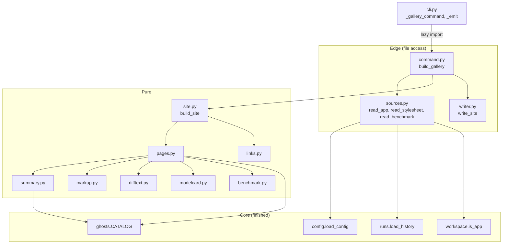
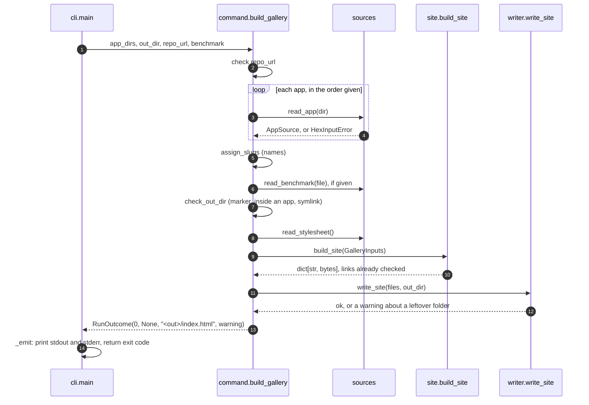

# Design Document: hexperiment-gallery

## Overview

`hexperiment gallery APP_DIR [APP_DIR ...] --out OUT_DIR` turns the recorded runs of one or more apps into a static website: a landing page with the haunted number, one case page per app, copies of the evidence files, and one stylesheet. It only reads the apps. The project publishes the gallery of its two example apps with a GitHub Pages workflow.

The design builds on the finished core and changes it in three places only:

- `cli.py` gets one subcommand, `gallery`, and a small helper `_emit` that prints a `RunOutcome` (the tail of `main` for the `run` command moves into it; behaviour does not change).
- `pyproject.toml` gets one `package-data` entry for the stylesheet.
- `tests/test_architecture.py` gets the rules of the new package (see "Dependency rules").

Everything else is new: the package `hexperiment/gallery/`, its tests, and `.github/workflows/pages.yml` (written by the owner). `hexperiment/__init__.py` does not change, `__all__` stays the same seven names, and nothing under `apps/` is touched.

The page design (colours, type, layout, motion, copy) is `.kiro/steering/gallery-design.md`. This document decides how to produce it, not how it looks, except where the steering file leaves a gap (see "Resolved questions" and "Open questions").

### Design principles

1. **Pure inside, writing at the edge.** One pure function turns inputs into `dict[str, bytes]` (relative path to file content). Only `sources.py`, `writer.py` and `command.py` touch the file system.
2. **Escaping cannot be forgotten.** HTML is built from a small builder in which every string is escaped unless it is explicitly marked as markup. The builder has no tag for scripts, so a script cannot be produced at all.
3. **Nothing is written until everything is known.** All inputs are read and every page is built in memory before the first byte is written. A refusal therefore writes nothing (Requirement 1.3), and a failure while writing leaves the previous gallery in place (Requirement 1.5).
4. **Same inputs, same bytes.** No clock, no random value, no absolute path and no set iteration reaches a page. Every text or file read from an app has `\r\n` and `\r` turned into `\n` before anything else looks at it (`newlines.py`), so a checkout with CRLF line endings, as Git writes it on Windows, gives the same bytes as one with LF (Requirement 4.4).
5. **Real evidence only.** Every number, status and ghost name on a page comes from a `Verdict`. The only text written by the gallery is fixed copy and sentences assembled from those values.
6. **No script.** The haunted number animates with CSS only.

### Key design decisions

| Decision | Choice | Reason |
|---|---|---|
| How `cli.py` reaches the gallery | `build_parser` adds the `gallery` subparser (no import). `main` calls `_gallery_command`, which imports `hexperiment.gallery.command` inside the function. | Other commands never load the gallery modules. A test checks that `cli.py` has no module-level import of the package (Requirement 4.5). |
| Return type of the command | `build_gallery(...)` returns a `RunOutcome` (`exit_code`, `status=None`, `stdout`, `stderr`) and never raises (except `KeyboardInterrupt`, `SystemExit`). | Same contract as `run_app`, so tests call it in process and `main` prints it exactly like a run. |
| Pure/edge split | `build_site(GalleryInputs) -> dict[str, bytes]` is pure. `write_site(files, out_dir)` is the only writer. | Requirement 4.4 and 8.1 are tested on the pure part without a file system. |
| HTML | `markup.py`: `Markup` wrapper, `el()` builder with a tag allowlist, escape on every `str`. | Requirement 4.1, 4.2. |
| Script | None. | The one animation is a CSS animation; Requirement 4.2 forbids a script in the pages, so a script file in `assets/` would be unused (Requirement 1.1 says "at most one"; Open question 22). |
| Stylesheet | `gallery/assets/gallery.css`, package data, read with `importlib.resources`, passed into the pure function as bytes. | It ships in the wheel (Requirement 1.1); the pure part stays free of file access. |
| Evidence copies | The bytes of `runs/<run_id>/verdict.json` and `model_card.md`, not a re-rendering, with `\r\n` and `\r` turned into `\n`. | They are the committed evidence. The conversion changes nothing in a file with LF endings (the committed files), and it makes the output independent of the checkout's line endings (Requirement 4.4). In JSON a raw line ending can only be white space between tokens, so the copy still parses to the same value (Open question 24). |
| Line endings | `newlines.normalize_text(str)` and `normalize_bytes(bytes)` are applied by every reader in `sources.py` and again by `diff_scripts`. | One rule in one pure module; the second application is a no-op and protects `diff_scripts` when it is called on its own (Requirement 4.4). |
| Deploy while private | The committed workflow skips the deploy job with `if: ${{ !github.event.repository.private }}`. | The build still runs and checks the gallery (Requirement 7.2). |
| Model card section | Built from the `Verdict`, with the number formats of `card.py`; a test compares the two. | Requirement 3.4. `card.py` has only private helpers, so reusing them would mean importing private names or changing a core module. |
| Swap on Windows | Two renames in a fixed order (old gallery aside, new gallery in), then delete the old one. | A folder cannot be renamed onto an existing one on Windows. |
| Workflow permissions | Workflow level `contents: read`; the deploy job adds `pages: write` and `id-token: write`. | Requirement 7.3: the build job gets no write permission. |

## Architecture

### Module layout

```text
hexperiment/
  pyproject.toml                         changed: package-data for the stylesheet
  src/hexperiment/
    cli.py                               changed: gallery subparser, _gallery_command, _emit
    gallery/
      __init__.py                        docstring only, no imports
      command.py                         edge: build_gallery(), the order of checks, exit codes
      sources.py                         edge: read_app(), read_stylesheet(), read_benchmark()
      newlines.py                        pure: normalize_text, normalize_bytes (CRLF and CR to LF)
      records.py                         pure: AppSource, Benchmark, GalleryInputs (frozen dataclasses)
      summary.py                         pure: slugify, assign_slugs, summarize_app, choose_hero
      markup.py                          pure: Markup, esc, el, prose, code, document
      pages.py                           pure: landing_page, case_page, the page shell, copy
      difftext.py                        pure: diff_scripts (difflib)
      modelcard.py                       pure: model_card_section
      benchmark.py                       pure: parse_benchmark, benchmark_section
      links.py                           pure: page_links, broken_links
      site.py                            pure: build_site
      writer.py                          edge: write_site, the marker check, the swap
      assets/gallery.css                 package data
  tests/
    gallery_builder.py                   helpers (like app_builder.py)
    test_gallery_newlines.py, test_gallery_markup.py, test_gallery_summary.py, test_gallery_diff.py,
    test_gallery_modelcard.py, test_gallery_benchmark.py, test_gallery_pages.py,
    test_gallery_site.py, test_gallery_writer.py, test_gallery_command.py,
    test_gallery_assets.py, test_gallery_examples.py, test_pages_workflow.py
.github/workflows/pages.yml              written by the owner (the builder cannot write .github/)
```

`gallery/__init__.py` imports nothing, so importing one gallery module does not load the others. The file names avoid the names in `test_architecture.PURE_FILES` (`card.py`, `models.py`, ...) except by intent: the card section is `modelcard.py`, not `card.py`.

### Dependency rules

Added to `tests/test_architecture.py` (the walk already finds new modules):

- `newlines.py`, `markup.py`, `pages.py`, `summary.py`, `difftext.py`, `modelcard.py`, `records.py`, `links.py`, `site.py` join `PURE_FILES`: none imports `os`, `pathlib`, `shutil`, `subprocess`, `tomllib`, `datetime`, and none calls `open`.
- `benchmark.py` is pure in behaviour (it reads no file and no clock) but imports `datetime` to parse `created_at` (`hexperiment-benchmark`, Requirement 4.1: ISO 8601 UTC), which the blunt `FORBIDDEN_IN_PURE` rule forbids. It stays out of `PURE_FILES`, with a comment in the test saying why.
- No gallery module imports `hexperiment.cli`, `pandas`, `sklearn`, `scipy` or `mcp`. `subprocess` stays with `canary.py`; no gallery module calls `print`.
- `cli.py` has no module-level import of `hexperiment.gallery` (checked on `tree.body`, so the function-level import passes).
- No module-level mutable variable (the existing rule): tables are tuples, `frozenset` or `MappingProxyType`.
- Every call to `markup.literal(...)` in the package has a string literal as its argument (checked with `ast`). This is the only way to turn a `str` into markup, so it cannot be fed data.

### Component diagram



### Sequence of a build



The first problem found ends the build with exit code `2`. Nothing is written before step 10.

## Components and Interfaces

Signatures are the contract; bodies are not specified. Public functions have type hints; results are frozen dataclasses.

### `cli.py`

```python
# build_parser(): new subparser
gallery = commands.add_parser("gallery", help="build a static website from the recorded runs of apps")
gallery.add_argument("app_dirs", nargs="+", metavar="APP_DIR", help="app folders with hex.toml, train.py and runs/")
gallery.add_argument("--out", required=True, metavar="OUT_DIR", help="folder to write the site into")
gallery.add_argument("--repo-url", metavar="URL", help="link to the source, shown on every page")
gallery.add_argument("--benchmark", metavar="FILE", help="benchmark results file (JSON)")

def _gallery_command(args: argparse.Namespace) -> int: ...
def _emit(outcome: RunOutcome) -> int: ...
```

`_gallery_command` imports `build_gallery` inside the function, calls it with `Path` arguments and returns `_emit(outcome)`. `_emit` prints `stdout` and `stderr` through `print_text` with failures suppressed and returns `outcome.exit_code`; `main` uses it for the `run` command too. A missing `--out`, no `APP_DIR`, or an unknown option is an `argparse` error with exit code `2`, as for the other commands.

Satisfies: 1.1, 1.2 (options), 4.5.

### `command.py` (edge)

```python
def build_gallery(
    app_dirs: Sequence[Path], out_dir: Path, *, repo_url: str | None, benchmark: Path | None
) -> RunOutcome: ...
def validate_repo_url(url: str) -> str: ...
def check_out_dir(out_dir: Path, app_dirs: Sequence[Path]) -> None: ...
```

`build_gallery` runs the steps of the sequence diagram in that order, so the first problem reported is the first in the list below. It catches `HexInputError` and `OSError` and returns `RunOutcome(2, None, "", "hexperiment: <message>")`; any other `Exception` becomes `hexperiment: internal error: <type>: <message>` and a traceback, as in `run_app`. On success `stdout` is `str(out_dir.resolve() / "index.html")`.

Order of checks: `repo_url` (if given); each app in the order given (`read_app`); slugs; the benchmark file; `OUT_DIR`; then the build and the write.

`validate_repo_url` accepts a string that `urllib.parse.urlsplit` reads as scheme `http` or `https` with a host, and that contains no whitespace, control character, `"`, `<` or `>`. It returns the string unchanged. Anything else (including `javascript:`) raises `HexInputError`. This is Requirement 1.8. `repo_link_label(url)` returns "Source on GitHub" when `urlsplit(url).hostname` is `github.com` and "Source code" otherwise; it lives in `pages.py` (pure) and `command.py` only validates.

`check_out_dir` raises `HexInputError` when:

1. `OUT_DIR` exists and is not a folder, is a symbolic link or a junction, or has no parent folder that exists (the build does not create folders outside `OUT_DIR`; Requirement 1.4);
2. the resolved `OUT_DIR` is an app folder, inside an app folder (Requirement 1.4), or contains an app folder (replacing it would delete the app; Requirement 1.4);
3. `OUT_DIR` exists, is not empty and has no marker file `.hexperiment-gallery` (Requirement 1.4).

Containment uses `Path.resolve()` and `Path.is_relative_to`, which compare case-insensitively on Windows.

The command takes no `app_lock` and never creates `.hex/`: it opens nothing in an app folder for writing (Requirement 1.6). It calls neither `run_app` nor `finalize_run`, so no test-set use is recorded.

Satisfies: 1.1 to 1.6.

### `sources.py` (edge)

```python
CONFIG_ERRORS = (HexInputError,)

def read_app(app_dir: Path) -> AppSource: ...
def read_stylesheet() -> bytes: ...
def read_benchmark(path: Path) -> Benchmark: ...
```

`read_app(app_dir)`:

1. `workspace.is_app(app_dir)`, else `HexInputError`: "`<dir>` is not an app folder: it needs hex.toml and train.py. Pass the folders that hold them, for example apps/churn."
2. `load_config(app_dir)` and `load_history(app_dir)`. Both already raise `HexInputError` that names the bad file. An empty history raises: "`<dir>` has no recorded run (runs/ holds no verdict.json). Run `hexperiment run <dir>` first, or leave this app out."
3. The last verdict is `history[-1]`; its file is `app_dir/runs/<run_id>/verdict.json`, read as bytes and passed through `normalize_bytes` to give `last_verdict_json`. The `run_id` is used in a path only after it matches `\d{8}-\d{6}-[0-9a-f]{6}` (the pattern in `runs.py`, copied here with a test that the two agree); `verdict.from_dict` does not check it, and a hostile `run_id` such as `..\..\x` must not make the gallery read, and publish, another file. A run folder that is missing raises `HexInputError` naming it.
4. The last approved run (status `APPROVED`, last in the history) gives `model_card.md` from its folder, read as bytes and passed through `normalize_bytes`. A missing file raises: "`<path>` is missing. Restore it from version control; the gallery does not write model cards."
5. If `app_dir/haunted/train.py` is a file, read it and `app_dir/train.py` as bytes, decode them as strict UTF-8 and pass the text through `normalize_text`, first of all, before the text is stored or compared (Requirement 4.4). Do not use `Path.read_text` for this: its newline handling depends on the platform and it hides what the code does. Invalid UTF-8 or an unreadable file raises `HexInputError` naming it. If `haunted/train.py` does not exist, both stay `None`.

`read_stylesheet` reads `importlib.resources.files("hexperiment.gallery") / "assets" / "gallery.css"` as bytes and turns `\r\n` into `\n` (a Windows checkout may have changed them, and the output must not depend on that). A missing resource raises `HexInputError` ("reinstall the package").

`read_benchmark` reads the file as UTF-8 (a leading BOM is accepted) and calls `benchmark.parse_benchmark(text, source=str(path))`. A file that is missing, unreadable or not UTF-8 raises `HexInputError` with the path.

Everything here only reads. The functions return data; none keeps state.

Satisfies: 1.3, 1.6, 3.1 (reads), 3.3, 3.4, 6.3.

### `newlines.py` (pure): one rule for line endings

```python
def normalize_text(text: str) -> str: ...      # "\r\n" then "\r" become "\n"
def normalize_bytes(data: bytes) -> bytes: ... # the same on bytes
```

`normalize_text` replaces `\r\n` by `\n` first and then every remaining `\r` by `\n` (the order matters: the other order would turn one CRLF into two line breaks). Nothing else is changed: no BOM handling, no stripping of trailing spaces, no change to `\x0b`, `\x0c`, `\x85`, `\u2028` or `\u2029`. Both functions are idempotent. They are the first operation every reader in `sources.py` applies to a script, a copied evidence file or the stylesheet, and `diff_scripts` applies `normalize_text` again to its two arguments, so a caller who forgot cannot get a diff in which every line differs (Requirement 4.4).

Satisfies: 4.4.

### `records.py` (pure)

```python
@dataclass(frozen=True, slots=True)
class AppSource:
    config: HexConfig                    # name, description, target, metric; app_dir is never rendered
    history: tuple[Verdict, ...]         # oldest first, never empty
    last_verdict_json: bytes             # runs/<last run>/verdict.json, LF line endings
    approved_card: bytes | None          # model_card.md of the last approved run, LF line endings
    train_py: str | None                 # LF line endings; None unless haunted_py is not None
    haunted_py: str | None               # LF line endings

@dataclass(frozen=True, slots=True)
class BenchmarkMechanism:
    leak_type: str                       # "L1.2"
    leak_type_name: str                  # the paper's name
    mechanism: str                       # one sentence
    designed_to_catch: tuple[str, ...]   # ghost names, empty when no check is designed for it
    scripts: int                         # at least 1
    rejected: int                        # 0 to scripts
    by_ghost: tuple[tuple[str, int], ...]  # sorted by count (descending), then name

@dataclass(frozen=True, slots=True)
class NotMeasured:
    leak_type: str
    leak_type_name: str
    reason: str

@dataclass(frozen=True, slots=True)
class Benchmark:
    created_at: str                      # as in the file
    day: str                             # YYYY-MM-DD, the UTC date of created_at
    hexperiment_version: str
    python_version: str
    scikit_learn_version: str
    source: str                          # the taxonomy citation
    mechanisms: tuple[BenchmarkMechanism, ...]   # file order
    clean_scripts: int
    false_alarms: int
    not_measured: tuple[NotMeasured, ...]        # file order

@dataclass(frozen=True, slots=True)
class GalleryInputs:
    apps: tuple[AppSource, ...]          # in the order given on the command line
    benchmark: Benchmark | None
    repo_url: str | None
    stylesheet: bytes
```

### `summary.py` (pure): slug, per-app summary, hero

```python
MARKER_FILENAME = ".hexperiment-gallery"
RESERVED_SLUGS = frozenset({"assets", "con", "prn", "aux", "nul", *com1..com9, *lpt1..lpt9})

def slugify(name: str) -> str: ...
def assign_slugs(labelled_names: Sequence[tuple[str, str]]) -> tuple[str, ...]: ...
def score_text(value: float | None) -> str: ...
def ghosts_found(history: Sequence[Verdict]) -> tuple[str, ...]: ...
def suspect_lines(finding: Finding) -> tuple[str, ...]: ...
def summarize_app(slug: str, source: AppSource) -> AppSummary: ...
def choose_hero(summaries: Sequence[AppSummary]) -> Hero | None: ...
```

**Slug rule (Requirement 1.7).** `slugify(name)` is `re.sub(r"[^a-z0-9]+", "-", name.lower()).strip("-")`. `assign_slugs` takes `(app_dir as given, name)` pairs and returns the slugs in the same order. It raises `HexInputError` when a slug is empty, is in `RESERVED_SLUGS`, or equals an earlier slug:

- "the name 'X' of the app in `<dir>` gives an empty case folder name. Use letters or digits in `[app] name` in hex.toml."
- "the name of the app in `<dir>` gives the case folder 'assets', which the site keeps for its stylesheet. Rename the app in hex.toml." (and the same wording for a Windows device name such as `con`, which cannot be a folder name; Requirement 1.7)
- "the apps in `<a>` and `<b>` both give the case folder 'x'. Give each app a different `[app] name` in hex.toml." This also covers two equal names (Requirement 1.3) and the same folder given twice.

**Score text.** `score_text(value)` is `f"{value:.4f}"`, or `"no score"` for `None` (a run that stopped on an input error has no metric value). Comparisons of scores (the hero rule) use `float(score_text(value))`, so a tie means a tie of the numbers a reader sees.

**Ghosts found.** `ghosts_found(history)` returns the distinct `ghost` names of all findings, any severity including waived, in the order of `ghosts.CATALOG` (a name that is not in the catalogue goes last, in alphabetical order). A waived ghost was found, and the case page marks it as waived.

**Suspect lines.** The canary finding keeps its location as `train.py`; the lines are only in its fix text (`... Suspect lines: train.py:100.`). `suspect_lines(finding)` returns the comma-separated items after `Suspect lines: ` up to the final full stop, or `()`. The hero sentence and the case page show them next to the location. This depends on the text of `canary.py`; a test builds the text with the same constant as `canary.py` where one exists and otherwise pins the format with the committed run of `hotel-cancellations` (Open question 5).

**Per-app summary.**

```python
@dataclass(frozen=True, slots=True)
class AppSummary:
    slug: str
    name: str
    description: str
    target_column: str
    metric_name: str
    threshold: float
    runs: tuple[Verdict, ...]
    first: Verdict
    last: Verdict
    first_rejected: Verdict | None       # first run with status REJECTED
    last_approved: Verdict | None        # last run with status APPROVED
    ghosts: tuple[str, ...]              # ghosts_found(runs)
```

`summarize_app(slug, source)` copies from `source.config` and `source.history`; it filters nothing and sorts nothing (the history is already in history order).

**Hero rule (Requirement 2.1, 2.6).**

```python
@dataclass(frozen=True, slots=True)
class Hero:
    app: AppSummary
    rejected: Verdict                    # the first REJECTED run of the app
    approved: Verdict | None             # the last APPROVED run of the app
```

`choose_hero(summaries)`:

1. A candidate is an app whose `first_rejected` exists and has a metric value (Requirement 2.6: a rejected run without a score is never chosen).
2. If there is no candidate, return `None`; the landing page then shows the motto and "No run has been rejected yet." (Requirement 2.6).
3. Otherwise the hero app is the candidate with the largest key `(score(first_rejected), drop, -index)`, where `score` is `float(score_text(value))`, `drop` is `score(first_rejected) - score(last_approved)` rounded the same way, or `-inf` for an app without an approved run, and `index` is the position in the order given. Larger `score` wins; on a tie the larger `drop`; on a tie the app given first. The hero has `approved=None` when the chosen app has no approved run, and the page then says "No approved run yet." instead of showing an honest score (Requirement 2.6: the app is the one chosen by the rule of 2.1, also when no app has an approved run; then every `drop` is `-inf`, so the highest first rejected score wins and a tie goes to the app given first).

The function is a plain `max` over a list in the order given; no set or dictionary order is involved.

Satisfies: 1.7, 2.1, 2.2, 2.6.

### `markup.py` (pure): HTML that cannot forget to escape

```python
@dataclass(frozen=True, slots=True)
class Markup:
    html: str                            # already safe; no __add__, no __str__ that hides it

type Child = str | Markup | Iterable[Child] | None
type Attr = str | bool | None

def esc(text: str) -> Markup: ...
def literal(html: str) -> Markup: ...      # trusted constant; only called with a string literal
def el(tag: str, *children: Child, **attrs: Attr) -> Markup: ...
def prose(text: str) -> Markup: ...        # esc + `code` spans
def code(text: str) -> Markup: ...         # <code>escaped</code>
def spaced(*parts: Child) -> Markup: ...   # children separated by one space
def document(root: Markup) -> bytes: ...   # "<!doctype html>\n" + root, UTF-8, "\n" newlines
```

- **Escaping.** In `el`, every child that is a `str` goes through `esc`; a `Markup` is inserted as is; a list or generator is flattened; `None` is skipped; any other type (an `int`, a `float`) raises `TypeError`, so a number is formatted on purpose (`score_text`, an f-string) before it can reach a page. `esc` is `html.escape(text, quote=True)` after replacing characters that cannot occur in HTML text with U+FFFD: C0 controls other than tab and line feed, DEL, and lone surrogates (a JSON string may contain `"\ud800"`, which would fail at the UTF-8 encoding and which an HTML parser would turn into a replacement character anyway). Requirement 4.1.
- **Tags.** `el` accepts only the tags in an allowlist (`html head meta title link body header nav main footer section div h1 h2 h3 p a ol ul li dl dt dd table caption thead tbody tfoot tr th td code em span time`) and writes `meta`, `link` and `br` as void elements. `script`, `style`, `iframe`, `object`, `embed`, `form` and `img` are not in the list, so they raise `ValueError`.
- **Attributes.** `class_`, `data_value` and `aria_label` become `class`, `data-value` and `aria-label`. A name must match `[a-z][a-z0-9-]*`. Names that start with `on`, and `style` and `srcdoc`, raise `ValueError` (Requirement 4.2). A `str` value is escaped with `quote=True`; `True` writes the bare attribute; `False` and `None` omit it. For `href` and `src` the value must be a relative reference (no scheme, not starting with `//`), or start with `http://` or `https://`; anything else (`javascript:`, `data:`) raises `ValueError`. Attributes are written in the order given.
- **Code spans.** `prose(text)` first escapes the whole text, then replaces every `` `([^`\n]+)` `` in the escaped string by `<code>\1</code>`. Backticks and the entities that `html.escape` writes cannot overlap, so only escaped text is ever wrapped, and the function adds nothing but the two tags. A backtick that has no partner stays a backtick. `` `<script>` `` gives `<code>&lt;script&gt;</code>`. `prose` is used for the catalogue texts (Requirement 2.4) and for finding messages, fix hints and waiver reasons; names, descriptions and column names use `esc` or `code`.
- **Layout of the output.** `el` writes `<tag attrs>` + children + `</tag>`, and a block-level tag (`html head body header nav main footer section div h1 h2 h3 p ol ul li dl dt dd table caption thead tbody tfoot tr th td title meta link`) is followed by one `\n`. Inline tags (`a code em span time`) add no whitespace, so the text inside them is exactly the text given. Words that must be separated are joined with `spaced`.
- **`literal`.** The only way to build a `Markup` from a `str`. The architecture test requires its argument to be a string literal, so no data can reach it.

If a build ever raised from `el` (a tag, attribute or URL that is refused), that is a bug in the gallery, not bad input: it ends as an internal error with exit code `2`.

Satisfies: 4.1, 4.2, 2.4 (code spans).

### `pages.py` (pure): the pages

> Superseded in part by "Redesign of the pages" below, which lists the parts it replaces.

```python
FONTS_URL = (
    "https://fonts.googleapis.com/css2?family=Spectral:ital,wght@0,200;0,400;0,600;1,400"
    "&family=IBM+Plex+Mono:wght@400;500&display=swap"
)

def landing_page(summaries: Sequence[AppSummary], hero: Hero | None,
                 benchmark: Benchmark | None, repo_url: str | None) -> Markup: ...
def case_page(summary: AppSummary, source: AppSource, repo_url: str | None) -> Markup: ...
def hero_sentence(hero: Hero) -> Markup: ...
def page_shell(*, title: str, body: Markup, path: str, repo_url: str | None) -> Markup: ...
def relative_href(from_path: str, to_path: str) -> str: ...
def repo_link_label(repo_url: str) -> str: ...
def status_mark(status: str) -> Markup: ...
```

**Shell.** `page_shell` writes, for every page: `<html lang="en">`; `<head>` with `<meta charset="utf-8">` first, the viewport meta, `<title>`, the Google Fonts `<link rel="stylesheet" href="FONTS_URL">` (the `&` becomes `&amp;` through the builder), then `<link rel="stylesheet" href="<relative>assets/gallery.css">`; `<body>` with the skip link (`<a class="skip" href="#main">Skip to main content</a>`) as the first element, `<header>` (the site name as a link to the landing page, and, only when `repo_url` is given, the repository link labelled by `repo_link_label(repo_url)`: "Source on GitHub" or "Source code", Requirement 1.8), `<main id="main" tabindex="-1">`, and `<footer>` (the same repository link when given, and "Released under the MIT licence."). No `preconnect` hints: the stylesheet is the only external reference (Requirement 4.2). The title is `Hexperiment: audited model runs` for the landing page and `Hexperiment: <app name>` for a case page, so titles differ (Requirement 5.2).

**Links.** Every internal link is built with `relative_href(from_path, to_path)` = `posixpath.relpath(to_path, start=posixpath.dirname(from_path) or ".")`, with both arguments being keys of the file mapping (`index.html`, `hotel-cancellations/index.html`, `assets/gallery.css`). A page therefore links to files by their path, never to a folder, and works from a sub-path and from `file://` (Requirement 4.3).

**Landing page** (Requirement 2; structure of the steering file). Sections in this order:

1. *Hero.* With a `Hero`:

   ```html
   <section class="hero" aria-labelledby="motto">
     <p class="haunted" data-value="1.0000">1.0000</p>
     <p class="lede">hotel-cancellations scored ROC AUC 1.0000 on its first rejected run. The audit found
        <em class="ghost">The Possession</em> at <code>reservation_status</code> and
        <em class="ghost">The Peeking Spirit</em> at <code>train.py</code> (suspect lines <code>train.py:100</code>).
        Its honest score is</p>
     <p class="honest">0.9096</p>
     <h1 id="motto">If your model looks too good to be true, it's haunted.</h1>
   </section>
   ```

   `hero_sentence(hero)` writes: `<name> scored <metric label> <score> on its first rejected run.`, then `The audit found <phrase>, <phrase> and <phrase>.` from the *error* findings of `hero.rejected` in verdict order (a phrase is the ghost name in `<em class="ghost">`, or the check name when there is no ghost, then ` at ` and the location in `<code>`, then ` (suspect lines <code>...</code>)` when `suspect_lines` finds some); with no error finding it writes `The audit rejected it.`; then `Its honest score is`, followed by the paragraph `honest` with `score_text(hero.approved.metric.value)`. Without an approved run the lede ends with `No approved run yet.` and there is no `honest` paragraph (Requirement 2.6). The metric label is `ROC AUC` for `roc_auc` and the metric name otherwise. The text is built only from the verdict, so a hostile finding location is escaped like any other text.

   **Plain-language version (Requirements 2.8 and 2.9, added by the owner on 2026-11-12; it replaces the wording above).** The readers who decide in a few seconds are often developers who do not work in machine learning, so the hero must not depend on knowing what ROC AUC is or what a ghost name means.

   - `METRIC_RANGE` (a `MappingProxyType` in `pages.py`): `{"roc_auc": "0.5 is guessing and 1.0 is perfect"}`. A metric without an entry gets no range clause.
   - `GHOST_GLOSS` (a `MappingProxyType` in `pages.py`), at most eight words each: The Doppelganger "the same rows in training and test"; The Possession "a column that gives the answer away"; The Peeking Spirit "training that saw the test rows"; The Prophet "training rows from after the test period"; The Shapeshifter "results that change between identical runs". A test checks that every `ghosts.CATALOG` entry with a ghost name has a gloss of at most eight words, so a new ghost cannot ship without one. A ghost name without a gloss (not in the catalogue) is shown without one.
   - `hero_sentence(hero)` writes: `On its first run, <name> scored <score> on ROC AUC, where 0.5 is guessing and 1.0 is perfect.` (`On run <n>,` when the first rejected run is not the first run; `on <metric label>` and no range clause for a metric without an entry), then `The audit found <phrase>, <phrase> and <phrase>.`, where a phrase is the ghost name in `<em class="ghost">`, then `, <gloss>,` when it has one, then ` at <code>location</code>` and the suspect lines as before; then `With the leaks removed, its honest score is`, followed by the `honest` paragraph. The rest (no error finding, no approved run) is unchanged.
   - `EXPLAINER` (a constant in `pages.py`, reviewed by the owner), a `<p class="explain">` directly after the `h1` motto, 70 words: "A data leak is information a model should not have had while it learned: the rows it is graded on, data from the future, or the answer itself. A leaky model is like a unit test that reads its expected value from the code it tests: it passes every time and proves nothing. Hexperiment finds the leak before anyone trusts the score, even when an AI agent wrote the code." It is shown in every version of the hero, including the one without a `Hero`.

   The `haunted` paragraph is real text. Its `data-value` attribute repeats the figure for the CSS pseudo-element (see "The stylesheet"). Without a `Hero` (no scored rejected run in any app) the section holds only the `h1` and the paragraph "No run has been rejected yet." (Requirement 2.6).

   The `h1` is the motto, so the page has one `h1` and the hero figure is not a heading (Requirement 2.7).

2. *Cases.* `<h2>` with the count in words ("One case", "Two cases", ..., digits above nine) and an unnumbered `<ul class="cases">` with one `<li>` per app in the order given (the cases are not a sequence, so no `ol`; steering, landing page). Each item: `<h3>` with the name; the description; a `<p>` with status mark, status word and "on its first run"; the ghosts found as `<em class="ghost">` names separated by commas, or "No ghost found"; "from `<first score>` to `<last score>`"; the status of the last run; "`N` recorded runs"; and the link "Read the case" to `<slug>/index.html`. The status of each run is written with `status_mark(status)` (see "The stylesheet"). The CSS places two items side by side from 768px with a single vertical rule (Requirement 2.2).
3. *How the check works.* `<h2>` and an `<ol>` of three steps, at most 80 words in total with the heading ("Train normally and keep what the model learned." / "Train again with the test rows scrambled at load time." / "Compare the two. In a script without leakage nothing the model learned depends on the test rows, so nothing moves."). Requirement 2.3.
4. *Benchmark* when `benchmark` is not `None`: `benchmark_section(benchmark, ghost_names)` with the ghost names of `ghosts.CATALOG` (see `benchmark.py`). Requirement 2.5.
5. *The ghosts.* `<h2>` and a `<dl>`: for each `ghosts.CATALOG` entry whose `ghost` is not `None` (in catalogue order), a `<dt>` with the name in `<em class="ghost">` and a `<dd>` with three paragraphs through `prose`: the meaning, "Why it matters: ...", "How to fix it: ..." (Requirement 2.4).
6. *How it was built.* `<h2>` and one fixed paragraph: the project was written against Kiro specs; hooks run the checks on save; a workflow repeats fix and re-check until the verdict is `APPROVED`; the kit ships as a Kiro power. The text is a constant in `pages.py`, reviewed by the owner (the claims must be true of the repository on the day it is published).

**Case page** (Requirement 3). The file is `<slug>/index.html`; its links are `../index.html` ("All cases"), `../assets/gallery.css`, `verdict.json` and `model_card.md`. Sections:

1. Back link, `<h1>` with the name, the description (when not empty), and a fact line: ``target `is_canceled`, metric roc_auc, threshold 0.8500, 4 recorded runs`` (target in `<code>`; Requirement 3.1).
2. *The record.* `<h2>` and `<ol class="record">`, one `<li>` per run in history order. The run number is the list's own marker (`li::marker` is styled), so it is read once and survives without CSS. Each `<li>`:

   ```html
   <li class="run">
     <p class="run-head"><span class="status status-rejected"><span class="mark" aria-hidden="true"></span>REJECTED</span>, full check, score 1.0000</p>
     <p class="run-meta"><time datetime="2026-11-11T19:50:51Z">2026-11-11 19:50:51 UTC</time>, test set used 1 time</p>
     <ul class="findings">
       <li class="finding finding-error">
         <p><em class="ghost">The Possession</em> error at <code>reservation_status</code></p>
         <p>reservation_status alone predicts the target with AUC 1.0000</p>
         <p>Fix: check whether this column is recorded after the outcome; if so, drop it</p>
       </li>
     </ul>
   </li>
   ```

   The status word is the value of the verdict (`REJECTED`, `APPROVED`, `UNVERIFIED`); the mark is a decorative `span` hidden from assistive technology because the word next to it says the same (steering, Status mark). `status_mark(status)` writes `<span class="status status-rejected"><span class="mark" aria-hidden="true"></span>REJECTED</span>` for the three values, and the word is the value as the verdict writes it (no `text-transform`, no capitals added by the CSS). `time` is the verdict's `created_at`: if it matches `YYYY-MM-DDTHH:MM:SSZ` it is shown as `YYYY-MM-DD HH:MM:SS UTC`, otherwise as written; no `datetime` module is needed. The score is `score_text`. A finding shows the ghost name, or the check name when there is none; its severity word (`error`, `warning`, `waived`); the location in `<code>`; the message and the fix through `prose`; for a waived finding also `Waiver reason: ...`. Findings are listed errors first, then waived, then warnings (a stable sort of the verdict's own order); warnings get the class `finding-warning`, set in Faded cyan (Requirement 3.2). A run with no findings shows "No findings." *(Colour names here are from the first design; the redesign replaces them, see "Redesign of the pages (2026-11-12)".)*
3. *The fix* (only with a haunted script; Requirement 3.3): `<h2>`, a sentence "<code>haunted/train.py</code> against <code>train.py</code> (the honest script kept in the repository): N lines removed, M lines added." and the diff (see `difftext.py`). Identical scripts give "The two scripts are identical."
4. *Model card of the last approved run* (Requirement 3.4): from `modelcard.model_card_section`, or the sentence "No approved run yet." when there is none.
5. *Raw files:* `<h2>` and a `<ul>` with links to `verdict.json` (always) and `model_card.md` (only with an approved run) (Requirement 3.5).

Satisfies: 2.1 to 2.6, 3.1 to 3.5, 5.1, 5.2.

### `difftext.py` (pure)

```python
@dataclass(frozen=True, slots=True)
class DiffLine:
    old_no: int | None
    new_no: int | None
    text: str

@dataclass(frozen=True, slots=True)
class Context:  lines: tuple[DiffLine, ...]
@dataclass(frozen=True, slots=True)
class Change:   removed: tuple[DiffLine, ...]; added: tuple[DiffLine, ...]
@dataclass(frozen=True, slots=True)
class Gap:      hidden: int

@dataclass(frozen=True, slots=True)
class ScriptDiff:
    blocks: tuple[Context | Change | Gap, ...]
    removed: int
    added: int

def diff_scripts(old: str, new: str, *, context: int = 3) -> ScriptDiff: ...
def diff_markup(diff: ScriptDiff, *, old_name: str, new_name: str) -> Markup: ...
```

`diff_scripts` first applies `normalize_text` to both texts (so a `train.py` with CRLF line endings gives the same diff as the same file with LF, and the lines of the diff never end in `\r`; Requirement 4.4). It then splits each text into lines on `\n` only (not with `str.splitlines`, which also splits on `\x0b`, `\x0c`, `\x85` and `\u2028`; one trailing newline does not add an empty line), runs `difflib.SequenceMatcher(None, old, new, autojunk=False)` (`autojunk=False` so that a script longer than 200 lines is compared the same way as a short one) and walks `get_grouped_opcodes(context)`. Line numbers start at 1. An `equal` opcode becomes a `Context`; `replace`, `delete` and `insert` become one `Change` that holds the removed lines and the added lines of that opcode, so a replaced block keeps its pair together. Between groups, and before the first and after the last, the number of unchanged lines that are not shown becomes a `Gap`. Two equal texts give no blocks.

`diff_markup` writes one structure, in unified order:

```html
<div class="diff" role="region" aria-label="Code diff: haunted/train.py against train.py" tabindex="0">
  <div class="gap">12 unchanged lines</div>
  <div class="context"><div class="line"><span class="no">99</span><span class="no">101</span><span class="sign"> </span><code>x = 1</code></div></div>
  <div class="change">
    <div class="removed">
      <div class="line line-removed"><span class="no">100</span><span class="sign">-</span><code>scaler.fit(df)</code></div>
    </div>
    <div class="added">
      <div class="line line-added"><span class="no">102</span><span class="sign">+</span><code>scaler.fit(train)</code></div>
    </div>
  </div>
</div>
```

Below 1024px the blocks stack: removed lines, then added lines (the unified view). From 1024px `.change` is a two-column grid, `.removed` in the left column and `.added` in the right, and `.context` spans both columns. The content is written once, so a screen reader reads it once, in unified order; only the CSS decides the layout. Lines do not wrap (`white-space: pre`), so the n-th removed line and the n-th added line of a block sit in the same row. The `sign` is real text (`-`, `+`), so it reads in greyscale (Requirement 3.3); the Lantern or Verdigris bar is a border of `.line-removed` and `.line-added`. The `role="region"`, the label and `tabindex="0"` make the box that scrolls (Requirement 5.3) reachable by keyboard. Each `text` goes through `esc` (inside `code`), so a script line such as `<script>alert(1)</script>` is text (Requirement 4.1).

Satisfies: 3.3, 4.1, 5.3.

### `modelcard.py` (pure)

```python
def model_card_section(verdict: Verdict, *, card_href: str) -> Markup: ...
```

Shows, from the `Verdict` of the last approved run only (Requirement 3.4): status, mode, run id and date, version; the metric value against its threshold and the result; the split (`data_path`, `test_fraction`, `seed`, `time_column` or "none"); the data summary (training and test rows with positive rates, and the time ranges when the verdict has them); the checks as a table (check, ghost, outcome); the waivers as a table with their reasons, or "No waivers applied."; the test-set uses; and a link to `model_card.md`. Key and value pairs are a `<dl>`; tables are wrapped in `<div class="scroll" role="region" tabindex="0" aria-label="...">` so they scroll inside their own box.

The number formats are those of `card.py`: positive rates `f"{x:.1%}"`, metric and threshold `f"{x:.4f}"`, counts as plain integers. `card.py` keeps its helpers private and the gallery does not import them; `test_gallery_modelcard.py` renders the same verdict with `card.render` and checks that every formatted value of the section also appears in the card text, so a change of format in one place fails the test. The section does not list findings (the case page shows them per run) or the run history.

Satisfies: 3.4.

### `benchmark.py` (pure)

The file format is `hexperiment-benchmark`, Requirement 4 (`format` `"hexperiment-benchmark/1"`). The gallery validates every key that Requirement 6.2 shows and ignores the others (`statuses`, `by_ghost` of `clean`, the other keys of `environment`).

```python
BENCHMARK_FORMAT = "hexperiment-benchmark/1"

def parse_benchmark(text: str, *, source: str) -> Benchmark: ...
def run_count(benchmark: Benchmark) -> int: ...          # sum of mechanism scripts + clean scripts
def percent(part: int, whole: int) -> str: ...           # f"{100 * part / whole:.1f}%"
def benchmark_section(benchmark: Benchmark, ghost_names: frozenset[str]) -> Markup: ...
```

`ghost_names` is the set of ghost names of `ghosts.CATALOG`, passed in by `pages.py`: a name in the set is set as a ghost (`<em class="ghost">`), any other name (a check name such as `canary` or `split_order`) as plain text.

`parse_benchmark` uses `json.loads(text, parse_constant=...)` where `parse_constant` rejects `NaN` and `Infinity`. It raises `HexInputError(problem, fix)` for the **first** problem, in the order of the table below. Every problem starts with `source` (the file as the user gave it), then a colon, then the key path and what is wrong: `<source>: mechanisms[2].rejected must be an integer from 0 to 12 (the value of scripts), not 13`. Key paths use `.` for keys and `[i]` for the zero-based position in a list. An "integer" is a JSON integer: a boolean, a number with a fraction (`3.0`) or a string is not one (the check is `type(value) is int`).

The required keys of an object are checked in the order written in the table, and the first missing one is reported before any wrong value in the same object. The gallery shows `leak_type`, `leak_type_name`, `mechanism`, `designed_to_catch`, `scripts`, `rejected` and `by_ghost` of each mechanism, `scripts` and `false_alarms` of `clean`, `leak_type`, `leak_type_name` and `reason` of each `not_measured` item, `created_at`, `source`, and `hexperiment`, `python` and `scikit-learn` of `environment` (the names of `hexperiment-benchmark`, Requirement 4.1; Open question 23).

| # | Problem (after `<source>: `) | Fix |
|---|---|---|
| 1 | the file is not valid JSON (`<message>`, line `L`, column `C`); also for `NaN` and `Infinity` | Write the file as JSON, or regenerate it with the benchmark runner. |
| 2 | the top level must be a JSON object, not `<type>` | Same as 1. |
| 3 | `format` is missing | Regenerate the file with the benchmark runner of this version. |
| 4 | `format` is `<value>`, but this gallery reads "hexperiment-benchmark/1" | Regenerate the file with the matching version, or build the gallery with the version that wrote it. |
| 5 | `complete` is missing or is not true or false | Regenerate the file with the benchmark runner. |
| 6 | `complete` is false: the file was written with `--only` and covers some mechanisms only | Run the full benchmark without `--only` and pass that results file. |
| 7 | `<key>` is missing, for the first missing of `created_at`, `environment`, `source`, `mechanisms`, `clean`, `not_measured` | Add the key, or regenerate the file. |
| 8 | `created_at` must be an ISO 8601 time in UTC (`2026-11-11T19:50:51Z` or ending in `+00:00`), not `<value>` | Write the time of the benchmark run in UTC. |
| 9 | `environment` must be an object; `environment.<key>` is missing or is not a non-empty string, for `hexperiment`, `python`, `scikit-learn` | Write the versions that ran the benchmark, for example "0.1.0". |
| 10 | `source` must be a non-empty string | Write the taxonomy citation. |
| 11 | `mechanisms` must be a non-empty list | Regenerate the file; a benchmark without mechanisms shows nothing. |
| 12 | `mechanisms[i]` must be an object; `mechanisms[i].<key>` is missing, for `leak_type`, `leak_type_name`, `mechanism`, `designed_to_catch`, `scripts`, `rejected`, `by_ghost` | Add the key, or regenerate the file. |
| 13 | `mechanisms[i].leak_type`, `.leak_type_name` and `.mechanism` must be non-empty strings | Write the leakage type ID, its name and the mechanism sentence. |
| 14 | `mechanisms[i].designed_to_catch` must be a list of non-empty strings (the list may be empty) | List the ghost names, or an empty list when no check is designed for it. |
| 15 | `mechanisms[i].scripts` must be an integer of at least 1 | A rate needs at least one script. |
| 16 | `mechanisms[i].rejected` must be an integer from 0 to `N` (the value of scripts) | Count only the scripts the run rejected. |
| 17 | `mechanisms[i].by_ghost` must be an object whose values are integers from 1 to `R` (the value of rejected); `mechanisms[i].by_ghost.<name>` is the first wrong one | List only ghosts that rejected at least one script. |
| 18 | `clean` must be an object; `clean.<key>` is missing, for `scripts`, `false_alarms` | Add the key, or regenerate the file. |
| 19 | `clean.scripts` must be an integer of at least 1 | A rate needs at least one clean script. |
| 20 | `clean.false_alarms` must be an integer from 0 to `N` (the value of clean.scripts) | Count only clean scripts that were rejected. |
| 21 | `not_measured` must be a list (it may be empty); `not_measured[i]` must be an object; `not_measured[i].<key>` is missing or is not a non-empty string, for `leak_type`, `leak_type_name`, `reason` | Write the ID, name and reason of each type that was not measured. |

An unreadable file (missing, not UTF-8) is reported by `read_benchmark` before row 1, with the path. A leading byte order mark is accepted. `NaN` is refused by `parse_constant`, which makes row 1 report it. Unknown keys are ignored. A `by_ghost` count may add up to more than `rejected` (one script can be rejected by two ghosts). `created_at` is checked with `datetime.fromisoformat` and must be timezone-aware with offset zero; its UTC date becomes `Benchmark.day`.

`benchmark_section(benchmark, ghost_names)` writes `<section aria-labelledby="benchmark">` with `<h2 id="benchmark">Benchmark</h2>`, one sentence ("Each leaky script was run through `hexperiment run`; its clean twin is the same script with the leak removed."), then a paragraph with the totals (Requirement 6.2: "30 of 39 leaky scripts rejected; 0 false alarms in 39 clean twins.", summed from the file), then a paragraph with the fixed caveat "The data is synthetic and the cases were written by the authors of the checks, so this shows that the checks see the leaks they were built for, not how often they find leaks in real projects.", and the table in `<div class="scroll" role="region" tabindex="0" aria-label="Benchmark results">`:

- A `<caption>`: "Leaky scripts rejected, by leakage type and mechanism".
- Header cells (`scope="col"`): Leakage type, Mechanism, Designed to catch, Rejected, Rejected by.
- The mechanisms are grouped by `leak_type` in the order in which each type first appears in the file, and keep file order inside a group. Each group is one `<tbody>`. The first row of a group starts with `<th scope="rowgroup" rowspan="N">` holding the type as `L1.2 Pre-processing on training and test set` (ID and the paper's name); the other rows of the group have no first cell. No other cell is a `th`.
- Per row: the mechanism sentence (`esc`); the ghosts designed to catch it (names in `ghost_names` as `<em class="ghost">`, others as plain text, separated by ", ") or the words "No check is designed for it"; "rejected `N` of `M` (`P`)" with `P = percent(rejected, scripts)`; and the names that rejected it with their counts, as `Name (count)` separated by ", ", sorted by count (largest first) and then name, or "none" when `by_ghost` is empty.
- A last `<tbody>` with one row for the clean twins: `<th scope="row" colspan="3">Clean twins</th>` and one `<td colspan="2">` with "`N` false alarm(s) in `M` scripts (`P`)" ("1 false alarm" in the singular).

Below the table, in this order: if `not_measured` is not empty, `<h3>Not measured</h3>` and a `<ul>` with one item per type, "`L3.3` Sampling bias in test distribution: `reason`" (ID, name and reason as text); `<p>` "Leakage types follow `source`."; `<p>` "Measured with hexperiment `V`, Python `P` and scikit-learn `S` on `YYYY-MM-DD`, in `R` runs." with `R = run_count(benchmark)`: every leaky and every clean script is one full run (Open question 23). All values go through `esc`, so a hostile `mechanism` or `reason` is text. The section contains no number that is not in the file or computed from it with the rules above.

Satisfies: 6.1, 6.2, 6.3.

### `links.py` and `site.py` (pure)

```python
def page_links(html_text: str) -> tuple[tuple[str, str], ...]: ...   # (attribute, value) of every href and src
def broken_links(files: Mapping[str, bytes], repo_url: str | None) -> tuple[str, ...]: ...

MARKER_TEXT = "Built by hexperiment gallery. The next build replaces this folder.\n"
def build_site(inputs: GalleryInputs) -> dict[str, bytes]: ...
```

`build_site`:

1. `slugs = assign_slugs(...)` over the names of the apps (the labels in the error are the names, because the pure part has no folders; `command.py` has already called `assign_slugs` with folder labels, so this second call cannot fail in practice and exists so that the pure function is safe on its own).
2. `summaries = [summarize_app(slug, source) ...]`, `hero = choose_hero(summaries)`.
3. Files, inserted in this order: `.hexperiment-gallery` (`MARKER_TEXT`), `assets/gallery.css` (`inputs.stylesheet`), `index.html`, then for each app `<slug>/index.html`, `<slug>/verdict.json` (`last_verdict_json`) and, with an approved run, `<slug>/model_card.md` (`approved_card`). Pages are `markup.document(...)` bytes.
4. `broken_links(files, repo_url)` parses every `.html` file with `html.parser`; every `href` and `src` must be a fragment that names an `id` on the same page, a reference that resolves (`posixpath.normpath` of the page's folder plus the reference, no `..` at the start) to a key of `files`, or an absolute URL that equals `FONTS_URL` or starts with `repo_url`. Anything else is a bug: `build_site` raises `RuntimeError` naming the first broken link, which ends the build as an internal error with nothing written (Requirement 4.3). The tests do not trust this function; they check links again with their own parser (see "Testing Strategy").

The mapping is returned in that insertion order, but nothing depends on it: the writer sorts paths. The output has no time and no absolute path: the only inputs that become text are the verdicts, the configs, the scripts, the benchmark and the repository URL (Requirement 4.4).

Satisfies: 1.1, 4.3, 4.4.

### `writer.py` (edge): marker check and the swap

```python
def write_site(files: Mapping[str, bytes], out_dir: Path) -> str: ...   # returns a warning, or ""
```

`write_site` runs after `check_out_dir`. It re-checks that every key of `files` is a relative POSIX path without `..`, a drive or a leading `/` (a defence; a bad key is a bug and raises `ValueError`). Names for the temporary folders are siblings of `OUT_DIR`, hidden, with a random token: `NEW = <parent>/.<name>.new-<token>` and `OLD = <parent>/.<name>.old-<token>`, `token = secrets.token_hex(3)`, repeated until neither exists.

Steps:

| Step | Action | Notes |
|---|---|---|
| W1 | Create `NEW`; write every file (`Path.write_bytes`, sorted by path, parents created) | Bytes are written as they are, so Windows does not change line endings. |
| W2 | If `OUT_DIR` exists and is empty: `os.rmdir(OUT_DIR)`. If it exists and has the marker: `os.rename(OUT_DIR, OLD)`. If it does not exist: nothing. | After W2 there is no `OUT_DIR`. |
| W3 | `os.rename(NEW, OUT_DIR)` | The destination does not exist, so this works on Windows. |
| W4 | `shutil.rmtree(OLD)` if W2 made one | Errors are ignored; they become the warning. |

W2 and W3 retry a `PermissionError` up to 5 times, 0.2 seconds apart (the pattern of `runs.clear_app_verdict`): on Windows an editor, a terminal whose working folder is inside the gallery, or a virus scanner can hold a handle. After the last attempt the error is raised.

**Failure inside the process** (an exception, also `KeyboardInterrupt`; each case ends with the previous gallery in place, Requirement 1.5):

- W1 or W2 fails: `NEW` is removed (best effort); `OUT_DIR` was not changed, or was only an empty folder that is gone. The error is reported.
- W3 fails after W2 moved the old gallery aside: `os.rename(OLD, OUT_DIR)` puts it back, then `NEW` is removed. If the restore also fails, the message names `OLD` and `NEW` so that the user can finish by hand.
- W4 fails: not an error. The command exits `0` and `stderr` holds "hexperiment: warning: could not remove the old gallery folder `<OLD>`; delete it by hand."

**What is left if the process is stopped from outside** (power loss, `kill -9`; nothing runs any more):

| Stopped | `OUT_DIR` | Leftovers |
|---|---|---|
| during W1, or after W1 and before W2 | the previous gallery, unchanged (or absent if it never existed) | `NEW`, partial or complete |
| after the rename of W2 and before W3 | **missing** | `OLD` = the previous gallery, whole; `NEW` = the new gallery, whole |
| after W3 and before the end of W4 | the new gallery | `OLD` = the previous gallery, whole or partly deleted |

In the second case nothing is lost: renaming either folder to `OUT_DIR` finishes the job, and running the command again builds a fresh gallery because `OUT_DIR` is then absent. The command never deletes a leftover folder of an earlier run: they are outside `OUT_DIR`, and the rule of Requirement 1.4 is that nothing outside `OUT_DIR` is deleted (the build's own `NEW` and `OLD` of the current run are the exception that Requirement 1.5 itself creates). Every leftover starts with `.` and ends in `.new-<token>` or `.old-<token>`, so it is easy to recognise.

Satisfies: 1.4, 1.5.

### The stylesheet and the haunted number

> Superseded by "Stylesheet" in "Redesign of the pages" below. Kept as the record of the first design.

`gallery/assets/gallery.css` is written by hand against the tokens of the steering file. It needs this entry in `pyproject.toml`, next to the existing one:

```toml
[tool.setuptools.package-data]
hexperiment = ["templates/**/*"]
"hexperiment.gallery" = ["assets/*.css"]
```

`gallery` is a package (it has `__init__.py`), so `packages.find` includes it and the pattern applies to it. A test (like the one for `templates/`) reads `pyproject.toml` and checks that the pattern matches `assets/gallery.css`, because an editable install would hide a missing entry. The CI workflow installs the package non-editably, which checks it again on the real wheel contents.

Structure of the file: `:root` custom properties for the six colours and the spacing steps; base (`html`, `body`, links, focus: `:focus-visible { outline: 2px solid var(--paper); outline-offset: 2px }`); the skip link (off-screen until focused); header, `main`, footer (one column, `max-width: 72rem`, 16px gutter, 32px from 768px); headings; the cases list; the record (`ol.record` with a 1px Faded cyan left rule on Deep print, `li::marker` in Faded cyan); status marks; findings; tables and `.scroll`; `.diff`; `.haunted`; `@media (min-width: 768px)`; `@media (min-width: 1024px)`; `@media (prefers-reduced-motion: no-preference)`. It contains exactly the six hex colours, no gradient, no shadow, no `transition`, no `@import` and no `url()` to another origin. Font stacks: `Spectral, Georgia, "Times New Roman", serif` and `"IBM Plex Mono", ui-monospace, Consolas, monospace`; figures use `font-variant-numeric: tabular-nums lining-nums`.

**The haunted number, CSS only.**

```css
.haunted {
  position: relative;
  display: inline-block;
  margin: 0;
  font-size: clamp(5rem, 18vw, 12rem);
  font-weight: 200;
  line-height: 1;
  font-variant-numeric: tabular-nums lining-nums;
  color: var(--paper);
}
.haunted::after {
  content: attr(data-value);
  content: attr(data-value) / "";      /* empty alternative text: not read by screen readers */
  position: absolute;
  inset: 0;
  transform: translate(0.06em, -0.09em); /* rises up and right: never reads as a drop shadow */
  filter: blur(1px);
  opacity: 0.25;                         /* Paper at 25%, the only use of opacity */
  pointer-events: none;
}
@media (prefers-reduced-motion: no-preference) {
  .haunted::after { animation: drift 1.6s ease-out 0.3s both; }
  @keyframes drift { from { transform: translate(0, 0); } to { transform: translate(0.06em, -0.09em); } }
}
```

The figure is real text in the page. The ghost copy is a pseudo-element, so it is not part of the document; the second `content` declaration (with the empty alternative) keeps browsers that expose generated content from reading it twice, and the first declaration is the fallback for those that do not understand it. The base rule places the ghost at its offset, so without the media query (reduced motion, or an old browser) it is shown at rest, with no movement. The animation runs once because `animation-iteration-count` is 1, and it starts after load because the stylesheet loads before first paint. The class `haunted` is used only on the landing page. The honest score has its own class `honest`, at about a third of the size, with a Verdigris rule and no pseudo-element.

**Status marks.** `.mark` is an inline block of `0.7em` by `0.7em` before the status word, in the order of the steering file: `.status-rejected .mark` is a filled Lantern square with `border-radius: 4px`; `.status-approved .mark` is a filled Verdigris circle (`border-radius: 50%`); `.status-unverified` sets the word in Faded cyan and its mark is a hollow circle with a `1px dashed` Faded cyan border (UNVERIFIED has no colour of its own). The mark carries no meaning alone: it is `aria-hidden` and the word is always written. **Code and line numbers.** `code`, `.diff` (including the `.no` line numbers), file paths and column names use IBM Plex Mono; scores, counts and times use Spectral with tabular figures (steering, Type). *(Superseded: the colour tokens and fonts in this paragraph are from the first design; the redesign uses the tokens and the self-hosted fonts of "Redesign of the pages (2026-11-12)".)*

Layout rules that tests cannot see (the side-by-side diff, the vertical rule between cases, the 360px layout) are checked by the owner in a browser once; the tests check that the rules exist (see "Testing Strategy").

Satisfies: 1.1, 5.1 to 5.4.

### `.github/workflows/pages.yml`

The owner wrote this file and it is committed; the builder cannot write `.github/` and does not change it. This section describes it as it is. The YAML below is a copy of the committed file with the comments left out and the action SHAs shortened (`<40 hex>`); the file itself has full 40-character SHAs.

```yaml
name: pages

on:
  push:
    branches: [main]
  workflow_dispatch:

permissions:
  contents: read

concurrency:
  group: pages
  cancel-in-progress: false

jobs:
  build:
    runs-on: ubuntu-latest
    steps:
      - uses: actions/checkout@<40 hex> # v7.0.1
        with:
          persist-credentials: false
      - uses: actions/setup-python@<40 hex> # v7.1.0
        with:
          python-version: "3.13"
          cache: pip
          cache-dependency-path: hexperiment/pyproject.toml
      - name: Install the package
        run: python -m pip install ./hexperiment
      - name: Build the gallery
        env:
          REPO_URL: ${{ github.server_url }}/${{ github.repository }}
        run: >-
          hexperiment gallery apps/hotel-cancellations apps/flight-delays
          --out site --repo-url "$REPO_URL"
      - uses: actions/upload-pages-artifact@<40 hex> # v5.0.0
        with:
          path: site

  deploy:
    if: ${{ !github.event.repository.private }}
    needs: build
    runs-on: ubuntu-latest
    permissions:
      pages: write
      id-token: write
    environment:
      name: github-pages
      url: ${{ steps.deployment.outputs.page_url }}
    steps:
      - id: deployment
        uses: actions/deploy-pages@<40 hex> # v5.0.1
```

- **Jobs and permissions (Requirement 7.3).** The workflow asks for `contents: read` only; `build` has no `permissions` key of its own and so inherits it. `deploy` adds `pages: write` and `id-token: write` for itself. The file therefore holds exactly the three permission keys, and the two write permissions appear only inside `deploy`.
- **Private repository (Requirement 7.2).** `deploy` has `if: ${{ !github.event.repository.private }}`, so while the repository is private the job is skipped, not failed, and `build` still runs: the gallery is built, and its refusals and internal errors show up, without being published. `deploy` needs `build`, so it never runs on a failed build.
- **Credentials.** `actions/checkout` runs with `persist-credentials: false`: no later step needs the token, so it is not left in `.git/config`.
- **Folded command.** The build command is a `run: >-` block: YAML folds the two lines into one line with a single space and no trailing newline, giving `hexperiment gallery apps/hotel-cancellations apps/flight-delays --out site --repo-url "$REPO_URL"`. The workflow test (see "Testing Strategy") reads the lines of the block and joins them with one space in the same way, because the command is split over two lines of the file.
- **Install.** `pip install ./hexperiment` is not an editable install, so the build also proves that the stylesheet ships in the package. It installs `pandas`, `numpy` and `scikit-learn` (the package's runtime dependencies), about a minute with the pip cache.
- **No secret, no data (Requirement 7.1).** The committed `runs/` folders, `hex.toml`, `train.py` and `haunted/train.py` are all that the gallery reads. `data/` and `.hex/` are not committed and not needed.
- **Repository URL.** From the `github` context, passed through an environment variable and quoted, so the shell never sees it unquoted. The URL passes `validate_repo_url` (Requirement 1.8) because `github.server_url` is `https://github.com`.
- **Pinned actions (Requirement 7.3).** Every `uses:` line is `owner/name@<40 hex>` followed by `# vX.Y.Z`.
- **Benchmark flag.** The committed file does not pass `--benchmark`. Requirement 7.1 adds `--benchmark hexperiment/benchmark/results.json` once that file is committed; that edit is an owner step (tasks, owner task). Until then the workflow test accepts the command without the flag, and it fails when `hexperiment/benchmark/results.json` exists but the flag is missing, so the owner cannot forget it.
- **`configure-pages` is not used.** All links are relative, so the base URL it provides is not needed.
- **Hidden files.** The marker file is a dot-file; the Pages artifact step may leave it out. It is not needed on the host.

Satisfies: 7.1, 7.2, 7.3.

## Redesign of the pages (2026-11-12)

The owner rejected the first look (the cyanotype case file) and approved a new one after a design review: the moonlit night of `.kiro/steering/gallery-design.md`. This section is the design for it. It supersedes, in "`pages.py`", `FONTS_URL` and the font link of the shell, the landing page, the head and record markup of the case page, `METRIC_RANGE`, `GHOST_GLOSS`, `EXPLAINER`, `hero_sentence`, `CHECK_STEPS` and `HOW_IT_WAS_BUILT`; and all of "The stylesheet and the haunted number". Everything else (records, sources, the summary rules, markup, difftext, the model card's content, benchmark, links, site, writer, command) stays as designed above, with the changes listed here.

### The reference pages are normative

`.kiro/specs/hexperiment-gallery/mockups/landing.html` and `mockups/case.html` are the approved pages. The built pages follow them for element structure, class names, ARIA attributes, SVG art and CSS. Their text is example data from the two committed apps: the builder writes every data part from the verdicts as below, never the numbers of the reference. Where the built page must differ from the reference, the list "Departures from the reference" says so; anything else that differs is a defect.

### Decisions

| Decision | Choice | Reason |
|---|---|---|
| Fonts | Self-hosted latin `woff2` of Special Elite and Archivo, with their licences, in `gallery/assets/fonts/`, copied to `assets/fonts/` in the site. | No request to another origin (Requirement 4.2); the owner approved downloading them. Both licences (Apache 2.0, SIL OFL 1.1) allow redistribution with the licence file. |
| Font bytes | `sources.read_fonts()` reads them; `GalleryInputs.fonts` carries them into the pure `build_site`. | Same pattern as the stylesheet: the pure part stays free of file access. |
| Art | Inline SVG as `literal("""...""")` constants in a new pure module `art.py`. | `literal()` only accepts string literals (architecture test), so app data can never reach the art. No `img` tag and no image files. |
| SVG tags | A second set `markup.ART_TAGS`. `el()` still refuses them; only `art.py` constants contain them. The site test allows `TAGS | ART_TAGS`. | The allowlist keeps protecting everything built from data. |
| Bold text | Add `strong` to `markup.TAGS` (inline). The reference's `<b>` becomes `<strong>`. | Semantic emphasis for the definition's first clause. |
| Scroll-linked motion | CSS scroll-driven animations inside `@supports (animation-timeline: view())`, no script. | Requirement 4.2 forbids scripts; unsupported browsers show the end state (Requirement 5.5). |
| Order of work | Fonts and art, then the stylesheet, then the landing page, then the case page. | Each step ends with the whole suite green. The stylesheet test's class check needs a short-lived list of old classes (see the tasks). |
| Screenshot of Kiro | Not in the gallery. | `img` stays out of the allowlist; the video shows Kiro. |

### Departures from the reference

1. **Fonts.** No Google Fonts `<link>`. The head holds `<meta charset="utf-8">`, the viewport meta, `<title>`, and `<link rel="stylesheet" href="<relative>assets/gallery.css">` only.
2. **Skip link.** The first child of `<body>` on both pages is `<a class="skip" href="#content">Skip to content</a>`. Its target, with `id="content"` and `tabindex="-1"`, is the element that holds the page's `h1`: on the landing page `<div class="wrap hero-main">`, on the case page the `<div class="wrap">` of the head section. The case page's `<main>` has no `id` and no `tabindex`. The skip link is off-screen until focused; `[tabindex="-1"]:focus { outline: none; }`.
3. **Ids of the landing screens.** The `section` ids are `leak`, `how`, `ghosts`, `cases`, `benchmark-page`, `kiro`, `loop` and `end`, and their `h2` ids are `leak-title`, `how-title`, `ghosts-title`, `cases-title`, `kiro-title`, `loop-title` and `end-title` (the benchmark `h2` keeps `id="benchmark"` from `benchmark_section`). The first screen is `<header class="page hero" id="top" aria-labelledby="question">` and its `h1` has `id="question"`. No CSS uses these ids.
4. **Links.** Every `href="#"` of the reference becomes a real link: see the screens below. The repository link appears only with `--repo-url`, labelled by `repo_link_label`.
5. **Benchmark screen.** Only with `--benchmark`: `<section class="page" id="benchmark-page" aria-labelledby="benchmark"><div class="wrap">` + `benchmark_section(...)` unchanged + `</div></section>`. The reference's placeholder heading and paragraph are not built.
6. **Model card.** Built by `modelcard.py` with its current content, regrouped (see "Case page").
7. **Diff.** Built by `difftext.py` unchanged. The stylesheet shows it unified at every width: inside `.change`, `.removed` sits above `.added`.
8. **Apostrophes.** Page copy uses U+2019, as the reference does. `MOTTO` becomes "If your model looks too good to be true, it’s haunted."

### `art.py` (pure, new)

Each constant is `NAME = literal("""...""")`, copied character for character from the reference. Imports: `literal` from `markup`, nothing else.

| Constant | Source in the reference |
|---|---|
| `SPRITE` | `<svg class="sprite" width="0" height="0" aria-hidden="true">` with the symbols `bat`, `ghost`, `tree`, `stone` (identical in both references). |
| `LANDSCAPE` | `landing.html`: the `<svg class="scene" ...>` of the first screen. |
| `GHOST_RISE` | `landing.html`: the `<span class="ghost-wrap" aria-hidden="true">...</span>` inside the claimed score. |
| `LEAK_FIGURE` | `landing.html`: the `<div class="figure">...</div>` of the problem screen (`role="img"` and its `aria-label`). |
| `ROWS_TRAIN`, `ROWS_SCRAMBLED`, `ROWS_CHANGED` | `landing.html`: the three `<div class="rows" aria-hidden="true">...</div>` of the canary steps, in order. |
| `PEEK` | `landing.html`: the `<svg class="peek" ...>` of the ghost screen. |
| `GRAVEYARD_LANDING` | `landing.html`: the `<svg class="graveyard" ...>` of the end screen (with two bats). |
| `CORNER_MOON` | `case.html`: the `<svg class="corner" ...>` of the head. |
| `GRAVEYARD_CASE` | `case.html`: the `<svg class="graveyard" ...>` (no bats). |

`markup.ART_TAGS = frozenset("svg defs symbol use g path rect circle ellipse line lineargradient stop pattern text i".split())`: the lower-case names `html.parser` reports for the tags in `art.py`.

### Fonts plumbing

- Package data: `gallery/assets/fonts/` holds `special-elite-latin.woff2`, `archivo-latin.woff2`, `LICENSE-SpecialElite.txt` and `OFL-Archivo.txt` (already committed). `pyproject.toml`: `"hexperiment.gallery" = ["assets/*.css", "assets/fonts/*"]`.
- `sources.read_fonts() -> tuple[tuple[str, bytes], ...]`: every file of `assets/fonts/` (through `importlib.resources`), sorted by file name, as `(file name, bytes)`. `.woff2` bytes are returned as they are; `.txt` bytes go through `normalize_bytes`. A missing folder, or a folder without a `.woff2` file, raises `HexInputError` with the same message shape as a missing stylesheet ("the fonts are missing from the install (...)", "Reinstall the package: pip install --force-reinstall hexperiment.").
- `records.GalleryInputs` gets `fonts: tuple[tuple[str, bytes], ...] = ()` as its last field, so existing test helpers keep working.
- `site.build_site` writes each font as `assets/fonts/<file name>`. `command._build` passes `fonts=read_fonts()`.
- `gallery.css` starts with two `@font-face` rules: `font-family: "Special Elite"; src: url("fonts/special-elite-latin.woff2") format("woff2"); font-weight: 400; font-style: normal; font-display: swap;` and `font-family: "Archivo"; src: url("fonts/archivo-latin.woff2") format("woff2"); font-weight: 100 900; font-style: normal; font-display: swap;`. The URLs are relative to `assets/gallery.css`.

### Shell (`page_shell`)

As before (`lang="en"`, the head of departure 1, distinct titles), with: the skip link of departure 2, then `art.SPRITE`, then the page body given by the caller. The shell no longer writes its own `<header>`, `<main>` or `<footer>`: each page writes them, because the reference places them differently on the two pages. `FONTS_URL` is removed.

### Landing page

Body, in this order (copy is fixed unless it names data):

1. **First screen** `<header class="page hero" id="top" aria-labelledby="question">`:
   - `art.LANDSCAPE`.
   - `<div class="wrap hero-nav"><div class="site-head"><a class="wordmark" href="#top">Hexperiment</a><nav aria-label="Site"><a href="#how">How it works</a>[repo link]</nav></div></div>`.
   - `<div class="wrap hero-main" id="content" tabindex="-1"><div class="hero-copy">` + `<h1 id="question">Is your model too good to be&nbsp;true?</h1>` (a U+00A0 between "be" and "true?") + `<p class="def"><strong>Hexperiment is a Kiro power that catches data leaks in <span class="nowrap">machine-learning</span> code:</strong> test answers that sneak into training and fake a high score. Kiro’s agent then fixes them.</p>` + `<a class="cta" href="<hero case page>">Open the case file</a>` + `</div></div>`. Without a hero app the call-to-action links to `#cases`.
   - `<div class="wrap hero-trail">` + the trail + `</div>`. With a hero app, `<ol class="trail">` with, joined by `<li class="dash" aria-hidden="true"></li>`:
     - `<li><span class="n o">{score}{art.GHOST_RISE}</span><p class="l">the score {app} claimed on its first run</p></li>` (`on run {n}` when the first rejected run is run n > 1 of the history);
     - only with canary counts: `<li><span class="n">{rows_changed:,}</span><p class="l">of {train_rows:,} training rows changed when we scrambled only the test rows</p></li>`;
     - with an approved run: `<li><span class="n g">{score}</span><p class="l">the honest score once the leaks were removed</p></li>`; without: `<li><p class="l">No approved run yet.</p></li>`.

     Without a hero app: `<p class="l">No run has been rejected yet.</p>` in place of the `ol`. Scores are `score_text`; counts use Python's `f"{n:,}"`.
2. `<main>`, holding the screens 3 to 9 (the end screen included).
3. **Problem** `<section class="page" id="leak" aria-labelledby="leak-title"><div class="wrap two">`: a `div` with `<h2 id="leak-title">A leak makes a broken model look perfect.</h2>` and the two `p.lede` of the reference, word for word; then `art.LEAK_FIGURE`.
4. **Canary** `<section class="page" id="how" aria-labelledby="how-title"><div class="wrap">`: the `h2` and `p.lede` of the reference, then `<ol class="steps">` with the three `li` of the reference (each: `h3`, `p`, the rows constant, `p.rows-key`). Step 3's `p` is "If any training row changed, the test rows leaked into training." followed, only with canary counts, by " In {app}, {rows_changed:,} of {train_rows:,} changed."
5. **Ghosts** `<section class="page" id="ghosts" aria-labelledby="ghosts-title">`: `<div class="wrap">` with `<h2 id="ghosts-title">{Count} ghosts it hunts.</h2>` (count of catalogue entries with a ghost name, in words through `_COUNT_WORDS`), the `p.lede` of the reference, and `<dl class="ghosts">` with one `<div class="ghost-entry"><dt>{name}</dt><dd>{GHOST_LINE[name]}</dd></div>` per catalogue entry with a ghost name, in catalogue order; then `art.PEEK` after the `div.wrap`. `GHOST_LINE` is a `MappingProxyType` in `pages.py` with the five sentences of the reference, looked up as `GHOST_LINE[name]`. The test that every catalogue ghost has a line keeps a new ghost without one from shipping.
6. **Cases** `<section class="page" id="cases" aria-labelledby="cases-title"><div class="wrap">`:
   - `<h2 id="cases-title">` with "{Count} haunted apps, caught and fixed." when every app has a `REJECTED` run followed later in its history by an `APPROVED` run, else "{Count} cases." (one app: "One haunted app, caught and fixed." / "One case.").
   - `<p class="lede">Every number here comes from a recorded run. Open a case file to see each run and every finding.</p>`
   - `<ul class="cases">`, one `<li class="case">` per app in the order given: `<div><h3>{name}</h3><p class="desc">{description}</p><p class="found">{found}</p></div>` (no `p.desc` when the description is empty), where `found` is "Found <em>A</em>, <em>B</em> and <em>C</em>. {N} recorded runs." or "No ghost found. {N} recorded runs." ("1 recorded run"); then `<div class="pair">` with two score blocks joined by `<span class="to" aria-hidden="true">→</span>`, each `<div><span class="v {o|g|u}">{score or "no score"}</span><span class="k">{first|last} run, {status in lower case}</span></div>` (`o` rejected, `g` approved, `u` unverified); then `<a href="{slug}/index.html" aria-label="Open the case file: {name}">Open the case file</a>`.
   - `<p class="note">The honest score is lower. That is the point: it is an honest estimate of how the model will do on new data.</p>`, only when every app has a scored first rejected run and a scored last approved run whose shown score (`score_text`) is lower.
7. **Benchmark**, only with `--benchmark`: departure 5.
8. **Kiro** `<section class="page" id="kiro" aria-labelledby="kiro-title"><div class="wrap">`: the `h2`, `p.lede` and `dl.kiro` of the reference, word for word.
9. **Loop** `<section class="page" id="loop" aria-labelledby="loop-title"><div class="wrap">`: the `h2`, `p.lede` (with `<code>/workflow run exorcise</code>`) and `ol.steps.loop-steps` of the reference, word for word.
10. **End** `<section class="page end" id="end" aria-labelledby="end-title">`: `<div class="wrap"><h2 id="end-title">{MOTTO}</h2><p class="lede">Open a case file to see every recorded run, or read the source.</p><div class="links"><a class="cta" href="...">Open the case file</a>[repo link]</div></div>` (without `--repo-url` the lede is "Open a case file to see every recorded run."; the call-to-action is the one of the first screen), then `art.GRAVEYARD_LANDING`, then `<footer class="site-foot"><div class="wrap">Released under the MIT licence.</div></footer>`. Then `</main>`.

The fixed copy (the problem paragraphs, the canary lede and steps, the ghost lede, `GHOST_LINE`, the Kiro and loop texts) are constants in `pages.py`, copied from the reference. `_COUNT_WORDS`, `_joined`, `status_mark`, `relative_href` and `repo_link_label` are reused.

`summary.canary_counts(verdict: Verdict) -> tuple[int, int] | None` (pure, new): the `(rows_changed, train_rows)` of the first finding of the verdict whose `check` is `canary` and whose evidence holds both keys as `int` (not `bool`) with `rows_changed > 0` and `train_rows > 0`; `None` otherwise. The trail and step 3 use it on the hero's first rejected run.

### Case page

Body:

1. `<main>`.
2. **Head** `<section class="page case-head" aria-labelledby="case-title">`:
   - `<header class="site-head"><div class="wrap"><a class="wordmark" href="../index.html">Hexperiment</a><nav aria-label="Site"><a href="../index.html#cases">All cases</a>[repo link]</nav></div></header>`.
   - `art.CORNER_MOON`.
   - `<div class="wrap" id="content" tabindex="-1">`: `<h1 id="case-title">{name}</h1>`, `<p class="desc">{description}</p>` (left out when empty), `<div class="scores">` with the first and last run as `<div><span class="v {o|g|u}">{score or "no score"}</span><span class="k">{first|last} run, {status_mark(status)}</span></div>` joined by `<span class="dash" aria-hidden="true"></span>`, and `<dl class="facts">` with `target` (in `code`), `metric`, `threshold` (`score_text`) and `recorded runs`, each as `<div><dt>..</dt><dd>..</dd></div>`.
3. **Record** `<section class="page" aria-labelledby="record-title"><div class="wrap">`: `<h2 id="record-title">Every recorded run</h2>`, `<p class="lede">Oldest first. An error stops a model; a warning is worth a look.</p>`, `<ol class="record">` with one `<li class="run"><div>...</div></li>` per run in history order:
   - `<p class="run-head">{status_mark}, {full|fast} check, score <span class="score">{score}</span></p>`, or `, no score` without a score;
   - `<p class="run-meta">{time element}, test set used {n} time|times</p>`;
   - only when the run folder holds `note.txt` (Requirement 3.8): `<p class="run-note">{escaped note}</p>`;
   - `<ul class="findings">` (errors, then waived, then warnings, as before), each `<li class="finding finding-{error|waived|warning}">` with `<p class="what">{<em>ghost</em> or check name} at <code>{location}</code><span class="sev">{error|waived|warning}</span></p>`, `<p class="msg">{prose(message)}</p>`, `<p class="fix">Fix: {prose(fix)}</p>`, and for a waived finding `<p class="waiver">Waiver reason: {prose(reason)}</p>`; or `<p class="clear">No findings.</p>`.
4. **The fix**, only with a haunted script: `<section class="page" aria-labelledby="fix-title"><div class="wrap">` + `<h2 id="fix-title">The fix</h2>` + `<p class="lede">` with the existing sentence + the diff from `difftext.py`.
5. **Model card** `<section class="page" aria-labelledby="card-title"><div class="wrap">`: `<h2 id="card-title">Model card of the last approved run</h2>`, then the model card section, or `<p>No approved run yet.</p>`; then `<p class="raw">Raw files: <a href="verdict.json">verdict.json</a> and <a href="model_card.md">model_card.md</a>.</p>` (only `verdict.json` without an approved run: "Raw files: <a>verdict.json</a>."). This replaces the old "Raw files" heading and list.
6. `</main>`, then `<div class="end">` + `art.GRAVEYARD_CASE` + `<footer class="site-foot"><div class="wrap"><p class="motto">{MOTTO}</p><span><a href="../index.html#cases">All cases</a>. Released under the MIT licence.</span></div></footer>` + `</div>`.

`modelcard.py`: the content and order stay; the wrapper becomes `<div class="card">` (was `model-card`) and each `h3` with the content that follows it is wrapped in `<div class="card-group">`; the groups holding a table (Checks, Waivers) get `class="card-group wide"`. The final paragraph linking `model_card.md` is removed from the section, because the raw-files line of the case page links it.

### Stylesheet

`gallery/assets/gallery.css` is rewritten: the two `@font-face` rules, then the reference CSS of `landing.html` and `case.html` merged into one file (shared rules once; rules that the two pages define differently scoped under `.hero`, `.case-head` or the screen's class so neither page changes), then the rules the references do not show:

- `.skip` (off-screen until `:focus`, then shown top left on `--night` with `--bone` text) and `[tabindex="-1"]:focus { outline: none; }`;
- `strong` in `.def` (the reference's `.def b` rule);
- `.v.u` and `.n.u` in `--muted`; `.status-unverified` word in `--muted` with a hollow `1px dashed var(--dash)` circle mark;
- `.finding-waived` like a warning, and `p.waiver`;
- the diff as `difftext.py` builds it: `.diff` on `--well`, `overflow-x: auto`, `.line`, `.no`, `.sign`, `.gap` as in the reference, `.line-removed` text in `--orange-soft`, `.line-added` text in `--lime-soft`, `.context`, `.change`, `.removed`, `.added` as plain blocks (unified at every width);
- the model card: `.card` as a grid of `.card-group` (auto-fit columns of at least 14rem), `.card-group.wide` spanning all columns, `h3` in `--muted`, `dl` as two columns;
- `.scroll` (`overflow-x: auto`) and tables (`th` and `td` with hairline `--rule` borders, tabular figures), which also styles the benchmark table;
- `p.raw` and `p.clear` in `--muted`.

Rules for the whole file (the tests check them): the hex colours are exactly the twelve tokens of the steering file (`#23153A #0B0612 #1A0F2A #EDE6F5 #D2C8E1 #BDB2CF #7A6893 #8A5CCB #FF8A1F #FFC08A #A6FF4D #C9FF94`), and the only other colour is `rgba(237, 230, 245, 0.16)`; no `gradient`, `box-shadow`, `text-shadow`, `transition`, `@import` or `text-transform`; `url(` only as `url("fonts/<file>")` naming a file of `assets/fonts/`; every `animation` declaration and `scroll-behavior: smooth` sits inside `@media (prefers-reduced-motion: no-preference)`; every `animation-timeline` and `view-timeline` sits inside `@supports (animation-timeline: view())`; the two on-load animations end by 5 seconds (`.ghost-wrap`: 1.4 s after 0.9 s; `.ghost-rise`: 2 × 1.3 s after 2.3 s) and no `animation` outside the `@supports` block uses `infinite`; `scroll-snap-type` sits inside `@media (min-width: 861px) and (min-height: 600px)`; `:focus-visible` has `outline: 3px solid var(--lime)` and `outline-offset: 3px`.

### Tests

- `test_gallery_art.py` (new): every constant of `art.py` parses with `html.parser` with balanced tags; uses only `ART_TAGS` and `TAGS`; has no `on*` attribute, no `style` attribute and no `<script`; every `href` is one of `#bat`, `#ghost`, `#tree`, `#stone`; every `url(` is `url(#sky)` or `url(#fence)`; every `svg` has `aria-hidden="true"` except the one in `LEAK_FIGURE`, which has `role="img"` and a non-empty `aria-label`; `SPRITE` defines exactly the four symbols.
- `test_gallery_markup.py`: `el("svg")` and `el("i")` are refused; `strong` is allowed; `ART_TAGS` and `TAGS` do not overlap.
- `test_gallery_sources.py`: `read_fonts` returns the four files sorted by name; the `woff2` bytes start with `b"wOF2"`; the `.txt` bytes have no `\r`; a missing fonts folder raises `HexInputError` (patch the package location as the stylesheet test does).
- `test_gallery_site.py`: the allowlist test uses `TAGS | ART_TAGS`; the fonts given in `GalleryInputs` are written under `assets/fonts/` byte for byte; no page has an `href` or `src` starting with `http` other than the repository link, and none names `fonts.googleapis.com`.
- `test_gallery_command.py`: a real build writes `assets/fonts/special-elite-latin.woff2` and `assets/fonts/archivo-latin.woff2`.
- `test_gallery_assets.py` (rewritten): the package-data patterns (`assets/*.css`, `assets/fonts/*`) and the four font files; every rule of "Stylesheet" above; the contrast of `--bone`, `--soft`, `--muted`, `--orange`, `--orange-soft`, `--lime` and `--lime-soft` on `--sky` and on `--well` is at least 4.5 (WCAG formula from the hex values); every class used by a built site has a rule (or is listed as structural in the test).
- `test_gallery_summary.py`: `canary_counts` for evidence with both counts; missing key; `bool` or `float` or string value; zero `rows_changed`; a non-canary finding with the same keys; the first matching finding wins.
- `test_gallery_pages.py`: the tests of the old hero sentence, explainer, glosses, check steps and how-it-was-built text are removed. New tests, one per rule of "Landing page" and "Case page" above: screen order and ids; one `h1` per page with the right text; the definition; the call-to-action target with and without a hero app; the trail with three numbers, with two (no canary counts), with "No approved run yet.", "on run 2", and the no-hero text; thousands separators; step 3 with and without counts; one ghost entry per catalogue ghost with its line, and every catalogue ghost has a `GHOST_LINE` entry (and no extra keys); both case headings and the one-app forms; the note shown and hidden; the found text with ghosts, without, and "1 recorded run"; the score classes `o`, `g`, `u` and "no score"; the case link's `aria-label`; the benchmark screen only with a benchmark; the repository link only with a URL (navigation and end screen); the skip link is the first element of `body` and its target exists; the case head scores and facts; the run head with "full check", "fast check" and ", no score"; the run meta with "1 time" and "2 times"; the finding paragraphs, the waived finding with its reason; "No findings."; the raw-files line with and without an approved run; the model card groups; a hostile app name is escaped in the `h3`, the trail label, step 3 and the `aria-label`.
- `test_gallery_modelcard.py`: the groups and the `wide` class; the section no longer links `model_card.md`.

Satisfies: 1.1, 2.1 to 2.11, 3.1 to 3.7, 4.2, 5.1 to 5.5.

## Data Flow

Inputs: app folders (`hex.toml`, `train.py`, `haunted/train.py`, `runs/*/verdict.json`, `runs/<last>/verdict.json`, `runs/<last approved>/model_card.md`), the stylesheet resource, the optional benchmark file, two optional strings. Outputs: the mapping of relative paths to bytes, then the folder.

```text
AppSource[]  ──► summarize_app ──► AppSummary[] ──► choose_hero ──► Hero
                                         │                           │
                                         ▼                           ▼
                                   case_page(s)                 landing_page
                                         │                           │
                                         └──────► files dict ◄───────┘
                                                      │ broken_links
                                                      ▼
                                              write_site (W1..W4)
```

## Error Handling

Every message starts with `hexperiment: ` (added by `build_gallery`) and holds the problem and the fix in one line. Exit code `2` for all of them; exit code `0` otherwise. No refusal writes anything.

| Situation | Where | Message (problem; fix) |
|---|---|---|
| `APP_DIR` is not an app folder | `read_app` | `<dir> is not an app folder: it needs hex.toml and train.py.` Pass the folders that hold them. |
| `hex.toml` invalid | `load_config` | The message of the core (names the file and the key). |
| App has no recorded run | `read_app` | `<dir> has no recorded run.` Run `hexperiment run <dir>` first, or leave the app out. |
| A history file is damaged | `load_history` | The message of the core (names the file). |
| Run id is not a run id; run folder or `model_card.md` missing | `read_app` | Names the file; restore it from version control. |
| `haunted/train.py` or `train.py` not UTF-8 | `read_app` | Names the file; save it as UTF-8. |
| Empty, reserved or repeated case folder name | `assign_slugs` | Names the apps; give each app a different `[app] name`. |
| `--benchmark` file unreadable or wrong | `read_benchmark`, `parse_benchmark` | The first problem of the table in `benchmark.py`. |
| `--repo-url` is not an http or https URL | `validate_repo_url` | `--repo-url <value> is not an http or https URL.` Pass a full address such as https://github.com/owner/repo. |
| `OUT_DIR` not empty and no marker | `check_out_dir` | `<out> exists, is not empty and was not built by hexperiment gallery (it has no .hexperiment-gallery file).` Choose an empty or new folder, or delete it yourself if you are sure. |
| `OUT_DIR` inside an app folder, or holds one | `check_out_dir` | `--out <out> is inside / holds the app folder <app>.` Choose a folder outside the apps, for example site. |
| `OUT_DIR` is a file, a link, or has no parent folder | `check_out_dir` | Names the problem; create the parent first or choose another folder. |
| Stylesheet missing from the install | `read_stylesheet` | Reinstall the package. |
| The folder is in use (Windows handle) | `write_site` | `<out> could not be replaced (<reason>). Close the program that uses it and run again.` The previous gallery is unchanged. |
| Old gallery folder could not be deleted | `write_site` | Exit `0`; warning on standard error, names the folder. |
| A bug (a refused tag, a broken link, a bad key) | any | `internal error: <type>: <message>` and a traceback, exit `2`; nothing written. |
| Bad command line | `argparse` | Usage message, exit `2`. |

## Testing Strategy

Commands as in `tech.md`. Tests mirror the modules. **Everything runs in process**: pure functions are called with dataclasses built in the test, apps are small folders under `tmp_path`, and the command is called as `build_gallery(...)` or `cli.main(["gallery", ...])` with `capsys` (the pattern of `test_cli.py`). No run of `train.py` takes place. **One new Python process is added**: the import-isolation test, which needs a fresh interpreter (Requirement 8.3: building a gallery loads none of `sklearn`, `scipy`, `mcp`). It writes a one-run app with `gallery_builder.write_app` in the test, then starts one interpreter that calls `build_gallery` on it and prints the loaded module names; it reuses the existing `loaded_after` helper of `test_architecture.py` if that helper can run a snippet, and otherwise uses `subprocess` in the test file (allowed outside the package). The interpreter start costs about 2 seconds with pandas imported. All other tests run in process. With about 330 small tests at a few milliseconds each, the gallery adds roughly 10 seconds to the suite, under the 2-minute limit of Requirement 8.4. Hypothesis tests use `max_examples=50` and `deadline=None`.

`tests/gallery_builder.py` gives helpers like `app_builder.py`: `make_verdict(status, mode, value, findings, created_at, run_id, ...)` builds a `Verdict`; `make_source(...)` builds an `AppSource`; `write_app(root, name, runs, haunted=..., newline="\n")` writes `hex.toml`, `train.py`, optional `haunted/train.py` and `runs/<id>/verdict.json` (through `verdict.to_json`) with a `model_card.md` (through `card.render`); with `newline="\r\n"` it writes the scripts, `verdict.json` and `model_card.md` with CRLF line endings, as a Windows checkout with `core.autocrlf=true` does (the writer opens files in binary mode, so the platform cannot change them).

### Coverage of Requirement 8.1

| Item of Requirement 8.1 | Where | How |
|---|---|---|
| Each page builder on verdicts built in the test | `test_gallery_pages.py` | `landing_page` and `case_page` on built sources: the hero block, summary items in a `ul` (the landing page has exactly one `ol`, the three steps; the cases are not a sequence), three steps, catalogue, timeline entries (status, mode, score, time, uses, findings with ghost or check name, severity, location, message, fix, waiver reason), fact line, raw-file links, "No approved run yet.", no benchmark and no repository link when not given. Word count of the steps at most 80. |
| Escaping of a hostile app name, column name, finding text and script line | `test_gallery_markup.py`, `test_gallery_pages.py` | Unit tests of `esc`, `el`, `prose`, `code` and the refusals of `el` (`script`, `onclick`, `style`, `javascript:` and `//host` URLs, an `int` child). Then a whole site built from a source whose app name, description, target, finding location, message, fix, waiver reason and script lines are `<script>alert(1)</script>`, `">`, `` `<b>` ``, `&amp;`, `\x00` and `\ud800`. Parsed with an `HTMLParser` subclass: the only start tags are in the allowlist, none is `script`, no attribute name starts with `on`, no `style` attribute, and the hostile text appears in the parsed text (control characters as U+FFFD). |
| The hero choice and the no-approved-run case | `test_gallery_summary.py` | Highest first rejected score wins; tie goes to the larger drop; tie goes to the app given first; app without approved run in a tie; rounding to four decimals decides ties; no approved run anywhere chooses by the rule of 2.1 (highest first rejected score, a tie to the app given first) and has no honest score; an app with a lower first rejected score but an approved run does not beat a higher one without; no rejected run gives `None`; a rejected run without a score is skipped. Hypothesis: for any list of apps the hero is a member and no other candidate has a larger key. |
| Slugs | `test_gallery_summary.py` | Examples (`Hotel Cancellations` to `hotel-cancellations`, leading and trailing symbols, runs of symbols, digits, `größe`, an empty result) and the refusals. Hypothesis: the result matches `^([a-z0-9]+(-[a-z0-9]+)*)?$` and `slugify(slugify(x)) == slugify(x)`. |
| The diff markup | `test_gallery_diff.py` | Equal texts, pure insert, pure delete, replace with unequal lengths, changes far apart (gaps and counts), line numbers on both sides, `\r\n` input, empty input, a script longer than 200 lines (no autojunk). Markup: removed lines are in `.removed` with `-`, added in `.added` with `+`, the same line text occurs once in the page, the box has `role`, a label and `tabindex`. Hypothesis: replaying the blocks (context plus added) rebuilds the new text and (context plus removed) the old text. |
| The benchmark table and every format error | `test_gallery_benchmark.py` | A valid file (built in the test as a dictionary and dumped with `json`) renders every mechanism grouped by leakage type (two mechanisms of one type share one `rowgroup` cell with the right `rowspan`; a file that interleaves two types is grouped by first appearance), the designed ghosts or "No check is designed for it", "rejected N of M" with the rate, the `by_ghost` names with counts in count order, the clean row (singular and plural), the not-measured list, the citation, the three versions, the date and the run count; a name that is not a catalogue ghost is not set as a ghost. One parametrised test per row of the error table (21 rows): a valid dictionary with one mutation, the expected first problem, and that the message starts with `<source>: ` and names the key path. Order of problems when two exist (for example `complete` false and a bad `created_at`: `complete` is reported). Bool and float are not integers; `NaN` is refused; a BOM is accepted; extra keys (`statuses`, `by_ghost` of `clean`) are ignored. A hostile `mechanism`, `reason` and `source` are escaped. |
| Exit codes and messages for each refusal of Requirement 1 | `test_gallery_command.py` | Not an app folder; no recorded run; same name twice; same folder twice; empty slug; `assets`; a Windows device name; `OUT_DIR` non-empty without marker; `OUT_DIR` inside an app folder; `OUT_DIR` holding an app; `OUT_DIR` a file; missing parent; bad `--repo-url`; bad benchmark. Each: exit `2`, one line on standard error that starts with `hexperiment: `, nothing on standard output, and the file tree unchanged (a hash of every file under `tmp_path` before and after). Success: exit `0`, standard output is the path of `index.html`, the files of Requirement 1.1 exist, `--repo-url` link on both pages and absent without it. `argparse` errors give `2`. |
| A refused or failed build leaves an existing gallery unchanged | `test_gallery_writer.py`, `test_gallery_command.py` | A marked gallery exists; every refusal above, a failing `parse_benchmark`, and an injected failure at W1, W2 and W3 (monkeypatching `writer.os.rename` and `Path.write_bytes`) leave its hash unchanged and no `.new-` or `.old-` folder behind. A failure at W3 restores the old gallery. Retry of a `PermissionError` (patched `time.sleep`, as the `refuse_unlink` fixture does). A failure at W4 gives exit `0` with a warning. |
| The swap, step by step | `test_gallery_writer.py` | The four steps are separate small functions, called one by one to build the states of the table "What is left": after W2 `OUT_DIR` is missing and `OLD` and `NEW` hold whole galleries; a new build then succeeds and leaves them alone. An empty existing `OUT_DIR` is accepted. A directory with the marker is replaced, and files that only the old gallery had are gone. |
| Determinism | `test_gallery_site.py`, `test_gallery_command.py` | `build_site` twice gives equal dictionaries; the same apps written to two different `tmp_path` folders (and different folder names) give equal bytes; **LF against CRLF**: the same app is written once with LF and once with CRLF scripts, `verdict.json` and `model_card.md` (`write_app(..., newline=...)`), the gallery is built from each through `build_gallery`, and the two output trees are compared file by file: same set of paths, same bytes, and no `\r` in any file (Requirement 4.4); the diff of the CRLF app has the same number of removed and added lines as that of the LF app; no page contains a four-digit year other than those in the runs' own times (the built site is searched for the current year); output is UTF-8 without BOM; the paths are sorted in the written folder. |
| Every relative link resolves | `test_gallery_site.py` | An independent check in the test file: an `HTMLParser` collects `href` and `src` of every page; each is a fragment with a matching `id`, a relative path that resolves inside the written files, `FONTS_URL`, or starts with the `--repo-url` value (allowed as external). Run on three sites: one app, two apps with a haunted script and an approved run, an app with no approved run. A negative test feeds `broken_links` a mapping with a missing target and an external URL and expects both reported, and `build_site` raising `RuntimeError`. |
| Pages parse with balanced tags | `test_gallery_site.py` | An `HTMLParser` subclass keeps a stack: every end tag matches the top of the stack, void tags are not pushed, the stack is empty at the end, `id`s are unique, and each page has one `main`, one `header`, one `footer`, one `h1`, a first focusable skip link whose target exists, `lang="en"`, and a title that differs from the others. Headings do not skip a level. |

### Other tests

- `test_gallery_modelcard.py`: every value of Requirement 3.4 appears; waivers with reasons; the comparison with `card.render` described above; a verdict with a time column and one without.
- `test_gallery_assets.py` (Requirements 5.1 to 5.4, as far as a text file can show them): the file exists as package data and `pyproject.toml` lists the pattern; the hex colours in it are exactly the six of the steering file; it has no `gradient`, `box-shadow`, `text-shadow`, `transition` or `@import`; the focus rule uses a 2px outline with 2px offset; `prefers-reduced-motion` wraps the only `@keyframes`; the diff and tables have `overflow-x: auto`; the `min-width` queries 768px and 1024px exist. The contrast of the six pairs on Prussian and on Deep print is computed from the hex values with the WCAG formula and must reach 4.5.
- `test_gallery_examples.py` (Requirement 8.2): builds the gallery of `apps/hotel-cancellations` and `apps/flight-delays` with `read_app`, `build_site` and `write_site`. The expected values are read straight from `runs/*/verdict.json` with `json` and a plain sort on `created_at` (not with the code under test): the first and last status and score of each app and the ghost names of its error findings. The test checks that the landing page and each case page state them, that the hero is the app with the highest first rejected score, that each timeline has four entries in order, that the diff appears on both case pages, that the copied `verdict.json` equals the last run's file byte for byte (after `\r\n` is turned into `\n`: on a Windows checkout with `core.autocrlf` the committed file may have CRLF line endings, and the test normalises the expected bytes with its own `replace`, not with `newlines.py`), and that the model card of the last approved run is shown. It also hashes the two app folders before and after (Requirement 1.6).
- `test_gallery_newlines.py`: `normalize_text` and `normalize_bytes` on `\r\n`, a lone `\r`, `\n\r` (becomes `\n\n`), a mix, no line ending, empty text, and `\x0c` and `\u2028` left alone; both are idempotent (Hypothesis, any text built from letters, `\r` and `\n`), and the text and bytes versions agree on UTF-8 encoded text.
- `test_pages_workflow.py`: reads `.github/workflows/pages.yml` as text (no YAML dependency) and **does not skip**: the file is committed, so a missing file is a failure with a message that names the path (Requirement 8.3). It checks: every `uses:` line ends in `@` and 40 lowercase hex characters followed by ` # v` and a version; every `uses:` of `actions/checkout` is followed by `persist-credentials: false`; the top-level `permissions` block holds exactly `contents: read`; the `build` job has no `permissions` key; the `deploy` job's `permissions` block holds exactly `pages: write` and `id-token: write`; the `deploy` job has an `if:` line that contains `github.event.repository.private` and `needs: build`; the `run: >-` block of the build step, joined with single spaces, equals `hexperiment gallery apps/hotel-cancellations apps/flight-delays --out site --repo-url "$REPO_URL"` (plus ` --benchmark hexperiment/benchmark/results.json` when that file exists in the repository); `pip install` has no `-e`; no `secrets.` appears; the triggers are `push` on `main` and `workflow_dispatch`, and `pull_request_target` does not appear. The parsing is a few small helpers in the test file that split the text into blocks by indentation. Negative tests feed the helpers a copy of the text with one defect each (a tag instead of a SHA, `-e`, a write permission in `build`, a missing `if`) and expect the matching failure, so a weak check cannot pass.
- `test_architecture.py` (Requirement 8.3, extended): the rules in "Dependency rules"; no gallery module imports `pandas`, `sklearn`, `scipy` or `mcp` itself (checked with `imported_roots`); a fresh interpreter builds a gallery with `build_gallery` (see the intro of this section) and the test asserts that `sklearn`, `scipy`, `mcp` and `anyio` are not in `sys.modules` after the build (pandas is loaded by the core modules the gallery reads, such as `runs`; Requirement 4.5 allows it). I checked by reading the note of `hexperiment-kiro` task 10 (module-level `sklearn` imports moved into the functions that use them), not by running the interpreter, that these four stay unloaded; the test is the proof. The existing test that the runtime dependencies stay `pandas`, `numpy`, `scikit-learn` covers the rest of 8.3.
- Cli parsing in `test_gallery_command.py`: `gallery` needs `--out` and at least one app; the options parse; `main` prints exactly the text of `build_gallery` and returns its code; a failure to print keeps the exit code.

Ruff: the new modules follow the existing configuration (`E F I UP B`).

## Resolved questions

The first draft of this design listed 21 open questions, each with a recommended answer. The owner accepted the recommendations and wrote them into the requirements or the steering file. The numbers are kept so that other places can still refer to them. Questions 5, 16 and 19 are still open and are listed in the next section.

1. **"No pandas" at run time.** Answer: no gallery module imports `pandas`, `sklearn`, `scipy` or `mcp` itself, and building a gallery loads none of `sklearn`, `scipy`, `mcp`; pandas is loaded by the core modules the gallery reads. Written in Requirement 4.5 and 8.3; tested by the fresh-interpreter test.
2. **Status words in capitals.** Answer: the status is written as the verdict writes it (`REJECTED`, `APPROVED`, `UNVERIFIED`); it is a value, so the no-capitals rule does not apply and no `text-transform` is used. Written in the steering file, "Status mark".
3. **`h1` of the landing page.** Answer: the motto is the page's only `h1`, set after the hero figure and sentence; the figure is not a heading. Written in Requirement 2.7 and the steering file, "Landing page".
4. **The hero sentence.** Answer: it is written from the findings of the hero run; the wireframe text is an illustration. Written in Requirement 2.1 and in the steering file, "Landing page".
6. **Requirement 2.6 against 2.1 when no app has an approved run.** Answer: the hero is the app chosen by the rule of 2.1, with the sentence "No approved run yet." and no honest score. Written in Requirement 2.6; `choose_hero` has one rule.
7. **No rejected run anywhere.** Answer: no haunted number, only the motto and "No run has been rejected yet.". Written in Requirement 2.6.
8. **A rejected run without a score.** Answer: it is never chosen for the hero. Written in Requirement 2.6.
9. **Validation of `--repo-url`.** Answer: only `http` or `https` with a host, and no whitespace, control character, quote or angle bracket; otherwise exit `2`. Written in Requirement 1.8.
10. **Slugs that Windows cannot create.** Answer: `con`, `prn`, `aux`, `nul`, `com1` to `com9` and `lpt1` to `lpt9` are refused, with `assets` and the empty slug. Written in Requirement 1.7.
11. **`OUT_DIR` beyond the first rule.** Answer: refuse an `OUT_DIR` that is inside an app folder or contains one, is a file or a link, or whose parent folder does not exist. Written in Requirement 1.4.
12. **"The only external resource".** Answer: the only external reference in the pages is the Google Fonts stylesheet, which loads its own font files; there is no `preconnect`. Written in Requirement 4.2.
13. **Label of the repository link.** Answer: "Source on GitHub" for host `github.com`, "Source code" otherwise. Written in Requirement 1.8.
14. **Status marks and `aria-label`.** Answer: the mark is `aria-hidden` because the word beside it says the same; the word is always written. Written in the steering file, "Status mark" and "Quality floor".
15. **Details of the benchmark file.** Answer: moot. The format is now fixed by `hexperiment-benchmark`, Requirement 4, and the gallery validates the keys it shows (Requirement 6.1). The validation order is in "`benchmark.py`".
17. **Line numbers in Plex Mono.** Answer: yes, the diff's line numbers are code and use Plex Mono. Written in the steering file, "Type".
18. **Corners of the status marks.** Answer: the circles are circles and the square keeps 4px corners. Written in the steering file, "Status mark" and "Layout and spacing".
20. **A workflow test that skips.** Answer: the file exists, so the test does not skip; a missing file fails. Written in Requirement 8.3.
21. **Where the layouts and the animation are checked.** Answer: the owner opens the built gallery at 360px, 768px and 1024px, with and without reduced motion and with the stylesheet disabled, as the last task of `tasks.md`.

## Open questions

Each question has a recommended answer. The design follows the recommendation unless it says otherwise. The numbers continue those of the resolved questions.

The owner accepted every recommendation below on 2026-11-12: 16 and 22 are now written in Requirements 2.2 and 1.1; 23 is settled in `hexperiment-benchmark`, Requirement 4.1, once that spec's design names the keys.

5. **Suspect lines are only in the fix text.** The steering wireframe shows `The Peeking Spirit, suspect train.py:100`, but the finding's location is `train.py` and the line numbers are in the fix text. *Recommended:* parse `Suspect lines: ...` from the fix text as designed, and show the fix text unchanged as well. A structured field in the verdict would be cleaner but changes the core format. Not answered by the requirements.
16. **Which ghosts count as "found" (Requirement 2.2: "the ghosts found across its history").** *Recommended:* every ghost name on any finding of any run, including warnings and waived findings, in catalogue order. The hero sentence uses only the error findings of the first rejected run. Requirement 2.2 does not say whether a warning or a waived finding counts.
19. **Model card section and `card.py`.** Reusing the formats of `card.py` would need public helpers there. *Recommended:* leave `card.py` unchanged and test the two against each other as designed; revisit if a third place needs the same formats.
22. **"At most one small script" (Requirement 1.1) against "no script" (Requirement 4.2).** The pages may not contain a script, so a script file in `assets/` would be unused. *Recommended:* the gallery writes no script; Requirement 1.1 could say "no script". The design and the tests follow 4.2.
23. **Names in the benchmark file that `hexperiment-benchmark` leaves open.** Requirement 4.1 of that spec says `environment` holds "the versions and run time" and `source` holds "the taxonomy citation", but names no keys, and the gallery's "number of runs" (Requirement 6.2) is not a key. *Resolved (owner, 2026-11-12):* the benchmark spec now names the keys; the gallery reads `environment.hexperiment`, `environment.python` and `environment["scikit-learn"]` as non-empty strings, `source` as a string, and the number of runs as the sum of all `mechanisms[].scripts` and `clean.scripts` (one full run per script). If the benchmark spec chooses other names or adds a run count, only `parse_benchmark` and its table change. The benchmark spec should state the names.
24. **Copies of the evidence files and line endings.** Requirement 1.1 says "copies" and Requirement 4.4 says output files have LF line endings and do not depend on the input's line endings. These agree for the committed files (LF) but not for a CRLF checkout. *Recommended:* the copy is the file with `\r\n` and `\r` turned into `\n`, as designed; the copy of an LF file is byte-identical to it.
25. **A benchmark with an empty `mechanisms` list.** Requirement 6 does not say. *Recommended:* refuse it (row 11 of the table in `benchmark.py`), since a complete benchmark has the mechanisms of `hexperiment-benchmark`, Requirement 1.1, and a table with no rows shows nothing.
