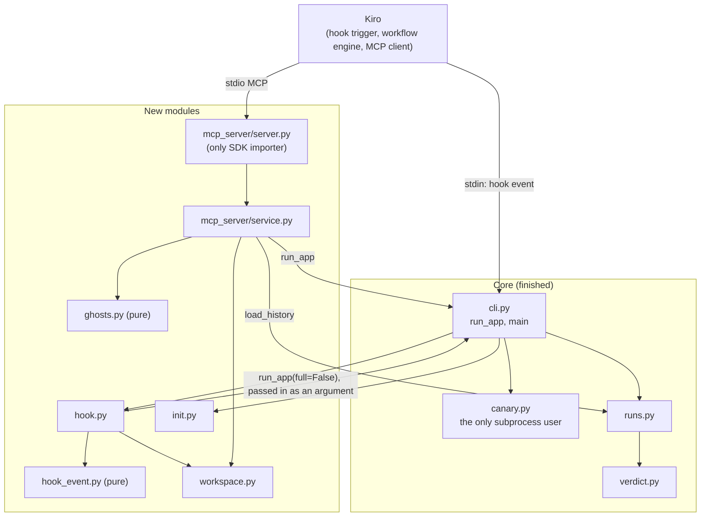
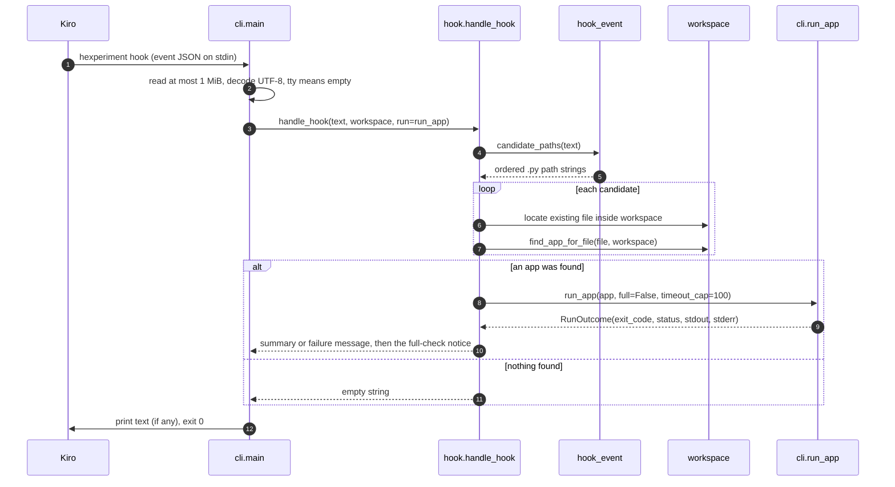
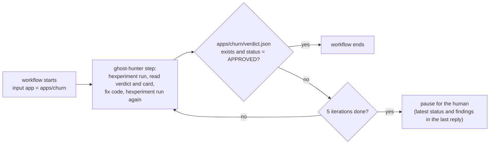

# Design Document: hexperiment-kiro

## Overview

`hexperiment-core` gives a training script a verdict. This spec connects that verdict to Kiro in four ways:

- `hexperiment hook`, started by a Kiro hook after every agent save of a Python file, runs the app that owns the file in fast mode and prints the result into the agent's context.
- The workflow `exorcise` repeats the restricted agent `ghost-hunter` on one app until `<app>/verdict.json` says `APPROVED`.
- `hexperiment-mcp` is an MCP server (tools `list_apps`, `run_audit`, `get_verdict`, `get_history`, `explain_ghost`, and the model card as a resource).
- The power `power/hexperiment/` packages the MCP server and a skill. `hexperiment init` writes the app templates and the Kiro files into a project.

The design builds on the finished core and changes it in one place only: `cli.py` gets a function `run_app` that returns the text of a run instead of printing it (see "Changes to `cli.py`"). Everything else is new modules and new files. The public API of `hexperiment/__init__.py` does not change, and `tests/test_architecture.py` keeps asserting the same seven names.

This document does not cover the example apps, the gallery or the leak benchmark.

### Status

Twelve questions are open (see "Open questions"), each with a recommended answer that this design already follows. Three of them depend on facts about Kiro that the available documentation does not state: the literal trigger name for "file saved", the JSON that Kiro writes to a command hook's standard input, and whether `fileCheck.path` in a workflow expands the workflow input. The design is built so that each of these fails safe (see "Key design decisions") and is checked live in task 9.

Two constraints on who can do what affect the tasks. The `builder` agent cannot write `.kiro/hooks/`, `.kiro/workflows/` or `.kiro/agents/`, and cannot run `kiro-cli`. Task 4 and the `kiro-cli` steps of task 9 therefore name a human step.

### Design principles

1. **A run has one implementation.** The hook, the MCP server and `hexperiment run` all call `cli.run_app`. No new module starts a process; only `canary.py` imports `subprocess`.
2. **Never print where output is a protocol.** `run_app` returns strings. The MCP server uses standard output for its protocol, and a run that printed would corrupt it.
3. **The hook never blocks.** `hexperiment hook` always exits `0`. Every outcome, including a crash of the hook itself, is text for the agent.
4. **Fail closed.** If a guess about an undocumented Kiro detail is wrong, the effect is a loop that runs to its limit, a hook that stays silent with a visible reason, or a tool that is refused. It is never a false `APPROVED`.
5. **One source for each Kiro file.** The files in `.kiro/` are the reference. The copies that `init --kiro` writes are package data, and a test fails when they differ.
6. **Optional means optional.** The MCP SDK is imported by one module in one optional subpackage, and `import hexperiment` never loads it.

### Key design decisions

| Decision | Choice | Reason |
|---|---|---|
| How the hook runs the app | In process, through `cli.run_app(app, full=False, timeout_cap=100)` | Keeps `subprocess` in `canary.py` only, and returns the text instead of printing it. |
| Hook timeout | Hook `timeout` is `120`; the run is capped at `100` seconds per execution | A fast run is one execution. The 20 seconds left cover Python start-up and writing the run folder, so Kiro does not kill a run that is still writing (Requirement 1.6). |
| Hook event parsing | Two tiers: values under path-like keys first, then any single-line string ending in `.py`; the first candidate that is an existing file inside the workspace and belongs to an app wins | The event schema is not documented. A parser that depends on one key name would go silent when the key differs. |
| Hook output when it cannot work | Silent exit `0` only for the cases of Requirement 1.4; any other failure is one line on standard output | A silent hook that never fires looks the same as a clean repository. |
| Finding the `hexperiment` executable | The command is the bare word `hexperiment`; `init --kiro` warns when it is not on `PATH` | Requirement 1.1 fixes the command. A bare name resolves to `hexperiment.exe` on Windows and to `bin/hexperiment` elsewhere through the shell's `PATH` lookup, so one file works on both. |
| Workflow stop condition | `fileCheck` on `{{app}}/verdict.json`, `$.status` equals `APPROVED` | Requirement 2.3. A wrong placeholder gives a path that never exists, which the documented rule treats as "no match", so the loop runs to its limit and pauses. |
| Ghost hunter write scope | Allow `apps/**/*.py`; deny the files of Requirement 3.3 and the `hexperiment` package; deny wins | Requirement 3.2 and 3.3. |
| Ghost hunter shell | Allow only `hexperiment run apps/*` and `hexperiment run --fast apps/*` (with and without a venv prefix); deny shell metacharacters and the command families of Requirement 3.4 | An allow pattern ending in `*` also matches `hexperiment run apps/x && curl ...`, so chaining characters are denied explicitly. |
| MCP SDK isolation | Only `mcp_server/server.py` imports `mcp` and `anyio`; `mcp_server/__init__.py` imports it lazily inside `main` | `import hexperiment` must not load the SDK (Requirement 4.1), and the console command must explain a missing SDK instead of crashing. |
| MCP audit concurrency | One `anyio.Lock` per server; a second `run_audit` waits | Requirement 4.6. The lock covers one server process only. |
| Template copies | `src/hexperiment/templates/kiro/...` are copies of `.kiro/...`, compared byte for byte (after line-ending normalisation) by a test | Requirement 5.4. |
| Power contents | `plugin.json`, `mcp.json`, one skill | The documentation does not say how a plugin bundles hooks or steering, so the power does not depend on it; `init --kiro` delivers those. |

## Architecture

### New and changed modules

```text
hexperiment/
  pyproject.toml                  changed: extra mcp, script hexperiment-mcp, package data
  src/hexperiment/
    cli.py                        changed: RunOutcome use, run_app, subcommands hook and init
    models.py                     changed: adds RunOutcome
    hook_event.py                 new, pure: find file paths in a hook event
    hook.py                       new, edge: event text -> output text
    workspace.py                  new, edge: workspace, app lookup, discovery, RunApp protocol
    ghosts.py                     new, pure: catalogue of ghosts and checks
    init.py                       new, edge: hexperiment init
    templates/                    new, package data (no __init__.py)
      app/hex.toml.tmpl
      app/train.py.tmpl
      kiro/hooks/hexperiment.json
      kiro/workflows/exorcise.workflow.json
      kiro/agents/ghost-hunter.json
      kiro/steering/ml-integrity.md
    mcp_server/                   new, optional subpackage
      __init__.py                 main(): lazy import of server, message when the SDK is missing
      service.py                  SDK-free tool logic
      server.py                   the only module that imports mcp and anyio
  tests/
    test_hook_event.py, test_hook.py, test_workspace.py, test_ghosts.py,
    test_init.py, test_mcp_service.py, test_mcp_server.py, test_kiro_files.py
.kiro/hooks/hexperiment.json        new (human step, task 4)
.kiro/workflows/exorcise.workflow.json   new (human step, task 4)
.kiro/agents/ghost-hunter.json      new (human step, task 4)
power/hexperiment/
  plugin.json, mcp.json, skills/hexperiment/SKILL.md
```

### Component diagram



Dependency rules added to `tests/test_architecture.py`:

- `hook_event.py` and `ghosts.py` are pure: they import none of `os`, `pathlib`, `shutil`, `subprocess`, `tomllib`, `datetime` and never call `open`.
- `mcp` and `anyio` are imported only by `mcp_server/server.py`. No module outside `mcp_server/` imports `hexperiment.mcp_server`. The module-level imports of `mcp_server/__init__.py` contain neither the SDK nor `server`.
- `hook.py` receives `run_app` as an argument and does not import `cli`, so `cli` can import `hook` without a cycle. `service.py` does the same.
- The existing rules (only `canary.py` imports `subprocess`, no module-level mutable state, `__all__` unchanged) apply to the new modules without edits.

### Sequence of a hook run



### The exorcise loop



`hexperiment run` deletes `verdict.json` before every run (core, Resolved question 3), so the file is `APPROVED` only after a full run that finished and approved. A save of Python code after that run triggers the hook, whose fast run replaces `verdict.json` with an `UNVERIFIED` one, so the loop continues. This closes the case where the agent edits code after the last full run.

## Components and Interfaces

Signatures are the contract; bodies are not specified. Every public function has type hints. Results are frozen dataclasses.

### Changes to `cli.py` and `models.py`

```python
# models.py (pure)
@dataclass(frozen=True, slots=True)
class RunOutcome:
    exit_code: int            # 0, 1, 2 or 3, as in hexperiment run
    status: Status | None     # None when exit_code is 2 (no verdict)
    stdout: str               # format_summary(verdict), or "" for exit code 2
    stderr: str               # "hexperiment: <message>" for exit code 2, else ""

# cli.py
def run_app(app_dir: Path, *, full: bool, timeout_cap: float | None = None) -> RunOutcome: ...
def main(argv: Sequence[str] | None = None) -> int: ...
```

`run_app` is the body of today's `main` after argument parsing: it checks the folder, resolves it, calls `runs.clear_app_verdict`, runs `_run` and maps the same exceptions (`HexInputError`, `ExecutionFailed`, `OSError`) to exit code 2. It returns a `RunOutcome` instead of calling `print_text`. `main` for the `run` command becomes: parse, call `run_app`, print `stdout` and `stderr` through `print_text`, return `exit_code`. Behaviour, output and exit codes of `hexperiment run` do not change, and the existing tests in `test_cli.py` must pass without edits (they replace `cli.run_executions` and `cli.new_run_id`, which stay module attributes used by `_run`).

`timeout_cap` limits `config.run.timeout_seconds` for this call to `min(configured, timeout_cap)` through `dataclasses.replace` on the frozen config. It exists for the hook (Requirement 1.6) and is `None` for every other caller.

`build_parser` gains two subcommands:

- `hook`: no arguments. `main` reads standard input (at most 1 MiB as bytes, decoded as `utf-8-sig` with replacement; an interactive terminal counts as empty input, so a manual run never waits), calls `hook.handle_hook(text, workspace=resolve_workspace(), run=run_app)`, prints the returned text if it is not empty, and returns `0`. An exception from `handle_hook` is caught in `main` and printed as one line, `hexperiment hook failed: <type>: <message>`, with exit code `0` (Requirement 1.5). Invalid command-line usage still exits `2` through `argparse`.
- `init`: optional `app_dir` and the flag `--kiro` (see `init.py`).

Satisfies: 1.3, 1.5, 1.6 (cap), 4.6 (the cap also bounds MCP audits).

### `hook_event.py` (pure)

```python
PATH_KEYS: tuple[str, ...]      # normalised key names: filepath, path, paths, file, files,
                                # filename, uri, document, target
MAX_EVENT_NODES = 10_000
MAX_EVENT_DEPTH = 12
MAX_CANDIDATES = 20

def candidate_paths(event_text: str) -> tuple[str, ...]: ...
```

`candidate_paths` returns the Python file paths mentioned in the event, best candidate first. It never raises.

1. Empty or whitespace-only text, text that is not JSON (`ValueError`, `RecursionError`), or a JSON value that is neither an object nor an array: return `()`.
2. Walk the parsed value with an explicit stack, not recursion. Stop at `MAX_EVENT_DEPTH` and `MAX_EVENT_NODES`. Object values are visited in key order; list items in index order.
3. Collect string values in two tiers. Both tiers reject a string that is longer than 1024 characters or contains a control character; the second rule rules out file contents and prompts, which contain newlines.
   - **Tier 1:** a string that is the value of a key whose normalised name (lower case, `_` and `-` removed) is in `PATH_KEYS`, or an item of a list under such a key. This finds `file_path`, `filePath`, `tool_input.path`, `event.file.path`, `files: [...]`.
   - **Tier 2:** any other string that ends in `.py`. Tier 2 is used only when tier 1 produced no path that ends in `.py`.
4. Normalise each string: strip surrounding quotes; turn a `file://` URI into a path with `urllib.parse.urlparse` and `urllib.request.url2pathname`; reject anything that still contains `://`.
5. Keep strings whose lower-cased form ends in `.py`. Remove duplicates, keep tier then discovery order, return at most `MAX_CANDIDATES`.

The module decides nothing about files: whether a path exists, lies in the workspace or belongs to an app is `hook.py`'s job. Paths with `\` or `/`, absolute or relative, are returned as they appear.

Satisfies: 1.2 (find the path), 1.4 (cannot be parsed), 7.1.

### `workspace.py` (edge)

```python
ENV_WORKSPACE = "HEXPERIMENT_WORKSPACE"

@dataclass(frozen=True, slots=True)
class AppRef:
    name: str            # [app] name from hex.toml, else the folder name
    path: Path           # resolved folder
    relative: str        # path relative to the workspace, "/" separators, "." for the workspace itself
    problem: str | None  # why hex.toml could not be read, else None

class RunApp(Protocol):
    def __call__(self, app_dir: Path, *, full: bool,
                 timeout_cap: float | None = None) -> RunOutcome: ...

def resolve_workspace(environ: Mapping[str, str] | None = None, cwd: Path | None = None) -> Path: ...
def is_app(folder: Path) -> bool: ...
def relative_posix(path: Path, workspace: Path) -> str: ...
def find_app_for_file(file: Path, workspace: Path) -> Path | None: ...
def resolve_app(workspace: Path, app: str) -> Path: ...
def discover_apps(workspace: Path) -> tuple[AppRef, ...]: ...
```

- `resolve_workspace`: the resolved value of `HEXPERIMENT_WORKSPACE` when set, otherwise the working directory. A value that is not an existing folder raises `HexInputError` naming the variable. Kiro runs command hooks in the project root, so the hook uses the working directory in practice.
- `is_app`: the folder contains the files `hex.toml` and `train.py`.
- `find_app_for_file(file, workspace)`: resolve `file` (relative paths are taken relative to the workspace; symlinks are followed). Return `None` if the resolved file is not inside the resolved workspace. Otherwise walk the folders from the file's own folder up to and including the workspace and return the first one where `is_app` holds. The walk never goes above the workspace (Requirement 1.2). The file itself does not have to be an app file, and a file in `apps/churn/helpers/utils.py` finds `apps/churn`.
- `resolve_app(workspace, app)`: the guard for the MCP server (Requirement 4.2, 4.5). `app` is a non-empty string without NUL. It is joined to the workspace (an absolute path is accepted), resolved, and must lie inside the resolved workspace, be a folder, and pass `is_app`. Each failure raises `HexInputError` that names the app, says which condition failed (outside the workspace, not a folder, `hex.toml` missing, `train.py` missing) and says how to fix it. Resolving first means `..` segments and symlinks that leave the workspace are rejected.
- `discover_apps`: `os.walk` from the workspace without following links, pruning folders whose name starts with `.`, folders named `node_modules` or `__pycache__`, and virtual environments (a folder that contains `pyvenv.cfg`). A folder that passes `is_app` is recorded and not descended into. `name` comes from `load_config`; if that raises `HexInputError`, `name` is the folder name and `problem` holds the message, so one broken `hex.toml` does not hide the other apps. The result is sorted by `relative`.

Satisfies: 1.2, 4.2, 4.3 (`list_apps` discovery), 4.5.

### `hook.py` (edge)

```python
HOOK_TIMEOUT_SECONDS = 120
HOOK_RUN_CAP_SECONDS = 100

def handle_hook(event_text: str, *, workspace: Path, run: RunApp) -> str: ...
def format_hook_output(outcome: RunOutcome, app_relative: str) -> str: ...
```

`handle_hook`:

1. `paths = candidate_paths(event_text)`. For each path in order: build the absolute path (relative paths are joined to the workspace), skip it unless it is an existing file, call `find_app_for_file`, skip it if that returns `None`.
2. For the first path that gives an app, call `run(app, full=False, timeout_cap=HOOK_RUN_CAP_SECONDS)` once and return `format_hook_output(outcome, relative_posix(app, workspace))`.
3. If no path gives an app, return `""` (Requirement 1.4). A saved file that is not Python never reaches this point because `candidate_paths` keeps only `.py` names.

`format_hook_output` returns the text for the agent: `outcome.stdout` when the exit code is not `2`, otherwise `outcome.stderr` (the failure message); then one line:

```text
Fast check only: the canary test did not run, so this result can never be APPROVED. Before you call the work done, run: hexperiment run <app>
```

`<app>` is the workspace-relative path with `/` separators. The same line follows a failure message: a failed fast run will also fail in full mode, and the agent still must not call the work done. The function accepts any status, including `APPROVED`, although a fast run cannot produce it (see Open question 11).

A hook run is an ordinary run: it calls `finalize_run`, writes `runs/<run_id>/` and counts as a test-set use (Requirement 1.7). Nothing in this module skips or discounts it. Consequence: an agent that saves often in a loop reaches `checks.max_test_uses` (default 5) quickly and gets the `test_set_uses` warning. The warning does not change the status.

Satisfies: 1.2 to 1.7.

### `ghosts.py` (pure)

```python
@dataclass(frozen=True, slots=True)
class Ghost:
    check: str            # check name as in verdict findings
    ghost: str | None     # ghost name, None for checks without a ghost
    meaning: str
    why_it_matters: str
    how_to_fix: str

CATALOG: tuple[Ghost, ...]
def find_ghost(name: str) -> Ghost: ...          # raises HexInputError for an unknown name
def to_dict(entry: Ghost) -> dict[str, str | None]: ...
```

`CATALOG` has one entry for every check name in `verdict.FINDING_ORDER`. Ghost names come from the constants of the core modules (`checks.row_overlap.GHOST`, `checks.target_proxy.GHOST`, `checks.temporal.GHOST`, `canary.PEEKING_SPIRIT`, `canary.SHAPESHIFTER`), so they cannot drift from the findings. `find_ghost` normalises its argument (lower case, a leading "the " removed, every character that is not a letter or digit removed) and compares it with the normalised ghost name and check name of each entry. `The Peeking Spirit`, `peeking spirit`, `peeking-spirit` and `canary` give the same entry. An unknown name raises `HexInputError` that lists the known ghost and check names.

| Check | Ghost | Meaning | Why it matters | How to fix |
|---|---|---|---|---|
| `row_overlap` | The Doppelganger | Identical rows exist in both train and test. | The model can memorise a training row and be scored on its copy, so the metric measures memory. | Drop exact duplicate rows before splitting, then call `hexperiment.split`. |
| `target_proxy` | The Possession | One feature alone predicts the target almost perfectly (stand-alone AUC at or above `checks.proxy_auc_max`, default 0.95). | Such a column is usually recorded after the outcome or derived from it, and will not exist at prediction time. | Find out when the column is recorded. If after the outcome, drop it and say why in a comment. A genuinely strong feature can only be accepted by a human through a waiver with a reason in `hex.toml`. |
| `canary` | The Peeking Spirit | Scrambling the test rows at load time changed what training saw, so test information reached training. | Statistics, scalers, encoders or selectors fitted on all rows carry test information into the model. The finding cannot be waived. | Fit every imputer, scaler, encoder and selector on training rows only, after `hexperiment.split`, preferably in a `Pipeline`. The finding lists suspect lines. |
| `temporal` | The Prophet | Some training rows are later than some test rows. | The model is trained on the future of the period it is tested on. | Set `split.time_column` in `hex.toml` and split with `hexperiment.split`. Never shuffle across time. |
| `determinism` | The Shapeshifter | Identical executions gave different results (a warning). | A result that changes between identical runs cannot be verified, so the verdict cannot be `APPROVED`. | Set `random_state` or a seed everywhere (models, samplers, NumPy) and avoid code that depends on hash order or thread timing. |
| `split_order` | none | A call that fits or computes statistics appears before the first split, or data is read without `hexperiment.load` (warnings only). | It is a hint to the likely cause of The Peeking Spirit. The canary is the authority. | Split first, fit on training rows, read data only with `hexperiment.load`. |
| `metric` | none | The metric is below its threshold, or far above it ("too good to be true" warning). | Below: the model is not good enough. Far above: a leak is more likely than a breakthrough. | Below: improve the model, never the threshold. Far above: look for a column that encodes the target. |
| `test_set_uses` | none | The same test set has been scored more than `checks.max_test_uses` times. | Repeated use turns the test set into a tuning set and the metric becomes optimistic. | Stop tuning against this test set. Use rows that were not used to choose the model for a final number. |
| `waiver` | none | A waiver in `hex.toml` matched no finding (a warning). | A stale waiver could silently cover a problem that appears later. | Remove the waiver from `hex.toml` if the finding no longer occurs. |
| `input` | none | `audit` received invalid input, so no check ran and the verdict is `REJECTED`. | The metric cannot be trusted when its inputs are wrong. | Read the message: it says what is wrong and how to fix it. |

Satisfies: 4.3 (`explain_ghost`), 4.5 (unknown name), 6.3 (the skill's ghost table is checked against this catalogue).

### `init.py` (edge)

```python
@dataclass(frozen=True, slots=True)
class TemplateFile:
    source: str           # path below templates/
    target: str           # path below the destination folder

@dataclass(frozen=True, slots=True)
class InitReport:
    created: tuple[Path, ...]
    skipped: tuple[Path, ...]

APP_FILES: tuple[TemplateFile, ...]    # app/hex.toml.tmpl -> hex.toml, app/train.py.tmpl -> train.py
KIRO_FILES: tuple[TemplateFile, ...]   # kiro/hooks/hexperiment.json -> hooks/hexperiment.json, ...

def init_app(app_dir: Path) -> InitReport: ...
def init_kiro(project_dir: Path) -> InitReport: ...
def format_report(report: InitReport, base: Path) -> str: ...
```

- `init_app(app_dir)` creates the folder (with parents) if it is missing and writes `hex.toml` and `train.py` from `APP_FILES`. If `app_dir` exists and is not a folder, it raises `HexInputError`.
- `init_kiro(project_dir)` writes the four `KIRO_FILES` below `<project_dir>/.kiro/`, creating folders as needed: `hooks/hexperiment.json`, `workflows/exorcise.workflow.json`, `agents/ghost-hunter.json`, `steering/ml-integrity.md`.
- Both functions read templates with `importlib.resources.files("hexperiment") / "templates"` and copy them as bytes, so line endings are not translated on Windows. A target file that exists is never opened for writing: it goes into `skipped` (Requirement 5.3). A template that is missing from the installed package raises `HexInputError` that says to reinstall.
- `format_report` prints one line per file, `created  <path>` or `skipped  <path> (already exists)`, with paths relative to `base` and `/` separators, followed by notes. Notes for `init <app_dir>`: put the CSV at `data.path` and edit the `CHANGE` lines in `hex.toml`; run `hexperiment run <app_dir>`; add `.hex/` to `.gitignore`; and, when the folder is not below `apps/`, that the ghost hunter can only edit Python files under `apps/`. Note for `init --kiro`: when `shutil.which("hexperiment")` is `None`, that Kiro hooks start `hexperiment` from its own `PATH`, so Kiro must be started from a shell where the virtual environment is active (or `hexperiment` must be installed with a tool such as `pipx`).
- The command `hexperiment init [app_dir] [--kiro]` needs at least one of the two; both together do both. Exit code `0` after a successful run, even if every file was skipped; `2` after a `HexInputError` or `OSError`, printed as `hexperiment: <message>`.

**App templates.** `hex.toml.tmpl` is a commented file that `config.parse_config` accepts unchanged:

```toml
# hex.toml: what this model must achieve and what the audit enforces.
# Edit the lines marked CHANGE. Agents must not edit this file.

[app]
name = "my-model"                 # CHANGE: shown in the model card
description = "What this model predicts, in one sentence."

[data]
path = "data/dataset.csv"         # CHANGE: CSV file, relative to this folder

[target]
column = "target"                 # CHANGE: the column to predict
positive = 1                      # the value that marks the positive class

[metric]
name = "roc_auc"
threshold = 0.75                  # CHANGE: the score the model must reach

[split]
test_fraction = 0.2
seed = 0
# time_column = "date"            # for time-ordered data: the split is then by time

[run]
timeout_seconds = 120

# A waiver accepts a finding. It needs a human reason of 10+ characters.
# [[waivers]]
# check = "target_proxy"
# column = "tenure_months"
# reason = "Known at prediction time and legitimately strong."
```

`train.py.tmpl` is valid Python that follows `ml-integrity.md`: it loads with `hexperiment.load()`, splits with `hexperiment.split(df)`, selects numeric feature columns other than the target, fits a `HistGradientBoostingClassifier(random_state=0)` on `train` only, and ends with one `hexperiment.audit(...)` that passes `y_score` from the positive-class column of `predict_proba` (found with `list(model.classes_).index(POSITIVE)`), `features`, `script=__file__` and `y_score_train`. Comments say that `TARGET` and `POSITIVE` must match `hex.toml`, that categorical columns need an encoder inside a `Pipeline`, and that nothing may be fitted before the split.

Satisfies: 5.1 to 5.4.

### `mcp_server/service.py` (SDK-free)

All functions take the resolved `workspace` and raise `HexInputError` for bad input. They return plain dictionaries that the server passes through.

```python
def list_apps(workspace: Path) -> dict[str, Any]: ...
def get_verdict(workspace: Path, app: str) -> dict[str, Any]: ...
def get_history(workspace: Path, app: str) -> dict[str, Any]: ...
def explain_ghost(name: str) -> dict[str, Any]: ...
def check_audit_request(workspace: Path, app: str, mode: str) -> tuple[Path, bool]: ...
def run_audit(workspace: Path, app: str, mode: str, run: RunApp) -> dict[str, Any]: ...
def model_card(workspace: Path, app: str) -> str: ...
def resource_uri(app_relative: str) -> str: ...
def app_from_resource_id(resource_id: str) -> str: ...
```

| Function | Result |
|---|---|
| `list_apps` | `{"workspace": "<absolute path>", "apps": [{"name", "path", "status", "problem"}]}`. `status` is the `status` in the app's current `verdict.json`, or `"none"` when the file is absent. If the file exists but cannot be read, `status` is `"none"` and `problem` says why. `problem` is also set when `hex.toml` is invalid. |
| `get_verdict` | `{"found": true, "verdict": {...}}` with the parsed content of `verdict.json`, or `{"found": false, "message": "..."}` saying that the app has no current verdict because no run has finished since the file was last deleted. A `verdict.json` that cannot be parsed raises `HexInputError`. |
| `get_history` | `{"app": "<relative path>", "runs": [{"run_id", "status", "metric_value", "ghosts"}]}` from `hexperiment.load_history`, oldest first. `ghosts` is the sorted list of distinct ghost names in the run's findings (any severity). A malformed history file raises `HexInputError` naming it. |
| `explain_ghost` | `ghosts.to_dict(ghosts.find_ghost(name))`. |
| `check_audit_request` | Runs `resolve_app` and validates `mode` (`"full"` or `"fast"`; anything else raises `HexInputError`). It runs no code. Returns the app folder and whether the mode is full. |
| `run_audit` | Calls `check_audit_request`, then `run(app_dir, full=..., timeout_cap=None)`. Returns `{"app", "mode", "status", "exit_code", "summary"}`. `status` is the verdict status for exit codes `0`, `1`, `3`, and `"none"` for exit code `2`; `summary` is the run's stdout, or its stderr for exit code `2`. A failed run is a normal result, not a tool error: the agent needs the failure message to fix its code. |
| `model_card` | The text of `runs/<id>/model_card.md` for the newest run in the history. Raises `HexInputError` when the app has no run yet. |
| `resource_uri` / `app_from_resource_id` | `hexperiment://model-card/<id>` where `<id>` is `urllib.parse.quote(relative, safe="")` and its inverse. Keeping the encoding in these two functions means the format can be changed in one place if the SDK does not route an encoded slash. |

The service never writes anything. The only call that can change an app folder is `run`.

Satisfies: 4.3, 4.4 (model card text), 4.5, 4.7.

### `mcp_server/server.py` (the only SDK importer)

```python
def build_server(workspace: Path, *, run: RunApp = run_app) -> MCPServer: ...
def serve() -> None: ...            # resolve_workspace(), build_server(...).run()
```

`build_server` creates the server, one `anyio.Lock` and the registrations, all inside the function so that the module holds no state.

- `MCPServer(name="hexperiment", instructions=..., version=...)`. The instructions tell a client that `run_audit` is the only tool that runs code, that `APPROVED` comes only from a full run, and that the workspace is the one reported by `list_apps`.
- Tools are registered with `@server.tool(...)`. Each wraps a `service` function and turns `HexInputError` into `ToolError(str(error))`, which the SDK returns as a result with `is_error` set (Requirement 4.5). The client sees the message prefixed with `Error executing tool <name>: `.
- `run_audit` is `async`. It first calls `service.check_audit_request`, so a bad app or mode is refused before the lock is taken and before any code runs. It then does `async with lock:` and `await anyio.to_thread.run_sync(...)` on `service.run_audit`, so the event loop stays free and at most one audit runs at a time in this server (Requirement 4.6). The audit uses the app's own `[run] timeout_seconds` for each execution, through the core runner. A client that cancels the call does not stop the training process; the lock is released when the run ends.
- The tool parameter `mode` is declared as `str`, not as a `Literal`, so that the refusal message comes from `check_audit_request` and names the allowed values.
- Resources: one template `hexperiment://model-card/{app}` whose handler calls `service.model_card(workspace, app)`: mcp 2.3.0 percent-decodes a template parameter once before the handler sees it, so decoding again with `app_from_resource_id` would corrupt a folder name that contains `%`. The handler raises `ResourceError` (from `mcp.server.mcpserver.exceptions`) for every `HexInputError`, because the SDK hides the message of any other exception from a resource handler. The SDK's default resource security also refuses `..` and absolute paths in a parameter before the workspace guard runs, and one static resource per app found at build time, registered with the same handler, so that `list_resources` shows the cards. An app created after the server started is reachable through the template but is listed only after a restart. Resources have `mime_type="text/markdown"`.
- Standard output carries the protocol. Nothing in `server.py`, `service.py` or `run_app` prints.

`mcp_server/__init__.py` defines `main() -> None`: it tries to import `hexperiment.mcp_server.server`; on a `ModuleNotFoundError` for `mcp` or `anyio` (any other import error is a bug in the server and is raised) it prints, through `console.print_text` to standard error, that the MCP SDK is missing and that `pip install "hexperiment[mcp]"` installs it, and exits with code `2`. A `HexInputError` from `resolve_workspace` is printed the same way. Otherwise it calls `serve()`.

Satisfies: 4.1 to 4.7.

### `pyproject.toml`

```toml
[project.optional-dependencies]
mcp = ["mcp==2.3.0"]
dev = ["pytest", "pytest-xdist==3.8.0", "hypothesis", "ruff", "hexperiment[mcp]"]

[project.scripts]
hexperiment = "hexperiment.cli:main"
hexperiment-mcp = "hexperiment.mcp_server:main"

[tool.setuptools.package-data]
hexperiment = ["templates/**/*"]
```

`dev` includes the `mcp` extra so that `pip install -e "hexperiment[dev]"` (the command in `tech.md`) gives the tests the SDK. The runtime `dependencies` stay `pandas`, `numpy`, `scikit-learn` (Requirement 7.3). A test reads the file and checks these facts and that every file below `templates/` matches a `package-data` pattern (an editable install would hide a missing pattern).

Satisfies: 4.1, 7.3.

## The Kiro files

These four files are the reference. They are written by a human step in task 4 (the `builder` agent cannot write these folders) and copied into `src/hexperiment/templates/kiro/` in task 5.

### `.kiro/hooks/hexperiment.json`

```json
{
  "version": "v1",
  "hooks": [
    {
      "name": "hexperiment-check-on-save",
      "description": "Runs the fast Hexperiment check on the app that owns a Python file the agent saved, and puts the result in the agent's context.",
      "trigger": "PostFileSave",
      "matcher": ".*\\.py$",
      "action": {
        "type": "command",
        "command": "hexperiment hook"
      },
      "timeout": 120
    }
  ]
}
```

The matcher `.*\.py$` gives the same result whether Kiro matches the whole path or searches in it, and it matches Windows and POSIX separators. File triggers fire for changes made by the agent, not for manual edits, which is the behaviour Requirement 1 asks for. See Open questions 1 and 2 for the trigger literal and the event schema.

### `.kiro/agents/ghost-hunter.json`

```json
{
  "name": "ghost-hunter",
  "description": "Fixes data leakage in one Hexperiment app. Can edit the app's Python files and run hexperiment run on it. Cannot change thresholds, waivers, verdicts, run history, data, .kiro or the hexperiment package.",
  "prompt": "You are the ghost hunter for one Hexperiment app. Your goal is to make `hexperiment run <app>` end with status APPROVED by fixing the cause of each finding in the app's Python files.\n\nRules:\n1. Thresholds, waivers and every other setting in hex.toml are the human's decision. You cannot edit them. Never ask to lower a threshold or to add a waiver.\n2. Removing the hexperiment.audit call, or a feature that is not the cause of a finding, does not count as a fix, and neither does silencing, skipping or weakening a check. Dropping a column flagged by The Possession is a fix only when the column is recorded after the outcome; say why it is. If an honest fix leaves the metric below its threshold, report that.\n3. If you cannot fix a finding, stop and report it with its ghost, location and fix hint instead of working around it.\n4. Never edit verdict.json, model_card.md, fetch_data.py, runs/, .hex/, data/, haunted/, .kiro/ or the hexperiment package. Your tools refuse these writes; do not look for another way.\n5. Run only `hexperiment run apps/<name>` or `hexperiment run --fast apps/<name>`, one command per call, with forward slashes and no other shell syntax.\n6. Follow the ML integrity rules in the steering file.\n7. End every reply with the status, the metric against its threshold and one line per finding of the latest verdict.json.",
  "model": "claude-sonnet-5.5",
  "tools": ["read", "write", "shell"],
  "resources": ["file://.kiro/steering/ml-integrity.md"],
  "permissions": {
    "rules": [
      { "capability": "fs_read", "effect": "allow" },
      {
        "capability": "fs_write",
        "match": ["apps/**/*.py", "**/apps/**/*.py"],
        "effect": "allow"
      },
      {
        "capability": "fs_write",
        "match": [
          "**/hex.toml",
          "**/verdict.json",
          "**/model_card.md",
          "apps/**/runs/**", "**/apps/**/runs/**",
          "apps/**/.hex/**", "**/apps/**/.hex/**",
          "apps/**/data/**", "**/apps/**/data/**",
          "apps/**/haunted/**", "**/apps/**/haunted/**",
          "**/fetch_data.py",
          "apps/**/hexperiment.py", "**/apps/**/hexperiment.py",
          "apps/**/hexperiment/**", "**/apps/**/hexperiment/**",
          ".kiro/**", "**/.kiro/**",
          "hexperiment/src/**", "**/hexperiment/src/**",
          "hexperiment/tests/**", "**/hexperiment/tests/**",
          "hexperiment/pyproject.toml", "**/hexperiment/pyproject.toml",
          "**/.venv/**", "**/site-packages/**"
        ],
        "effect": "deny"
      },
      {
        "capability": "shell",
        "match": [
          "hexperiment run apps/*",
          "hexperiment run --fast apps/*",
          ".venv/Scripts/hexperiment run apps/*",
          ".venv/Scripts/hexperiment run --fast apps/*",
          ".venv\\Scripts\\hexperiment run apps/*",
          ".venv\\Scripts\\hexperiment run --fast apps/*",
          ".venv/bin/hexperiment run apps/*",
          ".venv/bin/hexperiment run --fast apps/*"
        ],
        "effect": "allow"
      },
      {
        "capability": "shell",
        "match": [
          "*&*", "*;*", "*|*", "*>*", "*<*", "*`*", "*$(*", "*..*",
          "git*", "rm *", "rmdir*", "del *", "Remove-Item*",
          "curl*", "wget*", "Invoke-WebRequest*", "Invoke-RestMethod*", "iwr *", "irm *",
          "pip*", "python*", "hexperiment init*", "hexperiment hook*"
        ],
        "effect": "deny"
      }
    ]
  }
}
```

Why these choices:

- The `fs_write` deny list covers every item of Requirement 3.3. The package is denied by the specific folders `hexperiment/src/**`, `hexperiment/tests/**` and `hexperiment/pyproject.toml` rather than `**/hexperiment/**`: a checkout whose folder is named `hexperiment` would otherwise turn `**/hexperiment/**` into a rule that denies every file, including the app code that the agent may edit. The two `apps/**/hexperiment*` entries stop an app folder from shadowing the real package: `train.py` runs with its own folder first on `sys.path`, so a file `hexperiment.py` there would replace the kit. `.venv` and `site-packages` cover an installed copy of the package.
- Every path appears in a relative form and a `**/` form, as in `builder.json`, because the documentation does not say whether a rule sees workspace-relative or absolute paths.
- The shell allow patterns end in `apps/*`, so the agent can only run apps below `apps/`. `hexperiment run --full` is not allowed because `hexperiment run` is already a full run.
- The deny list holds the characters that chain or redirect commands, the command families named in Requirement 3.4, and `..` so that `apps/../..` cannot leave the apps folder. Deny wins over allow.
- `resources` loads only the integrity rules. The same file also attaches itself to any `apps/**/*.py` the agent reads (its `fileMatch` front matter).

**Limit of this guard.** The rules restrict what the agent's file and shell tools may do. They do not sandbox the Python the agent writes: `hexperiment run` executes `train.py` with the user's privileges, and code in it can write any file. The guard stops an optimising agent from taking a shortcut by editing the verdict or the settings; it does not stop code written to forge one. The evidence for a reviewer is the committed `runs/<run_id>/` folder and the diff of the app code. See Open question 7.

### `.kiro/workflows/exorcise.workflow.json`

```json
{
  "name": "exorcise",
  "description": "Repeats the ghost-hunter agent on one Hexperiment app until hexperiment run writes an APPROVED verdict.json. After 5 rounds it pauses for the human.",
  "inputs": {
    "app": "string"
  },
  "steps": [
    {
      "type": "repeat",
      "id": "hunt-until-approved",
      "maxIterations": 5,
      "onMaxIterations": "pause",
      "stopCondition": {
        "fileCheck": {
          "path": "{{app}}/verdict.json",
          "jsonPath": "$.status",
          "value": "APPROVED"
        }
      },
      "steps": [
        {
          "type": "step",
          "id": "hunt",
          "agent": "ghost-hunter",
          "prompt": "Work on the Hexperiment app in the folder given as the workflow input `app` ({{app}}), written with forward slashes relative to the workspace, for example apps/churn.\n1. Run `hexperiment run {{app}}` (full mode).\n2. Read `{{app}}/verdict.json` and the model card in the newest folder under `{{app}}/runs/`.\n3. If the status is APPROVED, stop here and report it.\n4. Otherwise change the app's Python files so that each finding is fixed at its cause. Use the finding's fix hint and the suspect lines it lists. Then run `hexperiment run {{app}}` again as the last thing you do in this step.\nDo not change thresholds, waivers or any file outside the app's Python code. If you cannot fix a finding, say so and stop; do not work around it.\nEnd your reply with the status, the metric against its threshold, and one line per finding of the latest verdict.json."
        }
      ]
    }
  ]
}
```

**How the stop condition names the app.** Checked live with Kiro CLI 3.2.0 on 2026-11-11, and consistent with the "Use template variables" section of the workflow documentation. A step prompt and `stopCondition.fileCheck.path` reference a workflow input by its bare name, `{{app}}`, and Kiro expands it in both; relative paths resolve from the workspace root. In a probe workflow, a repeat with a limit of two iterations, whose step wrote `{{app}}/flag.json`, stopped after the first iteration. With `{{app}}`, which is not a documented form, the placeholder stayed literal in the prompt and the path, and the loop ran to its limit. The workflow starts with `/workflow run exorcise --app apps/<name>`.

- *Why it is safe.* A path that is not expanded, or is wrong, names a file that does not exist. Kiro treats that as "no match, continue", so a mistake costs iterations, never a false stop. A shared test constant (`INPUT_REF`) holds the placeholder.
- *Check.* Task 9 validates the file with Kiro's `validate_workflow` tool and runs the workflow once on a prepared haunted app. The loop must stop after the first `APPROVED`.
- *A failing step.* A step that fails ends the whole run with status `failed`; the next iteration does not start. In the probe this happened when the step agent's file writes were refused. For the ghost hunter, failing is an acceptable way to hand back a finding it cannot fix (Requirement 3.5).
- *Headless runs.* In a non-interactive CLI session, a step agent can use only the tools that the session trusts (`--trust-tools`), in addition to its own permission rules. In Git Bash the command needs `MSYS_NO_PATHCONV=1`, or `/workflow` is rewritten as a file path.

The node discriminator `type` (`repeat`, `step`) and the `jsonPath` form `$.status` are likewise taken from the documented field names and common usage, not from a documented example; `validate_workflow` in task 9 covers them too.

**Residual limits of the loop.** The step prompt makes the agent run the full check last, but the real guard against edits after approval is the hook (above). The hook exists only where the host supports file-save hooks; the human reviewer reads the run folders either way. Each iteration costs at least two full runs plus one fast run per save, and every run counts as a test-set use, so an app in the loop will pass `max_test_uses` (default 5) and show the `test_set_uses` warning. The warning does not block approval.

### `power/hexperiment/`

`plugin.json`:

```json
{
  "$schema": "https://agent-plugins.org/schemas/1.0.0/plugin.schema.json",
  "name": "hexperiment",
  "version": "0.1.0",
  "description": "Leakage-proof ML for Kiro. Audits a training script for data leakage, writes a verdict and a model card, and refuses to approve a model that is good only because it cheated.",
  "author": { "name": "Jegadeesh" },
  "homepage": "https://github.com/jegadeesh17/hexperiment",
  "repository": "https://github.com/jegadeesh17/hexperiment",
  "license": "MIT",
  "keywords": [
    "data leakage", "train test split", "model card", "too good to be true",
    "target leakage", "canary test", "overfitting", "model audit", "hexperiment"
  ]
}
```

`mcp.json`:

```json
{
  "$schema": "https://agent-plugins.org/schemas/1.0.0/mcp.schema.json",
  "mcpServers": {
    "hexperiment": {
      "type": "stdio",
      "command": "hexperiment-mcp",
      "args": [],
      "env": {}
    }
  }
}
```

No secrets are needed and none are referenced. The server takes its workspace from the working directory it is started in, or from `HEXPERIMENT_WORKSPACE`. The power does not set that variable because the documentation names no workspace placeholder. `list_apps` returns the workspace it uses, so a client sees at once when the server started in the wrong folder (Open question 10).

`skills/hexperiment/SKILL.md` has front matter `name: hexperiment` (equal to its folder) and a `description` that says when to use it, followed by these sections: when to use the kit; setup (`pip install "hexperiment[mcp]"`, `hexperiment init apps/<name>`, `hexperiment init --kiro`, putting `hexperiment` on `PATH`); the ML-integrity rules (all eight, with the same bold titles as `ml-integrity.md`); how to read a verdict (the three statuses, exit codes `0`, `1`, `2`, `3`, the fields of a finding); the five ghosts and the other check names, as in the catalogue table above; the loop (`/workflow` `exorcise`, the ghost hunter, what it may not touch); the MCP tools; and the statement that only `hexperiment run` (in full mode) produces `APPROVED`, that nobody edits `verdict.json` or a model card, and that thresholds and waivers belong to the human. Tests check that the rule titles and ghost names in the skill match `ml-integrity.md` and `ghosts.CATALOG`.

Satisfies: 6.1 to 6.4.

## Error Handling

| Situation | Where | Result |
|---|---|---|
| Hook: empty input, input that is not JSON, no `.py` path, path outside the workspace, no app above the file | `hook_event`, `hook` | Standard output empty, exit `0` (Requirement 1.4). |
| Hook: the run fails (exit code `2` of `run_app`) | `hook.format_hook_output` | The failure message and the full-check line on standard output, exit `0` (Requirement 1.5). |
| Hook: an unexpected exception in `handle_hook` | `cli.main` | One line `hexperiment hook failed: <type>: <message>` on standard output, exit `0`. |
| Hook: `hexperiment` not found by Kiro | Kiro | Outside the program. Kiro sends the shell's error to the agent for a non-zero exit. `init --kiro` warns about it in advance. |
| MCP: app outside the workspace, not a folder, no `hex.toml` or `train.py`, unknown mode, unknown ghost | `workspace.resolve_app`, `service` | `ToolError`, result with `is_error`, no code run (Requirement 4.5). |
| MCP: the run fails | `service.run_audit` | Normal result, `status` `"none"`, `exit_code` `2`, the message in `summary`. |
| MCP: `verdict.json` or a history file is malformed | `service` | `ToolError` naming the file. |
| MCP: SDK not installed | `hexperiment.mcp_server.main` | Message on standard error naming `hexperiment[mcp]`, exit `2`. |
| MCP: `HEXPERIMENT_WORKSPACE` is not a folder | `resolve_workspace` | Message on standard error, exit `2`. |
| `init`: no argument and no `--kiro`; `app_dir` is a file; template missing from the install | `cli`, `init` | `hexperiment: <message>` on standard error, exit `2`. |
| `init`: a target file exists | `init` | Listed as skipped, never opened for writing, exit `0`. |

## Testing Strategy

Commands as in `tech.md`. Tests mirror the modules. Every new test that needs a training run uses `FakeRunner` from `conftest.py` (through `monkeypatch.setattr(cli, "run_executions", partial(run_executions, runner=...))`, as `test_cli.py` does) or a stub `RunApp`. Two tests start real Python: the `init` template run and the check that `import hexperiment` does not load the SDK. This keeps the suite near its present 70 seconds, below the 90-second limit of Requirement 7.4.

| File | Covers |
|---|---|
| `test_cli.py` (extended) | `run_app` outcomes for each exit code and that `main` prints exactly what it printed before; `timeout_cap` (the fake runner records the timeout: configured 120 gives 100, configured 30 stays 30, `None` leaves it); `hook` and `init` parsing; `main(["hook"])` with replaced standard input: a fast run with a clean result (`UNVERIFIED`, exit `0`), a rejected run (exit `0`, output holds the finding), a failed run (exit `0`, output holds the message), empty input, a terminal as standard input; an exception in the handler gives one line and exit `0`. |
| `test_hook_event.py` | Event shapes (below), and Hypothesis tests. |
| `test_workspace.py` | `resolve_workspace`; `find_app_for_file` (nearest app, nested helper file, file at the app root, app at the workspace root, no app, file outside the workspace, symlink out of the workspace, relative path, Windows backslash path); `resolve_app` (every refusal and message); `discover_apps` (hidden, venv, `node_modules`, no descent into an app, broken `hex.toml`, ordering). |
| `test_hook.py` | `handle_hook` with a stub `RunApp`: found, not found, first usable candidate wins, non-existent file skipped, file outside the workspace skipped, the call arguments (`full=False`, cap `100`), output for an `UNVERIFIED`, a `REJECTED`, an `APPROVED` (formatting only) and a failed outcome, the notice line with the relative path. |
| `test_ghosts.py` | Catalogue covers `verdict.FINDING_ORDER`, ghost names equal the core constants and the product table, `find_ghost` variants and the unknown-name message. |
| `test_mcp_service.py` | Each service function on a temporary workspace with prepared `verdict.json` and `runs/` folders; `run_audit` with a stub `RunApp`; the read-only functions leave the app folder byte-identical (a hash of the whole tree before and after). |
| `test_mcp_server.py` | Through `mcp.Client(build_server(...))` in memory: `list_tools` has exactly the five tools; each tool call; `is_error` for an outside app, a folder without `train.py`, a bad mode and an unknown ghost, with the stub `run` never called; resources listed and read (encoded slash, a name with a space); `run_audit` serialises two concurrent calls (a stub that records overlap); standard output is untouched. Marked with `anyio`; a `conftest` fixture fixes the backend to `asyncio`. |
| `test_init.py` | `init_app` and `init_kiro` create, skip and report; bytes are copied unchanged; templates parse (`tomllib` plus `parse_config`, `ast.parse`); the generated app runs end to end (below); the drift check. |
| `test_kiro_files.py` | Format checks for the hook, workflow, agent and power files, the permission simulator, the skill checks. |
| `test_architecture.py` (extended) | The rules in "Dependency rules"; `import hexperiment` in a fresh interpreter leaves `mcp` out of `sys.modules`. |

### Hook event shapes (Requirement 7.1)

`candidate_paths` is tested on at least these, each as an example with the expected result: a flat `{"file_path": "apps/x/train.py"}`; a camel-case `filePath`; a nested `{"tool_input": {"path": ...}}`; `{"event": {"file": {"path": ...}}}`; a list under `files`; an absolute Windows path with backslashes and a drive letter; the same as a `file:///c:/...` URI; a POSIX absolute path; a relative path; the path only inside a tier-2 string at an unknown key; the file contents (a multi-line string that mentions `helpers.py`) next to the real path, where only the real path is returned; a non-Python path (`hex.toml`); upper-case `TRAIN.PY`; two Python paths (order kept); a JSON array at the top level; `null`, a number and a bare string; invalid JSON; an empty string; a nesting deeper than the limit; a very long string; non-string values under path keys. The real shape captured from Kiro in task 9 is added to this list as a fixture.

### Property-based tests

| Module | Property |
|---|---|
| `hook_event` | For any JSON-serialisable value, `candidate_paths` does not raise and every result is a string whose lower-cased form ends in `.py`, with no duplicates and at most `MAX_CANDIDATES` entries. For a path planted under a key from `PATH_KEYS` at any depth up to 8 inside random surrounding structure, the result contains it. |
| `workspace` | For any relative path built from the segments `a`, `b`, `.`, `..` and `x y`, `resolve_app` either returns a folder inside the resolved workspace or raises `HexInputError`; it never returns a path outside. |
| `ghosts` | For every catalogue entry and any variation of its ghost or check name in case, spacing, `_` and `-`, `find_ghost` returns that entry. |
| `init` | For any subset of target files that already exist with random bytes, `init_kiro` keeps their bytes, lists exactly them as skipped and the rest as created; a second call creates nothing. |
| `service` | `get_history` returns runs in the order of `load_history` for any number of prepared runs. |

### Format checks (Requirement 7.2)

`test_kiro_files.py` loads each file and asserts the fields that its Kiro format requires:

- **Hook.** `version` is `v1`; `hooks` has one entry with non-empty `name`, `trigger` equal to the module constant `EXPECTED_TRIGGER` (`PostFileSave`), a `matcher` that compiles and matches `apps/x/train.py` and `C:\p\apps\x\train.py`, and does not match `hex.toml` or `train.py.bak`; `action.type` is `command`; `action.command` is `hexperiment hook`; `timeout` is `120`; the hook runner's cap is smaller than the timeout.
- **Workflow.** `name`, `inputs.app`, `steps` present; exactly one `repeat` node with `id`, `maxIterations` `5`, `onMaxIterations` `pause`, and a `stopCondition` that has `fileCheck` and none of `containsText`, `completionSignal`, `stopWhen`; `fileCheck.path` equals the input placeholder plus `/verdict.json`, `jsonPath` is `$.status`, `value` is `APPROVED`; the body is a `step` with `id`, `agent` equal to the `name` in `.kiro/agents/ghost-hunter.json`, and a `prompt` that contains the input placeholder, `hexperiment run`, `verdict.json`, `model_card`, `fix` and the words about thresholds and waivers; ids are unique; step count is at most 50 and nesting at most 8.
- **Agent.** `name`, `description`, `prompt`, `model`, `tools`, `permissions.rules`; every rule has a `capability` in `fs_read`, `fs_write`, `shell` and an `effect` in `allow`, `deny`; every non-read rule has a non-empty `match`; the prompt contains the statements of Requirement 3.5 (a phrase for each: the human's decision on thresholds and waivers, removing features or the audit call not counting as a fix, reporting a finding instead of working around it).
- **Power.** `plugin.json` has `name` `hexperiment`, a semver `version` equal to the package version in `pyproject.toml`, a `description`, `author.name`, and `keywords` that include "data leakage", "train test split", "model card" and "too good to be true". `mcp.json` has one stdio server whose `command` is `hexperiment-mcp`, with no `${` anywhere. `SKILL.md` has front matter whose `name` equals its folder, a `description`, and the content checks above.

**Permission simulator.** A small helper in the test module turns each glob into a regular expression in two readings: strict (`*` does not cross `/`, `**` does) and loose (`*` matches anything). A path is *surely denied* if a deny rule matches it under the strict reading, and *possibly allowed* if an allow rule matches under the loose reading and no deny rule matches under the loose reading. The test asserts that these paths are surely denied for writing: `apps/churn/hex.toml`, `apps/churn/verdict.json`, `apps/churn/runs/20260101-000000-abcdef/model_card.md`, `apps/churn/.hex/normal/meta.json`, `apps/churn/data/raw.csv`, `apps/churn/data/helper.py`, `.kiro/agents/ghost-hunter.json`, `.kiro/steering/ml-integrity.md`, `hexperiment/src/hexperiment/cli.py`, `hexperiment/tests/test_cli.py`, `apps/churn/hexperiment.py`, and the same with an absolute prefix. It asserts that `apps/churn/train.py` and `apps/churn/features/encode.py` are possibly allowed and not surely denied, that `apps/churn/notes.md` and `train.py` at the root are not allowed, and the same for the shell: `hexperiment run apps/churn` and `hexperiment run --fast apps/churn` are allowed; `hexperiment run apps/churn && curl x`, `hexperiment run ../x`, `hexperiment run apps/a; rm -rf .`, `git status`, `python -c 1`, `pip install x`, `hexperiment init apps/x` and `hexperiment run apps/a > out` are surely denied or not allowed. The simulator is an approximation of Kiro's matcher and says so in its docstring. It guards the intent of the rules, not Kiro's engine.

### Generated app runs end to end

One test in `test_init.py` runs `init_app`, writes a 600-row CSV (three numeric features and a target drawn from a seeded generator as a noisy function of two of them), and runs `cli.main(["run", str(app)])` for real. It expects `APPROVED` and exit code `0`. This proves that the template follows the integrity rules: it passes The Possession, the canary (it supplies `y_score_train` and fixes `random_state`) and the metric threshold of the template.

### Drift check (Requirement 5.4)

`test_init.py` reads the four reference files from the repository's `.kiro/` (found from `Path(__file__)`: `tests/` is below `hexperiment/`, which is below the repository root) and, for each entry of `init.KIRO_FILES`:

1. compares the package-data template with the reference file after normalising `\r\n` to `\n`;
2. calls `init_kiro(tmp_path)` and compares the written file byte for byte with the template.

The test names the file that differs. It also fails if the reference file is missing, so the human step of task 4 cannot be forgotten. A separate test checks that `KIRO_FILES` and the package-data list are the same four files.

## Open questions

Each question has a recommended answer. The design follows the recommendation.

1. **Trigger literal.** *Resolved:* `PostFileSave` is correct. A probe hook in Kiro CLI 3.2.0 (headless V3) fired with `hook_event_name` `PostFileSave` for every file the agent wrote; `PostFileCreate` also exists and fires first when the file is new, and `PostFileSave` follows, so the one `PostFileSave` hook covers new files too. Hooks are reloaded while a session runs.
2. **Hook event schema.** *Resolved:* the event is a flat object: `{"session_id": "sess_...", "hook_event_name": "PostFileSave", "cwd": "C:\Users\...\project", "file_path": "c:\Users\...\project\apps\x\train.py"}`. The path is absolute, uses backslashes on Windows and has a lower-case drive letter while `cwd` has an upper-case one, so workspace containment must compare normalised, case-insensitive paths on Windows (`os.path.normcase` after `resolve`). The defensive parser stays; this exact shape (with both drive-letter cases) is added to the event-shape tests as the primary fixture.
3. **Workflow input in `fileCheck.path`, and the node format.** *Resolved:* inputs are referenced as `{{app}}`, and Kiro expands them in `fileCheck.path`; a live probe stopped after its first iteration (see "How the stop condition names the app"). The per-app fallback is not needed, and Requirement 2.1 stands. The probe also confirmed the node types `repeat` and `step` and the `jsonPath` form `$.status`.
4. **Who writes `.kiro/hooks`, `.kiro/workflows` and `.kiro/agents`.** *Resolved:* the builder agent may now write `.kiro/hooks/**`, `.kiro/workflows/**` and `.kiro/agents/ghost-hunter.json` (its own and the other agents' files, steering and settings stay denied), and every change to these files is reviewed before it is committed. The `kiro-cli` and live Kiro checks of the final task are done by the owner. Original question: `builder.json` allows writes only to `hexperiment/`, `apps/`, `power/` and `tasks.md`, so the builder cannot create the three reference files, and it cannot run `kiro-cli` for task 9. *Recommended:* the project owner writes the three JSON files from this document (they are security-relevant, so the builder should not edit `ghost-hunter.json` in any case) and runs the `kiro-cli` and live Kiro checks of task 9.
5. **`docs/DECISIONS.md` for the MCP SDK.** *Resolved:* recorded as ADR-0002 in `docs/DECISIONS.md`. Original question: `tech.md` requires a recorded reason for any dependency beyond the three runtime ones. The SDK is an optional extra, but it is still a dependency, and the builder cannot write `docs/`. *Recommended:* the owner adds an entry before task 7 (a draft is in task 7): why the SDK (the official way to serve MCP over stdio), why optional (the core stays three dependencies), why pinned (`mcp==2.3.0`; the 2.x API renamed `FastMCP`).
6. **App location for the ghost hunter.** The write and shell rules name `apps/`, as `structure.md` does, and `init --kiro` must write the same file to every project (Requirement 5.4), so an app elsewhere (for example `churn/`) cannot be edited or run by the ghost hunter. *Recommended:* keep `apps/` and have `init <app_dir>` print a note when the folder is outside `apps/`. The alternative, `**/*.py`, would let the agent edit any Python file in the project.
7. **Extra denies and the limit of the guard.** *Resolved:* both accepted, and `**/fetch_data.py` and `apps/**/haunted/**` are denied as well. Original question: Beyond Requirement 3.3 the agent file denies `apps/**/hexperiment.py` and `apps/**/hexperiment/**` (a module in the app folder would shadow the kit) and says that executed code is not sandboxed. *Recommended:* accept both. Consider also denying `**/fetch_data.py`, because changing the data source changes what the metric means and is the human's decision; it is a one-line addition if the owner agrees.
8. **"Latest status" in `list_apps`.** Requirement 4.3 does not say whether it is the current `verdict.json` or the newest run in the history. *Recommended:* the current `verdict.json`, `"none"` when absent, so that it agrees with `get_verdict` and with the loop's stop condition. After a failed run it is `"none"` although the history has older runs.
9. **Meaning of "respect `timeout_seconds`" and of "one audit at a time".** The core applies `run.timeout_seconds` to each execution of `train.py`, so a full run can take up to three times that. *Recommended:* keep the per-execution meaning, and make a second `run_audit` wait for the first. The alternative, refusing at once with an error, is simpler for a client with short timeouts but gives the agent a retry loop. The lock is per server process; a hook run or a shell run in another process is not coordinated, and the core reports such an overlap as exit code `2`.
10. **MCP server start-up folder.** The power's `mcp.json` cannot name the workspace (no documented placeholder), so the server relies on the working directory Kiro gives it. *Recommended:* leave `env` empty, document `HEXPERIMENT_WORKSPACE` in the skill, and check in task 9 that `list_apps` reports the project folder after `kiro-cli powers install`. If it does not, the power needs a documented way to pass the workspace.
11. **Requirement 7.1 asks to test the hook for "an approved run".** *Resolved:* Requirement 7.1 now says a clean (`UNVERIFIED`), a rejected and a failed run. Original question: A fast run cannot be `APPROVED` (only a full run whose canary passed can), and the hook always runs in fast mode, so the hook never prints `APPROVED` for real. *Recommended:* test the reachable outcomes through the real `main(["hook"])` (clean fast run `UNVERIFIED`, `REJECTED`, failed) and cover `APPROVED` by calling `format_hook_output` with an `APPROVED` outcome, so the formatter is correct for any status. Reword Requirement 7.1 to "a clean (UNVERIFIED), a rejected and a failed run" at the next revision.
12. **Interpretation of "the core package SHALL NOT import the SDK" (Requirement 4.1).** The server lives inside the `hexperiment` distribution as the subpackage `hexperiment.mcp_server`. *Recommended:* read it as "no module outside `mcp_server/server.py` imports the SDK and `import hexperiment` does not load it", enforced by `test_architecture.py`. A separate distribution for the server would need a second `pyproject.toml` and is not worth it for one optional module.
