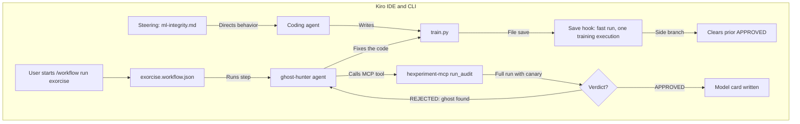

# How Kiro was used

Kiro plays two parts in Hexperiment. It **built** the kit, spec-first, with custom agents whose write rules limited each to its own files. And it is **the loop that runs the product's gate**: the steering contracts, the hooks, the MCP server, the permission-restricted ghost hunter agent (no shell; executed code is not sandboxed), and the `exorcise` workflow are how Hexperiment keeps an AI coding agent's leaky result from counting as done. This page describes both dimensions and what we discovered about Kiro along the way.

## 1. Building Hexperiment spec first

Every part of the kit was written from a formal Kiro spec in [.kiro/specs/](../.kiro/specs/): requirements in EARS form ("WHEN … THE system SHALL …"), a technical design document, and an ordered task list.

| Spec | Requirements | Tasks | What it covers |
|---|---:|---:|---|
| [hexperiment-core](../.kiro/specs/hexperiment-core/) | 17 | 26 | `load`, `split`, `audit`, the data checks, the canary test, verdicts, model cards, the CLI |
| [hexperiment-kiro](../.kiro/specs/hexperiment-kiro/) | 9 | 20 | hooks, MCP server, ghost hunter, `exorcise` workflow, power, `init --kiro` |
| [hexperiment-apps](../.kiro/specs/hexperiment-apps/) | 5 | 10 | the two example apps and their haunted scripts |
| [hexperiment-gallery](../.kiro/specs/hexperiment-gallery/) | 8 | 23 | the static gallery site |
| [hexperiment-benchmark](../.kiro/specs/hexperiment-benchmark/) | 6 | 19 | the 13-mechanism leak benchmark |

We wrote the requirements and the steering; Kiro wrote the designs, the task lists, and the code. Later fixes found in review were added to the task lists as new tasks, so the counts include them. During the build, Kiro looked up library documentation through the Context7 MCP server listed in [.kiro/settings/mcp.json](../.kiro/settings/mcp.json), used only for documentation lookups (`resolve-library-id` and `query-docs`; see the file). Steering in [.kiro/steering/](../.kiro/steering/) held the invariant rules every session followed: `product.md`, `structure.md`, `tech.md`, the ML-integrity rules in `ml-integrity.md` (which ship with the product too), and `gallery-design.md` for the site.

### Three build agents, each boxed in

The build ran through three custom agents in [.kiro/agents/](../.kiro/agents/), mostly headless in Kiro CLI (`kiro-cli chat --no-interactive` with a custom agent), one task per session:

| Agent | May write | May run | Denied |
|---|---|---|---|
| `spec-writer` | only `design.md` and `tasks.md` of a spec | nothing (no shell) | requirements and steering |
| `builder` | the kit, the apps, the power, the hooks, the workflow, the ghost hunter, and task ticks | project Python and `hexperiment`, read-only git | requirements, steering, docs, `.git`, secrets; `git commit`, `git push`, `rm` and `curl` as direct commands. The project Python it may run could still delete or download, so these are guardrails, not a sandbox |
| `reviewer` | nothing | `pytest`, `ruff`, read-only git | every write |

Every task was then verified outside Kiro: the full test suite and linter were run independently, and a task was committed only when both passed. No agent committed or pushed code.

### Moments where the spec process paid off

- **The spec writer refused a statistically wrong requirement.** The first draft said the canary would shuffle test values within each column. The spec writer pointed out that shuffling preserves each column's marginal mean, so a leak through an upstream mean imputer could never be observed. The design was changed to a "tilted resample" of test rows before any code was written. In the 78-app benchmark, the canary later rejected all six apps that leak through a scaler or imputer fitted on all rows.
- **The reviewer caught a subtle loophole.** A training script that reported its training-set predictions only during the normal run, but omitted them in the canary run, could allow the leak check to pass silently. The builder closed it and proved the fix by deliberately breaking the code (mutation check) and watching tests fail.
- **Mutation checks as a habit.** Across the tasks, the builder repeatedly injected deliberate faults (wrong boundary conditions, missing salts, swapped decision steps) to verify that the test suite caught each one. The suite now has about 3,600 tests, including Hypothesis property-based tests.

---

## 2. Kiro as part of the product: the exorcise loop

Hexperiment's aim is to make "no detected leakage and the threshold met" the condition for an approved verdict, so an agent's result counts only when it passes the full check.

Each Kiro feature has one job in this loop:

| Kiro feature | Source file | Role |
|---|---|---|
| **Steering** | [.kiro/steering/ml-integrity.md](../.kiro/steering/ml-integrity.md) | **Policy:** Eight rules that ask the agent to use the kit's data seams (`load`, `split`), temporal ordering, fixed seeds, and prohibiting verdict tampering. |
| **Save Hook** | [.kiro/hooks/hexperiment.json](../.kiro/hooks/hexperiment.json) | **Save-time fast run:** Runs the fast check on save (one normal training run, no canary); immediately invalidates any prior `APPROVED` status so stale passes never mask modified code. |
| **Stop Hook** | same file | **Turn Gate:** When the agent attempts to conclude its turn, checks whether modified apps are unapproved; if so, exits 1 with the findings on stderr, and the agent gets the message and one more turn. It fires once per prompt, so it cannot loop and does not guarantee an approved verdict. |
| **MCP Server** | `hexperiment-mcp` ([.kiro/settings/mcp.json](../.kiro/settings/mcp.json)) | **Structured Tool Interface:** Exposes `list_apps`, `run_audit`, `get_verdict`, `get_history`, `explain_ghost`, and model cards directly to agent context. |
| **Custom Agent** | [.kiro/agents/ghost-hunter.json](../.kiro/agents/ghost-hunter.json) | **Permission-Restricted Remediation:** Dedicated agent permitted to edit application Python files and call MCP audit tools (no shell; executed code is not sandboxed); denied shell execution, data modification, and threshold editing. |
| **Workflow** | [.kiro/workflows/exorcise.workflow.json](../.kiro/workflows/exorcise.workflow.json) | **Loop:** One ghost-hunter step (audit, read the findings, fix, audit again), repeated until `verdict.json` says `APPROVED`, at most 5 times. |
| **Power** | [power/hexperiment/](../power/hexperiment/) | **Distribution:** Packages the hexperiment skill and the MCP server for any Kiro session (`kiro-cli powers install`). `hexperiment init --kiro` writes the hooks, workflow, agent, steering and MCP entry into another project. |

### The loop, recorded

Both demo histories in the apps' `runs/` folders were recorded by the `exorcise` workflow running on hint-free haunted scripts, on 2026-11-22 in Kiro CLI headless mode (`kiro-cli chat --v3 --no-interactive`), with the ghost hunter calling `run_audit` (no shell). The ghost hunter's recorded sessions are available in [kiro/exorcise-hotel-cancellations.md](kiro/exorcise-hotel-cancellations.md) and [kiro/exorcise-flight-delays.md](kiro/exorcise-flight-delays.md):

- **Hotels:** Initially `REJECTED` at ROC AUC 1.0000 (The Possession on `reservation_status`, The Peeking Spirit on a label-derived country cancellation rate). The ghost hunter dropped the proxy column, recomputed the rate strictly from training rows, and achieved `APPROVED` at an honest 0.9090 in a single round.
- **Flights:** Initially `REJECTED` at 0.7971 (The Prophet: random split across time-ordered flights). The ghost hunter converted the split to the kit's temporal split and removed a label-derived carrier rate, achieving `APPROVED` at 0.6193 in one round.

Earlier recordings (2026-11-11, Kiro CLI 3.2.0) ran `hexperiment run` through the shell. Live probes then showed that Kiro's shell rules are not a boundary inside a headless workflow (see below), so we took the shell away and gave it the MCP tool `run_audit` instead. A live headless `exorcise` run on a copy of the hotel app on 2026-11-13 (Kiro CLI 3.3.0) went REJECTED 1.0000 → APPROVED 0.9092 in one round, with no shell tool offered or used and nothing denied.

---

## 3. What we learned about Kiro

We probed Kiro's runtime characteristics extensively wherever its behavior was undocumented or our design depended on it. Detailed logs are preserved in [kiro/kiro-formats.md](kiro/kiro-formats.md):

- **Hook output routing:** In Kiro CLI 3.2.0 and Kiro IDE 1.4.154, command hooks on `PostFileSave` or `PostToolUse` execute successfully, but their stdout/stderr is not injected into agent session context, although the documentation says it is. Our write-up is in [kiro/hook-output-issue.md](kiro/hook-output-issue.md). What *does* reliably communicate with the agent in Kiro CLI 3.3.0 is a `Stop` hook exiting with code 1 and diagnostics on stderr. The agent receives the error and one more turn, and the hook fires once per prompt, so it cannot loop. That is why Hexperiment's nudge is a Stop hook.
- **Shell rules are not a boundary in a headless workflow.** Inside a workflow step the shell tool is `run_command`, and once it is trusted, a command that matches no rule runs; deny rules are case-sensitive while PowerShell is not, and a chain with `;` is judged one part at a time. So we removed the shell tool from `ghost-hunter` entirely and routed its runs through the typed `hexperiment-mcp` server. The code it writes is still executed by every audit, which no rule can prevent; the README says so.
- **File-write rules held.** Write globs were case-insensitive and treated `\` and `/` alike, and every attempt to write `hex.toml` was refused. One gap: `..` in a path is not resolved, so the ghost hunter's rules also deny any path containing `..`.
- **MCP server lifecycle in Powers:** A power's MCP server starts from its installation directory rather than the user's workspace root. `hexperiment init --kiro` configures a workspace-level MCP definition so `hexperiment-mcp` resolves the project's app folders.
- **Workspace Trust:** The Kiro IDE activates hooks and custom MCP servers only after the developer explicitly trusts the workspace folder.

---

## 4. Numbers

- **5 specs, 45 requirements, 98 tasks:** Kiro wrote the code for 91; the other 7 are owner checks: live probes in Kiro, the complete benchmark run, and the GitHub Pages checks. Each task was verified and committed on its own.
- **About 3,600 automated tests:** passing with exit code 0 in about 3 minutes on a 2019 four-core laptop on a power-saving plan.
- **Leak benchmark (synthetic data, Kapoor & Narayanan taxonomy):** 78 scripts; 30 of 39 leaky scripts rejected as predicted; **0 false alarms** across 39 clean twins ([hexperiment/benchmark/README.md](../hexperiment/benchmark/README.md)).
